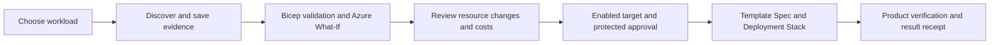

# Platform Studio

**Managed DevOps Pools — 20 October 2026:** the current suite has eleven workload types, 44 disabled Azure targets, 22 dedicated workload menus and 30 registered root pipelines. The new private pool workload uses stateless pinned Gen2 agents, an approved delegated subnet and a separate existing bootstrap runner. [Create, qualify and consume the pool](workloads/managed-devops-pool/README.md). Earlier dated increments retain their original scope/counts.

**20 October 2026 — Fabric added:** the suite now has ten workload types, 40 disabled Azure targets, 20 dedicated workload menus and 28 registered root pipelines. Fabric adds F64+ capacity through the standard flow, a separate protected Fabric API workspace/promotion lifecycle, optional workspace Private Link, connector examples and a sixth MCP provider. [Fabric setup, best practices and acceptance](workloads/fabric/README.md).

### Azure developer self-service with Bicep, Azure DevOps and evidence-based AI

Platform Studio is a local Windows web application for discovering Azure resources, configuring workload stacks, reviewing infrastructure changes and requesting governed Azure DevOps deployments. Reusable Bicep modules, versioned Template Specs and Deployment Stacks provide the delivery foundation. Optional Codex workflows explain evidence and prepare reviewable source drafts.

[**Documentation wiki**](docs/README.md) · [Get started](docs/getting-started.md) · [Workload catalog](docs/workload-catalog.md) · [Implementation status](docs/completion-status.md) · [Roadmap](docs/self-service-expansion-plan.md)

**Customer foundation continuation — 24 October 2026:** [The service](docs/foundation-service.md) reuses application Bicep/AVM, MCP and Codex code through signed customer HTTP/AHP, with rotating identity keys, reviewed access/support/lifecycle/configuration, signed technical entitlements, SQLite v4, encrypted credentials, independent local workers, frozen paged exports, audit/anchors/recovery and local preview packaging. [Security and operations](docs/foundation-security-operations.md) and [roadmap revision 6](docs/plans/platform-studio-commercial-release.md) distinguish implemented/mock-qualified code from remaining live consent, complete legacy UI migration and production/commercial gates. All Azure targets remain disabled.

> [!IMPORTANT]
> Source implementation and local verification are documented. All 44 Azure workload targets, tag Apply and the AVNM allocation profile remain disabled pending platform onboarding and live acceptance. A successful local check or discovery run does not establish Azure deployment readiness.

## What you can do

| Capability | Experience |
|---|---|
| **Configure workloads** | Eleven offerings with dedicated resource, dependency and cost descriptions; separate Discover and Deploy menus. |
| **Discover and visualize** | Resource and network inventory, explicit collection coverage, observed topology, proposed components and saved Azure What-If diagrams. |
| **Compare live IaC state** | Shared Azure MCP before/What-If/after captures, [nested property/child probes and coverage gates](docs/nested-iac-evidence.md), existing-resource Bicep snapshots and phase-specific Codex visualizer reviews. [Workflow and manual acceptance](docs/agentic-iac.md). |
| **Work with AI** | Ten explicit Codex workflows: nine scoped reviews/drafts and one connected-provider orchestration workflow; deterministic checks remain usable without a model. |
| **Orchestrate MCP tools** | Discover full Azure Bicep, Azure, Azure DevOps, GitHub and Microsoft Learn catalogs; run accepted reads and prepare exact ordered plans for human-approved changes. Includes [complete provider skills, instructions and supporting files](docs/provider-mcp.md#guidance-files-and-updates). [Connections, authorization and acceptance](docs/provider-mcp.md). |
| **Analyze Private DNS and drift** | Dynamic Azure subscription picker, DNS records/coverage matrix, configured graph, explicit reference/observed/desired comparisons and editable analysis proposals. [Implemented scope and acceptance](docs/operations-workflows.md). |
| **Design Bicep** | Compose reviewable source drafts from local module contracts, with explicit required settings and qualification before deployment. [Real AHP/Codex AVM generation and offline verification](docs/avm-end-to-end-validation.md) covers seven modules and typed child parameters. |
| **Use verified module building blocks** | Six pinned AVM-backed modules add identity, private registry/configuration/telemetry, NSGs and routing, with seven typed child collections. Browse their inputs in source drafting. [Module library](docs/avm-module-library.md). |
| **Govern tags** | Subscription resource/tag views, deterministic findings, editable drafts and a protected ADO change path. |
| **Deliver through ADO** | Reviewed pipeline registration, saved discovery, Preview summaries, immutable bundle checks, Template Spec publication and stack deployment. |
| **Connect private GitHub source** | Browser sign-in through local GitHub CLI, verified account status and authenticated source checks in ADO setup. ADO retains its separate repository connection. [Setup](docs/local-portal.md#github-browser-sign-in). |
| **Operate the local suite** | Ordered stop/build/start for the portal, authenticated Aspire telemetry and optional Functions/Azurite runtime, with protected sign-in recovery and process ownership checks. [Lifecycle guide](docs/local-suite.md). |
| **Assess recovery rules** | Seventeen workflow policies, portal explanations and an offline assessor. Restore execution is not implemented. |

Explore the [platform overview](docs/platform-overview.md) for architecture, identity boundaries, skills and current limitations.

**Live discovery acceptance, 4 October 2026:** Blob copy and Event flow Discover succeeded on merged `main`. Portal network/skill/DNS discovery exposed an unresolved DNS API coverage gap; tagging succeeded. See the [test README and issue log](docs/testing/README.md) for results, reproducible failures and remaining acceptance scope.

**Phased implementation:** [the operations workflow plan](docs/plans/operations-workflow-suite.md) now has an O0–O1 DNS/drift analysis pilot. Live acceptance and accepted deployment baselines remain open. Access review, private diagnostics, data promotion, AKS maintenance, pipeline analysis and qualified DNS/drift execution are subsequent phases, not enabled actions.

**Stack naming and Preview:** [all eleven workloads](docs/resource-naming.md) have optional standard-v2 Bicep names, generated discovery-name tables and local draft previews. Dedicated Deploy menus accept a reviewed source instance for Preview only, freeze its names, and show names from fresh Azure What-If in the portal. Saved reports are never rewritten. Local Release/HTTP/browser checks passed; live named Preview and model acceptance remain pending. Named Deploy remains blocked. The primary portal was rebuilt on 17 October with [verified cached sign-in restoration](docs/portal-fresh-restart.md); that activation does not establish live named Preview acceptance.

Agent workflows use **GPT-6.1 Sol (`gpt-6.1-sol`), Ultra reasoning and Standard speed** through the existing AHP coordination and Codex app-server integration. The connected account must advertise the requested model and effort; execution blocks if the provider substitutes settings. See [agent setup and acceptance](docs/agent-workflows.md).

**17 October 2026 — provider integration:** the browser-owned MCP broker and bounded AHP `workflow-orchestration` actions are implemented in source. Providers use the connected Azure/ADO/GitHub identities; Learn is public. Full catalogs retain exact approval gates for changing, sensitive or unclassified tools. Installation, credential attachment and live provider/model acceptance are separate checks. Existing scoped reviews retain their two frozen-evidence tools. See [the provider guide](docs/provider-mcp.md).

## Start Platform Studio locally

Use Windows 11 ARM64 or x64, PowerShell 7.4+, Git, the .NET SDK selected by [global.json](global.json), and Node.js 22+. From this repository root:

```powershell
./scripts/Manage-Suite.ps1 -Action Status
./scripts/Manage-Suite.ps1 -Action Start
```

Open [localhost:5087](http://localhost:5087/). You can browse workloads, skills and recovery policies before connecting cloud accounts. The default Studio profile starts the authenticated Aspire dashboard before the portal and builds all application entry projects in isolated outputs. If prerequisites are missing, follow [the installation and upgrade steps](docs/getting-started.md), or explicitly use `-InstallMissing`. For a fresh rebuild with eligible sign-ins preserved:

```powershell
./scripts/Manage-Suite.ps1 -Action Restart
```

Use `-Profile Full` to add the local Blob copy Functions/Azurite runtime. ProductFunctions and the operator tools are built but not automatically run against Azure. `-Action Stop` stops producers before telemetry and preserves eligible sign-ins by default; `-DiscardConnections` explicitly selects session cleanup. See [suite commands, ordering and failure recovery](docs/local-suite.md).

Azure, Azure DevOps, Fabric and Codex use separate connections. In **Connections → Local authentication — Azure CLI**, click **Sign in locally — Azure CLI** to open Microsoft sign-in without a custom app registration; then connect ADO or Fabric through the same account. Registered Entra app authentication remains an alternative. See [authentication and cache handling](docs/local-portal.md#configure-microsoft-browser-sign-in) and [agent setup](docs/agent-workflows.md). The pipeline service connection remains a separate identity. Suite stop/restart uses the [protected Azure CLI/Codex handoff and recovery flow](docs/portal-fresh-restart.md).

For connected-provider orchestration, also run `./scripts/Setup-McpProviders.ps1`, rebuild the portal, and connect each server under **Connections → MCP tool servers**. Azure MCP requires the isolated local CLI mode; GitHub MCP uses the portal's verified CLI attachment. No token is entered into the model or tool arguments. Follow [provider setup and live acceptance](docs/provider-mcp.md) before executing a real change.

## Workload catalog

**Blob copy · Event flow · Private Storage Workspace · Key Vault · Observability · HTTP Functions API · Service Bus worker · Private Data Platform · Private AKS Foundation**

[Private AKS Foundation and Helm delivery](workloads/private-aks/README.md) add private Kubernetes infrastructure and a separate manual render/diff/deploy application pipeline. All Helm profiles also remain disabled.

Private Data Platform includes [manual ADF and Databricks recipes](workloads/private-data-platform/recipes.md) with deployment-bound connections and a local setup exporter.

The [workload catalog](docs/workload-catalog.md) lists each offering's resources, dependencies, readiness boundary and exact Discover/Deploy YAML files. Hosting, private endpoints, storage, messaging and monitoring may incur charges; unavailable estimates are not zero-cost estimates. See [cost assumptions](docs/self-service-costs.md).

## Discover, Preview and Deploy



Dedicated Deploy pipelines default to **Preview only**. Deployment uses a fresh Preview, a qualified bundle and configured ADO controls. The default [azure-pipelines.yml](azure-pipelines.yml) builds/tests/packages the project; use the [workload-specific YAML files](docs/workload-catalog.md#pipeline-entry-points) for deployment.

Read [ADO onboarding](docs/self-service.md), [pipeline registration](docs/ado-pipeline-registration.md), [Preview](docs/deployment-preview.md) and [artifact flow](docs/pipeline-flow.md).

## Discovery, analysis and diagrams

Microsoft's bundled **Azure Resource Visualizer** is fundamental to the agent-assisted network discovery experience. The portal collects evidence; the scoped MCP bridge supplies that evidence and the pinned skill to Codex. Generated Mermaid must pass grammar and resource-reference validation before rendering. Observed configuration, agent interpretation, proposed components and Azure What-If remain distinct views.

The portal's factual diagrams also work without AI. A completed deployment currently reloads its Preview; a run-bound verified after-state diagram and recovery executor remain planned. See [the visualizer workflow](docs/platform-overview.md#azure-resource-visualizer-and-network-evidence), [diagram behavior](docs/portal-diagrams.md) and [recovery rules](docs/recovery-rules.md).

## Documentation and expansion

The [repository wiki](docs/README.md) is the documentation home, versioned and reviewed with the code.

| Start here | Purpose |
|---|---|
| [Getting started](docs/getting-started.md) | Install, connect, update and package the portal; run Blob copy locally. |
| [Platform overview](docs/platform-overview.md) | Architecture, capabilities, identity, agents and evidence boundaries. |
| [Workload catalog](docs/workload-catalog.md) | Product resources, pipeline files and onboarding requirements. |
| [Current status](docs/completion-status.md) | Implemented capabilities, verified evidence and outstanding acceptance. |
| [Contributor guide](docs/repository-structure.md) | Source placement, reusable modules and runtime/test boundaries. |
| [Expansion plan](docs/self-service-expansion-plan.md) | Planned products, networking, recovery and qualification work. |

Historical test counts and run details belong in the [validation log](docs/validation.md), with [machine-readable evidence](docs/validation-results.json). New capabilities follow the [workflow standard](docs/agent-workflow-standard.md), [blueprint](docs/templates/agent-workflow-blueprint.md) and [documentation-maintenance skill](.agents/skills/self-service-docs/SKILL.md).
