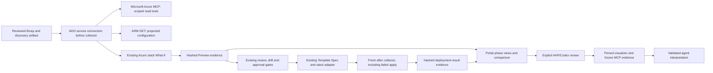

# Shared agentic IaC evidence workflow

**Named Preview evidence:** optional source-registered naming drafts freeze the intended resource group and map before What-If. Portal artifact loading regenerates that draft from the reviewed source, checks its digest and binds the IaC scope. The existing agent evidence projection includes actual full names parsed from validated observed/predicted resource IDs. Candidate names remain separate; AHP advice cannot infer existence, ownership, reachability or Deploy authorization. Live named Preview/agent acceptance remains pending.

[Wiki](README.md) · [Preview and Deploy](deployment-preview.md) · [Agent workflows](agent-workflows.md) · [Recovery boundaries](recovery-rules.md)

Implemented in source on 4 October 2026. The dedicated workload Deploy pipelines now use a common **live before → Azure What-If → observed after** evidence component. The portal renders these phases and can send the exact selected artifact to the existing AHP/Codex agent, using the bundled Microsoft `azure-resource-visualizer` skill. Local tests and an actual installed Azure MCP handshake are verified; a live Azure/ADO/Codex end-to-end run remains a manual acceptance task.

## What the developer sees

1. Run the workload's existing Discover pipeline. Select its successful artifact in the dedicated Deploy menu and choose **Preview only**. No new pipeline definition is required for this increment.
2. Preview compiles the full release and verifies the discovery handoff. Under the selected service connection, Microsoft Azure MCP inventories the workload resource group and ARM GETs capture selected configuration properties. Azure What-If then supplies the planned resource changes.
3. In the portal, connect ADO, choose the matching workload, environment and region, enter the run ID, and select **Load Azure Preview diagram**. The new view contains **Before**, **Prepare / What-If** and **Observed after** tabs, resource/property comparisons, an evidence download, a receipt and an existing-resource Bicep inventory. Older runs remain readable by the legacy Preview projection but do not acquire invented before-state evidence.
4. **Review this phase with Codex** selects the matching agent workflow, artifact and phase. Connect Codex and explicitly run the review. It uses GPT-6.1 Sol / Ultra / Standard through the existing AHP-coordinated runtime. Authentication and viewing a report never start inference or queue a pipeline.
5. To deploy, queue the usual **Preview and deploy** run. Existing enablement, bundle, Template Spec, stack, drift and protected-environment checks still apply. Immediately before mutation, the pipeline collects a fresh baseline and repeats What-If. It then applies through the existing deployment adapter.
6. After Apply is attempted, the shared component collects live state again, including after a partial application failure. Select **Load observed after from Deploy** for that same run. This loads the immediate pre-apply baseline, rechecked plan and post-attempt observations from `deployment-result`. No after-state is synthesized when deployment was skipped, blocked or cancelled before evidence publication.

The table distinguishes **Projected properties match**, **Partial projected match**, **Observed existence only**, **Observed absent**, **Mismatch** and **Unknown**. A projected match concerns only the properties listed in `checkedPaths`. It is not a certificate of full Azure configuration, application health, private reachability or recoverability. A detected mismatch or failed after-collection causes the deployment wrapper to withhold readiness and fail with a reconciliation message; it does not automatically retry or roll back.

## Components and identities



There are two distinct MCP boundaries:

| Boundary | Execution and authority |
|---|---|
| Microsoft Azure MCP Server | Pinned `@azure/mcp` **2.0.5**, launched by the Node MCP client inside the ADO AzureCLI task. Only `group_list` and `group_resource_list` are exposed, with `--read-only`. `AZURE_TOKEN_CREDENTIALS=AzureCliCredential` confines authentication to the task's isolated Azure CLI context. No model controls these tool arguments. |
| Platform MCP evidence bridge | Codex must read `platform_evidence` and `platform_skill`. These contain the selected, validated pipeline artifact and the bundled visualizer instructions. The agent has no shell, direct Azure credentials, write tools or authority to refresh the pipeline implicitly. A fresh Preview/Deploy run produces fresh live evidence. |

The collector also uses direct ARM GETs because generic inventory does not provide all comparison properties. The task obtains its management token with Azure CLI and supplies it to Node through stdin only. It is never an argument, environment variable, artifact or browser payload. The portal's delegated ADO token is used to locate the registered run; it is not forwarded to signed artifact storage. Browser Azure sign-in is used by the separate interactive discovery workflows, not substituted for the pipeline service connection.

## Evidence and snapshot contract

| File / artifact | Meaning |
|---|---|
| `deployment-preview/azure/iac/analysis.json` | `platform.iac-analysis/v1`: scope, producer/run/commit/tenant/region, compiled-template/input digests, collector version, before observations and planned projection. |
| `deployment-result/iac/analysis.json` | Fresh pre-apply baseline plus rechecked plan, after observations and per-resource comparison. Baseline timestamps can differ from the earlier Preview artifact. |
| `receipt.json` in each `iac` directory | `platform.iac-receipt/v1`: SHA-256 for every emitted analysis, Bicep and summary file, with matching producer provenance. Hashes detect artifact changes; trusted registered-main provenance establishes which pipeline produced them. They are not signatures or approvals. |
| `before.bicep`, optionally `after.bicep` | Existing-only declarations for representable observed resource identities with known API versions. No properties, secrets, data, restore commands or resource writes. Omitted/unsupported identities remain in JSON. |
| `README.md` | Status, action/comparison table and limits, uploaded to ADO Summary / Extensions and retained with the JSON. |
| Existing `stack-template.json`, `effective.parameters.json`, `azure/stack-what-if.json` | Original deployment authority and Azure prediction, retained by the existing Preview flow. The portal/model receives an allowlisted projection rather than all values in these files. |

**A generated snapshot is not the desired deployment source.** The reviewed repository Bicep, compiled inputs, Template Spec and existing approval path remain authoritative. Azure exports can omit properties or unsupported resources; they are not universal backups. This component deliberately uses `existing` declarations and a separate configuration projection instead of presenting generated Bicep as a complete reconstruction or rollback. See Microsoft's [Bicep export limitations](https://learn.microsoft.com/en-us/azure/azure-resource-manager/bicep/export-bicep-portal) and [What-If behavior and limitations](https://learn.microsoft.com/en-us/azure/azure-resource-manager/bicep/deploy-what-if).

## Collection and comparison coverage

- Azure public cloud; the primary workload resource group plus exact IDs returned by What-If within the selected subscription. After What-If and before apply, the baseline is completed with direct reads of planned child/shared-group IDs that generic inventory did not include. This does not scan other groups or tenants. Cross-subscription changes block this analysis until an explicitly reviewed multi-subscription adapter is implemented.
- At most **500 resource records**, a five-minute collection budget (plus an in-flight read timeout), 4 MiB per artifact file and 32 MiB per downloaded ZIP. The model additionally has a 256 KiB evidence budget and a 200-node diagram budget. Exceeding a boundary produces an explanation; no silent truncation is presented as completeness.
- Microsoft Azure MCP enumerates groups/resources. ARM verifies subscription visibility and the group's existence. A group is absent only when the subscription is visible, the group GET returns 404 and MCP also does not list it. Denied, inconsistent or failed queries are partial/unknown, never successful empty discovery.
- API versions come from compiled declarations, with pinned fallbacks for the reviewed types in `scripts/iac/profiles.json`. Other types retain identity with `NotAssessed`; no arbitrary “latest” API version is guessed. After collection explicitly GETs every planned in-scope ID, including child resources absent from generic inventory.
- Scalar and nested configuration paths are allowlisted in `scripts/iac/profiles.json`, used by Node projection and embedded into the portal validator. Selected arrays retain reviewed leaves and explicit `$count` fields. Tags, arbitrary settings, connection strings, outputs, credentials and data-plane contents remain excluded. Other What-If properties still require the original ADO report. See [nested discovery and qualification](nested-iac-evidence.md).
- The deterministic diagram draws only collected resources and explicit configured references. The agent's Mermaid must use the selected phase's known aliases and relationships and pass the existing grammar validator. No executable links, directives, HTML, invented connections or inferred reachability are rendered.
- Collection is a sequence of reads, not an atomic Azure snapshot. Timestamps identify the window. A report remains historical after collection; an agent review does not silently refresh it or extend approval validity.

## Reuse from another pipeline

The two-stage workload template integrates the component automatically for the nine dedicated workload Deploy menus. The same steps/scripts can be called by another pipeline, but registration and an evidence adapter are required before an arbitrary new pipeline appears in the portal. Helm and tag pipelines are not Bicep deployments and are not silently rerouted through this adapter.

After checkout, include the locked dependency/tool qualification step:

```yaml
- template: pipelines/templates/steps/setup-iac-analysis.yml
- template: pipelines/templates/steps/iac-analysis.yml
  parameters:
    serviceConnection: SC-AZ-A-Bicep
    phase: before
    directory: $(Build.ArtifactStagingDirectory)/iac
    inputDirectory: $(Pipeline.Workspace)/prepared-preview
```

`prepared-preview` must contain the already qualified `target.json`, `preview-inputs.json`, `stack-template.json` and `effective.parameters.json`, using the existing workload input contract. The collector does not qualify a new caller's deployment source or grant permission to deploy it. Keep all three calls bound to the same target, run, source and service connection:

1. **before** reads live state and creates `analysis.json` plus receipt.
2. **plan** reads that directory and the actual Azure What-If JSON supplied in `whatIfPath`. It accepts the existing stack result shape (`properties.changes.resourceChanges`) or ordinary ARM What-If's `changes` array. It records predictions separately and completes missing before-state IDs with real reads before apply; it never substitutes predicted values for those observations.
3. **after** reads that directory after the caller's explicitly authorized apply and captures live state. Run it in a failure-preserving `finally`/always path when mutation was attempted. Preserve the original apply failure and report failed observation separately. Publish the directory even when analysis fails.

Required tools: PowerShell 7.4+, Azure CLI authenticated by AzureCLI@2, Node 24, locked npm dependencies and HTTPS package/ARM access from the agent. `setup-iac-analysis.yml` uses `npm ci --ignore-scripts`, then performs an offline initialize/tools-list handshake. It does not log in or call Azure. Private build agents need package connectivity or a reviewed pre-provisioning/cache arrangement. Azure permissions are scoped resource reads for this collector; the existing Preview/Deploy permissions remain necessary for their separate actions. No extra Owner grant is introduced.

## Method map

| Entry | Calls / result |
|---|---|
| `Invoke-WorkloadPreview.ps1` | Calls `Invoke-WorkloadInfrastructurePreview -CaptureIac`; captures before, executes existing stack What-If and writes planned evidence even when governance rejects its changes. |
| `Invoke-PreviewedWorkloadDeployment -CaptureIac` | Rechecks before/plan, preserves fingerprint validation, applies existing phases, captures after in `finally` and retains the primary apply failure. |
| `Invoke-IacAnalysis.ps1` | Establishes the AzureCLI task identity, passes the short-lived read token through stdin, invokes `scripts/iac/run.mjs`. |
| `azure.mjs` / `core.mjs` | Real MCP transport and bounded fixed ARM reads; deterministic projection, API-version extraction, inventory-Bicep generation and comparison. |
| `profiles.json` / `projection.mjs` / `probes.mjs` | Shared property allowlist, nested leaf/array projection, missing-value coverage and fixed child GET/list routes with pagination receipts. |
| `qualification.mjs` | Detects unresolved desired values, linked templates, incomplete probes and missing comparison evidence; creates the before-state fingerprint consumed by Preview/Deploy. |
| `AdoGateway.Iac` / `IacAnalysis.Read` | Registered definition/repository/main/run check, fixed named artifact, anonymous allowlisted ZIP download, hash/target/schema checks and safe projection. No archive extraction. |
| `iac.mjs` / `IacAnalysis.Graph` | Deterministic portal phase view and bounded server evidence graph for the selected agent phase. |
| `AgentWorkflows.Run` with `workflow=iac` | Loads the exact Preview/Deploy artifact, checks target/region, freezes evidence and the pinned visualizer, invokes the existing AHP/Codex runtime and validates Mermaid before rendering. |

## Manual acceptance

Rebuild/restart your local portal through the existing lifecycle scripts before testing; no existing running process was replaced by this implementation task. Publish the reviewed source changes to your main branch through your normal PR process. Keep targets disabled for Preview-only testing.

1. Run a dedicated Deploy pipeline with **Preview only** against an approved empty resource group. Confirm the actual Microsoft MCP calls and `GroupAbsent`/empty evidence, successful What-If, summary and receipt; it must not claim an observed final state.
2. Repeat against an approved existing group. Confirm resource IDs, API versions, safe properties, explicit unassessed records and Bicep identities against Azure. Verify a denied resource/group does not become “none found.”
3. Load that artifact in the portal. Compare phase timestamps, action/property table, downloads and source/run/target bindings. A different workload/environment must be rejected; a corrupt archive must fail hash checks.
4. Connect Codex, select a phase and its exact artifact, and run the IaC review. Confirm both MCP evidence reads, the Microsoft visualizer skill hash, GPT-6.1 Sol / Ultra / Standard receipt, and validation of any returned Mermaid. Test cancellation and output rejection without granting write tools.
5. After separate platform approval and target enablement, perform one low-risk **Preview and deploy**. Compare its fresh baseline, actual result, direct after reads and projected comparison. Verify a failed apply preserves its original error and still attempts after collection. Reconcile uncertain results before retrying.

Record actual ADO run IDs and retained artifacts when these pass. Local mocks, compiler success and a real offline MCP handshake are not substitutes for these live acceptance steps. Recovery execution remains unimplemented; this evidence is input to a future qualified recovery plan, not a rollback button.
