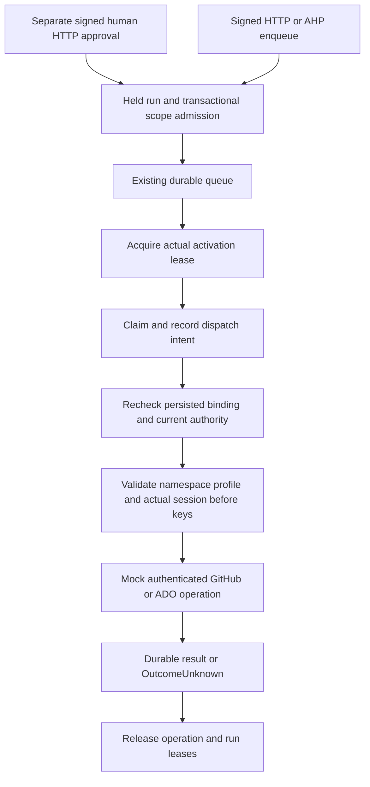

# Compose the Foundation bound pipeline consumer

The Foundation host's in-process job runner can explicitly use the [schema-12 credential/runtime binding](foundation-credential-runtime-binding.md) through a concrete, mock-only consumer. It shares the existing signed HTTP/AHP workflow, separate human approval, durable queue, dispatch adapter and reconciliation behavior. Default hosts and the standalone worker remain disconnected. No Azure deployment or live provider operation is enabled.

This qualifies one selected consumer. The optional fresh namespace profile below explicitly excludes direct token access and acquisition for that namespace. Existing general vaults, legacy Portal providers, Codex authentication, the standalone worker, other processes/hosts and already-issued provider tokens remain separate coverage work. The consumer does not provision, rebind, adopt credentials or release a [restored-cell execution hold](foundation-recovery-execution-hold.md).

## Restrict a fresh credential namespace

Trusted owner composition can provision a new namespace with a finite supported credential consumer set:

```csharp
var vaultOptions = new CredentialVaultOptions(newVaultPath, customerId, cellId, encryptionKeyId)
{
    AccessProfile = CredentialVaultAccessProfile.FoundationBoundDispatchOnly,
    RollbackProtection = new(newRollbackPath)
    {
        Format = CredentialRollbackFormat.AuthenticatedScopeV2
    }
};
var vault = CredentialVault.ProvisionStrongBoundDispatch(vaultOptions, trustedKeyProvider);
// Reopen existing custody with the same explicit profile and format.
var reopened = new CredentialVault(vaultOptions, trustedKeyProvider);
```

Both roots must be fresh, separately protected local namespaces. The profile is committed by distinct vault and rollback marker kinds; omitting the profile or selecting a legacy factory cannot reopen or convert those roots. Provisioning does not request a key, create a database binding, register a worker or authorize a dispatch. An owner can explicitly seed a supplied token through the existing `PutAsync` API, which encrypts it at rest; no artifact-import or adoption protocol is added.

| Credential consumer | Behavior for this profile |
|---|---|
| Concrete `FoundationCredentialBoundTransport`, including the typed host consumer | Actual current session must match the vault, exact dispatch scope, persisted database binding and activation custody before token resolution and revalidation; ordinary job/plan/role checks still apply. |
| Direct `ResolveAsync` and `RevalidateAsync` | Refused before credential-key lookup; no token lease is returned. |
| Generic `PipelineAuthenticatedTransport`, including custom permit sources | Refused before permit callbacks or credential-key lookup. A caller-created permit cannot replace the internal concrete session. |
| GitHub installation and Entra federated token acquisition | Refused before private-key/assertion callbacks, token HTTP or token storage. Acquisition support for this profile remains unimplemented. |
| Non-exporting profile/rollback status, owner-supplied token seeding through `PutAsync` and revoke/rewrap | Keep their own existing authorization and custody requirements; they do not grant token-use authority. |
| Existing General dependency/absence-proof inspection and V1/V2 signed recovery-set capture | Continue to refuse this profile before key or signer access. The separate [restricted source-V3 protocol](foundation-restricted-recovery.md) supports explicit inventory/capture and retained-byte rehearsal with the profile signed into the artifact. Older stage/checkpoint/review formats remain unavailable. |
| Legacy Portal/Codex credentials, issued tokens, other credential stores or hosts | Outside this namespace policy. Stop or exclude unsupported consumers separately before a recovery cutover. |

This is fresh namespace enforcement, not an upgrade to existing general vaults or a complete production source-use fence. Encrypted profile payloads keep their existing format; the policy is enforced by protected namespace metadata and cooperating APIs, rather than cryptographic non-portability of ciphertext held with its customer key. Possession of raw keys, an OS owner replacing custody, outstanding provider tokens and admitted remote work remain separate boundaries. No public HTTP, AHP, MCP, model or standalone-worker configuration can mint the internal session. The current host consumer factory remains mock-only; no live integration or recovery release follows from provisioning this profile.

## Authority and operation lifetime



Trusted C# composition supplies actual vault and activation-authority objects, independently reviewed namespace/custody identity, exact database instance and binding digest, and a finite immutable credential-scope allowlist. Incoming HTTP/AHP/model arguments cannot select a vault, authority, handler factory or credential scope. The current durable dispatch and validated connection select an exact configured scope; they do not supply custody proof.

Startup validates existing current binding and actual custody without reading a credential key or token. It never calls `BindCurrent`, repairs missing state or migrates a configured bound runtime. This metadata readiness check does not establish key availability, token expiry or provider permissions. A separate explicit owner cutover must already have established the binding.

Consumer startup/run checks retain shared read handles over immutable namespace markers and vault/rollback binding files. They verify actual path, protected ownership/ACLs, current bytes and the pinned identities without taking the credential admission gates or reading mutable rollback state, profiles or keys. Concurrent key-free checks and an unrelated asynchronous key wait can coexist. Binding provisioning and actual authenticated sends retain their existing exclusive custody, mutable rollback-state and credential checks. A metadata run scope cannot authorize an HTTP send in place of that strong per-operation session.

The runner obtains a concrete activation-held run scope before claiming work and retains it through awaited dispatch and durable outcome handling. Each bound HTTP operation also owns its existing activation lease through key lookup, response/body disposal and final authorization. Startup success cannot substitute for those checks. Cancellation or host disposal cannot release operation authority while an uncooperative handler is still running. Changing requests are not automatically replayed; post-admission failures retain uncertain-effect semantics.

Host disposal requests shutdown and refuses new owned runner uses before claim. Concrete active-use tokens retain the existing actual host activation lease until their awaited work and outcome handling finish; disposal does not detach the work or wait indefinitely for a handler. Releasing the last active use after shutdown releases that lease. Retention does not extend a job/plan lease, role, grant or credential expiry. A process crash, expiry or genuine loss of current store authority can still leave a durable dispatched intent for lease-expiry/reconciliation; it cannot be reported as a verified deployment or automatically replayed.

Enqueue also holds a concrete run scope while checking the actual scoped plan/current connection against the configured allowlist and committing through the run's typed enqueue method. `RequireConnection` is an early target constraint, not an authorization grant or a scope resolver. The store checks current binding policy, actual scope eligibility, approval, digest, role and connection generation in the enqueue transaction; unsupported connections are refused before queue mutation, and drift cannot reuse the earlier eligibility check. Direct public store calls cannot substitute for the concrete run on a bound cell.

## Admit fresh work in the write transaction

Startup readiness and a prior policy read do not authorize a later SQL mutation. Enqueue, claim, dispatch intent and execution-worker registration re-read binding/history requirements inside their existing write transaction. Bound cells require the actual concrete run/session and exact store, current instance, namespace, activation custody/generation and persisted binding. Actual metadata/activation handles remain held while waiting for the write lock and through commit; no incoming DTO, boolean or callback can stand in for them.

The legacy public store signatures remain valid for never-bound cells. Once binding history is required they refuse unbound enqueue, claim, both dispatch-start paths and changing worker registration. Enqueue performs the check even for an idempotent return. Claim checks before lease-expiry/reaping, fence or attempt changes. Dispatch checks precede intent/denial mutation, and changing registration checks the restore execution hold before binding policy, registry pruning, heartbeat or audit changes. Disabled registrations retain their disconnected monitoring behavior; they grant no execution authority.

The binding provisioner and these admissions use the same database write serialization. If old work commits first, the existing queued/claimed/dispatched/active-worker quiescence check refuses cutover. If binding commits first, a stale legacy actor is refused in its later transaction. Selected target eligibility uses the actual stored plan and connection in that same snapshot. Unsupported existing queue entries may need cancellation or rerouting; this does not introduce a new fairness or recovery policy.

The concrete run exposes `EnqueuePlan`, `ClaimNext`, `StartMockDispatch` and `RegisterWorker` with the existing customer/job/worker arguments. These call internal store entry points with the actual run; public legacy signatures do not accept a proof DTO or enable bound execution. The host and HTTP/AHP service use the typed methods whenever the consumer is configured. A shared bounded stored-connection mapper supplies target metadata to admission, host loading and credential-wire verification; it grants no authority.

Bound commit failure or loss of proof/availability after a completed SQL operation reports `BoundConsumerAdmissionUncertain` (503). Inspect existing job/idempotency, outbox, audit or worker state before deciding what happened; do not automatically retry a changing operation, repair a binding or treat missing acknowledgement as no effect. Definite pre-commit bound-admission proof/policy refusals roll back that admission; existing dispatch-authority denials retain their recorded `Blocked` behavior and audit evidence.

Completion/failure recording, heartbeat/stop, authorized reads and human reconciliation retain their existing rules so uncertainty can still be recorded. Existing cell-wide expiry/outcome housekeeping remains available to the dedicated worker under a valid concrete run; configured target eligibility restricts fresh job admission, not that safe housekeeping. The change adds no role, schema, credential provisioning, live provider permission or recovery release. It closes this Foundation database-admission race, while direct vault/token acquisition, legacy Portal/Codex, other hosts and outstanding provider tokens remain separate coverage work.

## Registration and refusal rules

Registration is an explicit typed host option for trusted local qualification. The handler factory must create a fresh synthetic handler per operation; that operation owns its disposal. It is a test seam, not an incoming configuration or model tool. Generic transports and the bound consumer cannot be configured together. The existing `PipelineMockDispatch` feature/entitlement vocabulary remains; no live-dispatch feature is added.

The trusted composition shape is:

```csharp
var consumer = FoundationCredentialBoundPipelineConsumer.ForMockHandlers(
    vault, activationAuthority, reviewedNamespace, reviewedActivationIdentity,
    expectedDatabaseInstanceId, expectedBindingSha256, allowedScopes,
    () => new SyntheticPipelineHandler());
var options = existingOptions with
{
    RequireActivationAuthority = true,
    ActivationAuthorityDirectory = reviewedActivationDirectory,
    BoundPipelineConsumer = consumer,
    DisconnectedTransport = null
};
```

`SyntheticPipelineHandler` is a trusted test handler that returns the existing correlated GitHub/ADO response contract. The scope allowlist holds 1–256 detached scopes; duplicate or ambiguous selectors are refused, and caller mutation cannot change their required scopes. Handler-reference reuse is refused. `ValidateStartup(store)` briefly acquires and releases a real run scope; the runner separately calls `OpenRun(store)` and retains its concrete `FoundationCredentialBoundPipelineRun` through completion. These APIs do not accept a caller-supplied assertion that custody is held.

`BoundPipelineConsumer` is ignored by JSON serialization and is absent from the public configuration loader. Missing required activation, mixed transports and missing required consumer report `BoundPipelineConsumerActivationRequired`, `BoundPipelineConsumerConflict` and `BoundPipelineConsumerRequired`, respectively. A read-only preflight examines existing schema/binding history before constructor initialization, followed by another policy check against the actual store before bootstrap. Valid never-bound legacy initialization remains separate. Configured bound and inspection-only bound runtimes open an existing current schema; they do not migrate it at startup.

A bound/history-bearing cell cannot start a configured legacy changing transport or worker in place of this consumer. Its read-only host remains available when no changing consumer is configured. Direct legacy runner use on a bound cell refuses before claim. Never-bound legacy disconnected behavior remains compatible. Schema-11 recovery holds still deny fresh work independently of transport readiness.

The standalone worker does not register this typed consumer. Its `MockLoopback` and `ClaimHold` qualification modes refuse bound/history-bearing cells after receipt reservation and read-only database preflight, before worker registration, heartbeat or claim. Default `Disabled` behavior remains disconnected. `--validate-config` remains software/path validation without starting a worker or establishing cell/provider readiness. This refusal is not standalone credential-consumer integration or live support.

## Verification and remaining work

Qualification uses disposable databases, identities, keys and mocked provider payloads. GitHub and ADO fixtures follow the existing signed plan, distinct-human approval and enqueue paths, then inspect actual authentication, dispatch result, durable audit and uncertainty. Independent cases cover wrong binding/namespace/custody, scope and connection changes, missing configuration, restoration, cancellation and operation lifetime. Dated execution results belong in [validation](validation.md) after the tests run.

Supported production composition, complete consumer coverage, outstanding provider-token behavior, independently held latest/key custody, reviewed recovery release/adoption and coordinated activation remain open in the [commercial release plan](plans/platform-studio-commercial-release.md). Local mock qualification does not clear those gates or commercial distribution.
