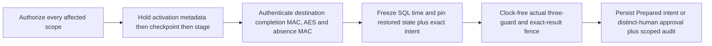

# Review an exact restricted recovery adoption intent

The adoption-intent protocol prepares a separate review for `ProvisionFreshRestrictedNamespacesForRestoredInstance`. It joins an actual current [restricted checkpoint](foundation-restricted-recovery-checkpoints.md), the completed restricted stage, the current restored database/hold, validated runtime-binding history and trusted owner destination selections. A distinct human approves that exact intent across every present and absent scope.

This is an intent-review prerequisite. `Approved` records agreement with the pinned proposal; execution admission, namespace reservation, credential adoption, activation and execution-hold release remain unavailable. Existing [read-only stage approval](foundation-restricted-recovery-review.md) and [joint verification](foundation-restricted-recovery-joint-verification.md) cannot substitute for this separate review. No default HTTP/AHP/MCP/model/worker route is added.

## Supported restored cells

The current instance must have a verified `RestoredSnapshot` execution hold with a known, different source database instance. Its validated historical runtime binding must identify that source instance and the same namespace as the restricted stage. Binding must remain required, and the restored current instance must have no current runtime binding. Never-bound restorations, legacy restores with unknown origin, missing history and mismatched source namespaces are refused in this increment.

This check validates the current audit chain and the completed `BackupRestored` event matching the hold's backup commitment. It does not attest an independently held backup or key copy; those claims remain false.

The target pins the current database instance and path commitment, policy, exact hold, full sorted runtime-binding history commitment and count, the matching source binding, complete checkpoint identity/head and stage/completion-proof commitments. A count alone cannot identify history. The source binding is retained evidence; it does not establish that the original host or issued provider tokens have been fenced.

## Trusted destination selection and custody

The trusted C# composition uses a separate coordinator:

```csharp
var adoption = new FoundationCredentialRestrictedRecoveryAdoptionCoordinator(
    store, activationAuthority, expectedActivationIdentity,
    expectedActivationGeneration, expectedActivationHeadSha256,
    checkpointAuthority, expectedCheckpointIdentity, destinationVerifier,
    expectedRestoredDatabaseInstanceId, futureVaultDirectory,
    futureRollbackDirectory);

var intent = await adoption.PrepareAsync(requesterContexts,
    restrictedPlan, reviewedPlanSha256, expectedReceiptSha256,
    expectedCheckpointSequence, expectedCheckpointSha256,
    purpose, expiresUtc, cancellationToken);

var approved = await adoption.ApproveAsync(distinctApproverContexts,
    intent.Id, intent.Digest, restrictedPlan, reviewedPlanSha256,
    expectedReceiptSha256, expectedCheckpointSequence,
    expectedCheckpointSha256, cancellationToken);

var history = store.GetCredentialRestrictedRecoveryAdoptionIntent(
    readerContexts, intent.Id);
```

The two context sets represent separate human actors with current signed and persisted authority. The example records intent review; it invokes no changing recovery operation.

Trusted application composition supplies the actual checkpoint authority, independently pinned identities, destination key provider and activation metadata authority. Future vault and rollback destination paths remain private; the public selection contains their canonical commitments. Fresh destinations are required for a future executor. This review creates no destination folders or namespace IDs and does not reserve those paths for later use.

Preparation and approval also require both paths to be absent now, nonoverlapping, under private parents and outside protected ancestors. Those conditions are checked before keys and again in the final fence. Absence is an observation, not a reservation; a future executor must use a fresh atomic reservation and revalidate custody.

Actual activation metadata is held first, then the checkpoint lease and completed-stage guard. Disposal reverses that order. Activation selection includes the actual authority custody identity and current generation/head, including the empty head of a fresh authority. It is a pinned selection, not an activation operation or a source-host fence.



Preparation requires a current human Operator with `credential.recovery.prepare` in every affected project/environment. Approval uses a distinct current human Approver with `credential.recovery.approve` across that same complete union. Reads use existing recovery-read authority. Signed roles intersect current standing grants; workload and support-delegated identities cannot supply human approval. No new execution capability or role grant is introduced.

Both preparation and approval freshly authenticate the actual destination completion MAC, every retained AES envelope and every absence MAC while holding the real guards. Source folders and source keys are unnecessary. Before the first key lookup and after awaits, clock-driven checks are followed by clock-free snapshots of all held selections; a matching DTO, boolean or callback cannot establish custody.

The write transaction samples a single instant after configured activation checks, rechecks all current grants/versions/expiry, lifecycle, restored instance/hold and complete binding history, and writes the exact intent or approval with per-scope audit. The final actual activation and checkpoint checks use that frozen instant, followed by the exact stage session/result snapshot and cancellation immediately before commit. No time-provider or caller callback follows that fence.

The intent expires within fifteen minutes and no later than requester authority. Approval rechecks original requester authority and exact target/digest under fresh actual custody. Approved history is not automatically refreshed, replayed or consumed by any executable recovery operation. A future executor must introduce its own changing-operation capability, atomic one-use admission and protected mutation/reconciliation protocol.

## Durable history and remaining recovery work

Additive schema 15 retains separate immutable request/approval records with `Prepared`, `Approved` and restore-quarantined states. It preserves earlier DDL/checksums 1–14 and existing General/scoped/restricted review wire formats. Restoration quarantines inherited intent authority while preserving its audit history; newly restored instances need their own review. Tests use disposable local cells and keys. The primary application is not migrated or restarted.

Targets are bounded to 256 KiB, with 2,048 retained intents and 64 unexpired pending intents. These are local admission limits; they do not qualify production capacity. Ambiguous database commits require protected history inspection; the coordinator does not automatically recreate or retry an intent or approval.

Actual adoption still needs a reviewed conversion protocol. Restricted stage AES/AAD and absence/completion MACs bind the stage, plan, roots and identities. Runtime absence proofs have their own original-transaction/generation semantics. Renaming staged files or manufacturing apparent original runtime proofs would not preserve those contracts. Namespace reservation, recovered runtime formats, source-use fencing, independent latest/key custody, changing one-use admission, coordinated database/credential activation, interruption recovery and hold release remain separate work.

Native Windows local qualification, concrete limits and actual test/package results are recorded in [validation](validation.md). Cross-platform/service-identity/storage behavior, administrator/whole-root rollback and other-host/token threats, complete production consumer coverage, signing, security/legal review and [commercial release gates](plans/platform-studio-commercial-release.md#next-implementation-order) remain unqualified. This work deploys nothing to Azure and performs no live provider or pipeline operation.
