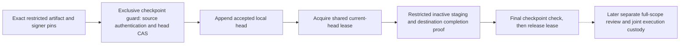

# Restricted retained-set checkpoints

`CredentialRestrictedRecoverySetCheckpointAuthority` keeps a locally accepted [restricted source-V3 artifact](foundation-restricted-recovery.md) selection under independently configured namespace and signer pins. Acceptance authenticates every retained positive AES envelope and original absence HMAC before appending a checkpoint. A separate wrapper retains the concrete current-head lease through [restricted inactive staging](foundation-restricted-recovery-staging.md). Both protocols preserve `FoundationBoundDispatchOnly`.

This is a native Windows local-owner protocol. It adds no human approval, namespace adoption, credential/database activation, restored-cell execution-hold release or default HTTP/AHP/MCP/model/worker route. Existing General V1/V2 checkpoint and staging types, wire formats and database migrations remain separate.



## Provision and accept explicitly

```csharp
var authority = CredentialRestrictedRecoverySetCheckpointAuthority.Provision(
    freshPrivateCheckpointDirectory, independentlyPinnedSourceNamespace,
    configuredSignerKeyId, configuredSignerPublicKeySha256, clock);
var expectedIdentity = authority.DescribeIdentity();

var head = await authority.AcceptNextAsync(
    retainedRestrictedSet, reviewedArtifactSha256, pinnedSignerPublicKey,
    configuredSourceKeys, expectedSequence, expectedHeadSha256,
    cancellationToken);
```

Provisioning consumes a fresh owner-private root beneath a trusted local parent. Existing-only construction validates the exact stored path, owner, namespace, signer and authority commitment; it does not provision or repair a missing or partial root. The generic `.credential-recovery-checkpoint.guard` and `.credential-recovery-checkpoint.json` filenames protect operational namespace boundaries, while distinct restricted schema/kinds and required access-profile fields prevent General protocol fallback or policy normalization.

First acceptance uses sequence zero and a null head. Every later acceptance must match the exact prior sequence/hash and increase the signed source generation. Reusing an accepted set ID or selecting an older still-valid generation is refused. The actual selected artifact and RSA public key are detached before external source-key awaits. Retained AES/HMAC authentication, authority custody, the full bounded chain, expected head, cancellation and lifetime are checked under the exclusive guard before append and final readback. No current source folder or database membership supplies missing provenance.

The chain permits 1,024 checkpoints, 16 KiB per metadata document and 16 MiB history. Strict JSON, exact filenames, fixed policy, source/signer/authority bindings, previous digests, ordering and timestamps are checked together. Missing keys, wrong signatures, invalid source ciphertext/proofs, stale pins or incomplete custody cannot return an accepted head. Once an append is attempted, failure is uncertain: inspect the protected current state; do not automatically retry, overwrite, repair or delete it.

The authority stores selection and authentication metadata, not an independent copy of the recovery artifact or source keys. Preserve those separately. A rehearsal digest records prior local authentication; later staging still authenticates the actual supplied retained bytes.

Historical head inspection can remain available after the artifact expires. It does not renew the artifact or grant staging authority. Acceptance checks source lifetime at its final append cutoff; checkpoint-backed staging checks both source and plan lifetime at its final checkpoint cutoff. A late expiry cannot return successful new work.

## Hold the current selection through staging

```csharp
var staging = new CredentialRestrictedRecoveryCheckpointStageExecutor(
    authority, independentlyPinnedCheckpointIdentity,
    new CredentialRestrictedRecoveryStageExecutor(sourceKeys, destinationKeys, clock));
var result = await staging.StageLatestAsync(
    retainedRestrictedSet, restrictedPlan, reviewedPlanSha256,
    pinnedSignerPublicKey, expectedHeadSequence, expectedHeadSha256,
    cancellationToken);
```

The wrapper obtains a real shared checkpoint read lease from the configured authority. Exact identity/head, policy, namespace, artifact, plan, inventory and signer must agree before RSA/key-provider or destination access. A caller-supplied identity, checkpoint DTO, matching authority ID or claimed lease cannot replace the configured authority's actual lock custody.

The lease spans every inner source/destination-key await, source authentication, fresh destination reservation, contextual destination AES, original absence commitments, mandatory completion MAC and final written-output validation. Cooperating checkpoint writers cannot advance the head during that interval. Cancellation awaits an uncooperative dependency before releasing custody. Final checkpoint and cancellation checks precede success; failure after completed staging remains an unknown outcome, with the inactive output preserved.

After inner staging completes, the wrapper opens the completed stage under its real shared guard using the exact returned receipt pin. Both guards remain held through final checkpoint validation, then the stage's bytes, membership and private custody are checked again before return. This prevents a final checkpoint clock callback from changing the stage after its last output check. The exact receipt fixes the already-authenticated output; this final held check does not perform another destination-key lookup.

The result binds the restricted policy, complete checkpoint identity/head and exact stage receipt. It remains an inactive recovery hold. Normal vault usability, promotion, adoption, activation, source-host fencing, external execution, key retirement, independent backup verification, customer-review admission and production recovery qualification remain false.

## Remaining gates

The lease ends when this staging operation returns. Restricted complete-scope human review and later joint execution-time custody must separately cover every present and absent project/environment, the exact completed stage and its current checkpoint. No approval is inferred from a checkpoint, source key, verification result or incoming authority DTO. Changing adoption and coordinated credential/database activation need their own one-use authorization and supported-consumer protocol.

These guards protect cooperating local custody. Copying or restoring the whole authority can restore an older chain; this is not an independent/global latest-state witness, administrator-resistant monotonic storage or key backup. Issued provider tokens, raw-key holders and other hosts remain outside the local fence. Supported service/storage behavior, independently held latest-set/key backups, full customer review, production recovery and commercial clearance remain open in the [roadmap](plans/platform-studio-commercial-release.md#next-implementation-order). Qualification uses disposable local payloads and keys, without Azure deployment or a primary application restart. See [validation](validation.md) for executed evidence.
