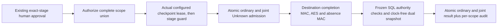

# Verify an approved restricted stage while its checkpoint is held

`FoundationCredentialRestrictedRecoveryJointReviewCoordinator` joins an existing [restricted complete-scope human approval](foundation-restricted-recovery-review.md) with the actual current [restricted checkpoint](foundation-restricted-recovery-checkpoints.md). The fixed `FoundationBoundDispatchOnly` profile, original source selection and mandatory destination completion-proof commitment remain bound throughout. The coordinator retains real checkpoint and stage guards through one-use admission, destination authentication, current all-scope authorization and durable completion.

The human approves the exact completed stage. The configured checkpoint is an additional execution-time constraint: its identity/head is not implicitly approved or asserted current at approval time. There is no second approval or second usable admission. This remains read-only local evidence, with no namespace adoption, activation, restored-cell hold release, source-host fencing, key export, provider operation or default HTTP/AHP/MCP/model/worker route.

This protocol uses native Windows local custody. Cross-platform, service-identity and production storage behavior require separate qualification.



## Explicit trusted composition

Prepare and approve through the existing restricted review coordinator and store. Its complete present-plus-absence scope union, distinct human requester/approver, exact request digest, actor versions, policy, instance and expiry remain unchanged. Absence-only stages are eligible; empty unions are refused.

```csharp
var joint = new FoundationCredentialRestrictedRecoveryJointReviewCoordinator(
    store, configuredRestrictedCheckpointAuthority,
    independentlyPinnedCheckpointIdentity,
    new CredentialRestrictedRecoveryStageVerifier(destinationKeys, clock),
    expectedDatabaseInstanceId);

var evidence = await joint.ExecuteApprovedAsync(
    currentExecutorContexts, approvedReview.Id, approvedReview.Digest,
    restrictedPlan, reviewedPlanSha256, expectedReceiptSha256,
    expectedCheckpointSequence, expectedCheckpointSha256,
    cancellationToken);

var history = store.GetCredentialRestrictedRecoveryJointVerification(
    currentReaderContexts, approvedReview.Id);
```

The authority instance, independently pinned full identity, destination key provider and database instance come from trusted application composition. An incoming packet cannot choose the authority root or replace actual custody with a checkpoint DTO or matching authority ID. Expected sequence/hash must match that authority's actual current head. The namespace, typed set authority, inventory, signer, fixed profile, full checkpoint identity/head and exact approved stage target must all agree before key access.

Execution uses `CredentialRecoveryVerify` and a current human Operator in every affected project/environment. Reading uses `CredentialRecoveryRead` with Operator, Approver or Auditor authority in every scope. Exactly one context per scope, the same human actor/customer/cell/version, existing signed-role intersection, current standing grants and expiry are required. Workload and support-delegated contexts are refused; the executor must differ from the approver. No new role or grant is introduced.

## One admission and two real guards

The coordinator first authorizes the complete scope union and exact review/plan/receipt/database selection before opening private checkpoint or stage metadata. It acquires the concrete checkpoint read lease first, then the concrete completed-stage read guard; this lock order is fixed and disposal reverses it.

One write transaction checks configured activation, current instance/policy/lifecycle, all executor contexts and original requester/approver grants, versions and expiry. It inserts the ordinary schema-13 execution and the separate joint execution as consumed `OutcomeUnknown`, with one shared admission ID and per-scope audit, before destination-key access. Ordinary and joint coordinators contend on the same ordinary execution key; there is exactly one winner and no alternate path for retrying a consumed approval.

Both guards remain held while the verifier resolves the destination key once, matches and freezes its material, authenticates the mandatory completion MAC, every positive AES envelope and every absence MAC, and rechecks the bounded stage tree. No source folders or original source keys are needed. No database transaction spans an external key-provider await. Cancellation awaits an uncooperative provider before releasing either guard.

The internal joint verifier takes the real typed checkpoint lease. Before its first key lookup, it samples the stage clock, checks the checkpoint under its clock, then checks stage bytes/custody without another clock call. These dual checks repeat after the key await. A clock callback that changes the selected checkpoint or stage before lookup cannot bypass freshness; no caller callback, boolean or nominal lease supplies this proof.

Final completion receives the actual joint session and its exact produced verification result. A write transaction samples one current instant after configured activation callbacks, checks all current authority and exact target again, then writes both results and per-scope audit at that frozen time. After strict readback, the actual checkpoint lease validates its complete current chain/custody at that same observed instant without calling its time provider. The actual stage session then checks exact result identity, bytes/custody and cancellation immediately before commit, with no clock or caller callback after this fence.

Cooperating checkpoint writers cannot advance the selected head while the shared lease is held. Both success records commit together, or neither does. Public evidence contains commitments, scope IDs and hashes rather than private root paths, raw MACs, ciphertext, tokens or keys.

## Historical validity, outcomes and failure

This verifies an already completed stage. The current head is a custody constraint; historical source/plan expiry does not turn it into a new staging operation. `StageLatestAsync` retains its stricter live source/plan lifetime checks. Current review, context, approval and instance validity are still required here. After the guards are released, the checkpoint may advance; success does not promise perpetual latestness.

Ordinary review history retains `HeldRestrictedStageVerified`; joint history records `CurrentCheckpointHeldRestrictedStageVerified` with the selected checkpoint identity/head and held-verification evidence. Inactive hold remains true; promotion, adoption, activation, external execution and independent backup verification remain false. Safe-maintenance lifecycle policy permits eligible Active, Suspended or Offboarding cells and denies Offboarded cells without resuming ordinary work.

Failure after admission leaves both executions consumed and unknown. Process interruption, cancellation, source-head/custody drift, lost authority, verification failure or unavailable final audit cannot authorize a fresh attempt. An ambiguous admission or completion commit requires protected history inspection, not an automatic retry. A committed success is immutable and cannot be demoted by later unknown recording. The default cooperative deadline is 20 seconds; an uncooperative dependency can retain the caller and both guards until it actually returns.

## Schema 14, restore and remaining gates

Additive schema 14 defines `credential_restricted_recovery_joint_executions`, linked to the same schema-13 ordinary review execution and admission. A new composite parent index and foreign key bind customer, review ID and admission ID as one tuple, preventing a cross-review admission link. Immutable target/authority fields, one-use linkage, legal outcome transitions and retained success guard both histories. Existing DDL/checksums 1–13, ordinary restricted approval digests and General/scoped contracts remain fixed. No new prepare/approve flow is added.

Joint targets are limited to 256 KiB and results to 16 KiB; the existing 2,048-review history and one-use limits remain. These are bounded local admission limits, not production capacity or latency qualification.

Upgrade and restore qualification uses disposable local databases. Older runtime opening with initialization disabled refuses migration; exact versioned backup admission validates schema/checksums before destination creation. Restore preserves successful history, quarantines unfinished ordinary requests and retains both consumed joint/ordinary outcomes as non-replayable evidence, with new instance/policy fencing. No primary customer database migration or application restart is performed by these tests.

This is cooperating local custody. Whole-root rollback, malicious OS owners/administrators, other hosts, issued tokens, independently held latest-set/key backups, complete production consumer coverage and supported service/storage recovery remain outside the claim. Changing recovery release/adoption, coordinated credential/database activation, signing, security/legal review and commercial clearance remain separate [roadmap gates](plans/platform-studio-commercial-release.md#next-implementation-order). Local testing deploys nothing to Azure and performs no live provider/pipeline operation or credential-cache cleanup. See [validation](validation.md) for actual results and limits.
