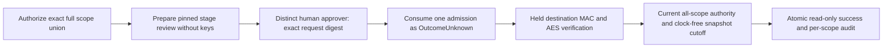

# Complete-scope review of a restricted inactive stage

`FoundationCredentialRestrictedRecoveryStageReviewCoordinator` adds explicit human review and one-use read-only verification for a completed [restricted recovery stage](foundation-restricted-recovery-staging.md). The target preserves `FoundationBoundDispatchOnly`, the restricted destination-key identity and the mandatory completion-proof commitment. Its scope is the sorted union of every project/environment in present profiles and authenticated absence provenance. An absence-only stage is eligible; a completely empty union is refused.

Preparation is key-free structural inspection under current customer authority. Successful execution requires actual destination completion-MAC, positive AES and absence-MAC authentication under the concrete stage guard. This does not adopt a namespace, activate credentials, release a restored-cell execution hold, export keys, fence another host or authorize provider/pipeline operations. There is no default HTTP, AHP, MCP, model, worker or host route.



## Explicit composition and authority

```csharp
var coordinator = new FoundationCredentialRestrictedRecoveryStageReviewCoordinator(
    store, new CredentialRestrictedRecoveryStageVerifier(destinationKeys, clock),
    expectedDatabaseInstanceId);
var review = await coordinator.PrepareAsync(
    requesterContexts, restrictedPlan, reviewedPlanSha256,
    expectedReceiptSha256, purpose, expiresUtc, cancellationToken);
var approved = store.ApproveCredentialRestrictedRecoveryStageReview(
    approverContexts, review.Id, review.Digest);
var outcome = await coordinator.ExecuteAsync(
    executorContexts, approved.Id, approved.Digest,
    restrictedPlan, reviewedPlanSha256, expectedReceiptSha256,
    cancellationToken);
```

Contexts come from the existing signed identity validator and membership resolver, not a request body's identity fields. Each operation needs exactly one current `CustomerContext` for every affected project/environment. All contexts must identify the same human principal, customer, cell, actor version and operation capability. Missing, extra, duplicate, foreign, workload or support-delegated contexts are refused. Current source connections or database scope membership cannot invent missing artifact provenance.

| Operation | Capability | Standing role in every scope |
|---|---|---|
| Coordinator `PrepareAsync` | `CredentialRecoveryPrepare` | Operator |
| Store `ApproveCredentialRestrictedRecoveryStageReview` | `CredentialRecoveryApprove` | Approver |
| Coordinator `ExecuteAsync` | `CredentialRecoveryVerify` | Operator |
| Store `GetCredentialRestrictedRecoveryStageReview` | `CredentialRecoveryRead` | Operator, Approver or Auditor |

The approver must differ from both requester and executor. Approval covers the exact request digest, including its target, purpose, policy, database instance and expiry. Request lifetime is at most 15 minutes and cannot exceed the earliest requester-context expiry; the approver's earliest context expiry also constrains execution. Signed-role intersection, enabled standing grants and actor versions remain required. These are distinct stored human principals; physical human presence and independent organizational custody are not attested.

The local cell permits 2,048 retained review requests, 64 pending reviews, at most 256 affected scopes and 128 KiB per target. These are bounded local admission limits, not production capacity or latency qualification.

Existing safe-maintenance lifecycle policy remains in effect: inspection/recovery verification can operate in eligible Active, Suspended or Offboarding states without resuming ordinary work. No new product entitlement or privilege grant is introduced.

## Exact admission and held verification

Preparation authorizes the entire scope union before opening private stage metadata. Under the actual stage read lease, it persists a separate typed target: fixed profile, plan/receipt/source/inventory/namespace, destination root/key commitment, stage IDs, binding/state/completion-core/completion-proof hashes, counts and full scope union. Public records expose hashes and scope IDs, not private paths, encrypted envelopes, raw MACs, credentials or keys.

Execution snapshots its context list, rereads the exact stored request and opens that same strict stage selection. One transaction checks configured activation, current instance, policy, lifecycle, requester, approver, executor, full scope union and expiry, then records consumed `OutcomeUnknown` admission plus every scope's audit before destination-key access. Concurrent callers cannot reuse that admission. There is no database transaction across an external key-provider await.

The actual held verifier resolves and freezes the destination key once after commitment matching. It authenticates the mandatory completion MAC, every positive ciphertext and every absence proof, then checks the complete tree, bytes, names and private custody again. Source folders and source keys are unnecessary. Cancellation does not detach an uncooperative dependency or release custody while it still uses retained inputs.

Completion takes the concrete held session and the exact verification result produced by that session. In a write transaction it samples current time after configured activation checks, revalidates all current executor contexts and original requester/approver grants, policy, lifecycle, instance and expiry, and writes the result with per-scope audit at that frozen time. After strict row readback, a clock-free check proves the exact session result, retained stage bytes/custody and cancellation immediately before commit. No caller callback, boolean or nominal lease can replace this fence; no late clock callback runs after it.

`Succeeded` records `HeldRestrictedStageVerified` for the exact restricted stage. Inactive hold remains true; promotion, live adoption, activation and external execution remain false. This is read-only local evidence rather than changing recovery authority.

## Failure, schema and restore

Any verification failure, cancellation, revocation, policy/instance drift, process interruption or unavailable final audit after admission leaves a consumed `OutcomeUnknown`. Unknown outcomes are not automatically retried. An uncertain admission commit does not mean no admission: inspect protected history. An ambiguous final commit is also reconciled through history; a recorded success cannot be demoted by later unknown recording. The default cooperative operation deadline is 20 seconds; an uncooperative provider can retain the caller and guard until it returns.

Additive schema 13 defines separate `credential_restricted_recovery_stage_review_requests`, `credential_restricted_recovery_stage_review_approvals` and `credential_restricted_recovery_stage_review_executions` tables with immutable authority, retained history, exact state transitions and one-use execution. DDL/checksums 1–12 and General/scoped review contracts stay fixed. Current-runtime opening with `initializeSchema:false` refuses an older schema; it does not repair or migrate it.

Use the existing reviewed signed-backup and fresh-staging owner upgrade flow for customer migration. This increment tests schema upgrades only on disposable local databases and does not migrate the primary application. Backup admission checks the exact versioned schema/checksum chain before restore destination creation. Restore rotates instance/policy, preserves completed history and quarantines every unfinished restricted review, including consumed unknown executions; copied authority cannot replay on the new instance.

## Remaining recovery gates

This review covers the exact completed stage. It does not assert a current checkpoint was approved or retain checkpoint custody through approval. The separate [restricted joint verifier](foundation-restricted-recovery-joint-verification.md) reacquires the independently configured [checkpoint authority](foundation-restricted-recovery-checkpoints.md) and retains checkpoint plus stage guards through the same one-use admission, final authority checks and durable outcome. Ordinary `ExecuteAsync` remains stage-only; existing General joint APIs remain separate.

Changing release/adoption, coordinated credential/database activation, complete supported-consumer coverage, independently held latest-set/key backups, supported service/storage recovery and commercial clearance remain open in the [roadmap](plans/platform-studio-commercial-release.md#next-implementation-order). Local tests use synthetic payloads and disposable keys without Azure deployment, real provider/pipeline operations, primary restart or sign-in-cache cleanup. See [validation](validation.md) for the executed evidence and its limits.
