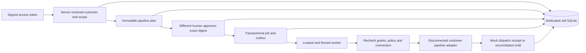

# Dedicated customer foundation service

Continued implementation, 24 October 2026, roadmap revision 6. The dedicated service reuses the existing Bicep/AVM emitter, MCP bridge and isolated Codex runtime through customer-authorized HTTP and AHP handlers. Added [cell metrics](foundation-cell-metrics.md), [signed backups](foundation-signed-backups.md), [local load/recovery qualification](foundation-load-qualification.md) and [dependency/license evidence](foundation-dependency-evidence.md) alongside independent workers, paged metadata exports and reviewed configuration. Existing browser workflows retain their session boundary; complete migration and customer UI remain open. No model approval, signing or credential tool exists. [Release plan](plans/platform-studio-commercial-release.md) · [Architecture](plans/platform-studio-foundations-and-customer-isolation.md) · [Security and operations](foundation-security-operations.md) · [SQLite ADR](adr/0001-foundation-dedicated-cell-sqlite.md).

## Implemented flow



`src/SelfService.Foundation` contains rotating-key identity validation, scoped/temporary access, permission proposals, encrypted credential custody/acquisition, SQLite migrations/state, audit/anchors/artifacts, jobs, snapshots and provider adapters. `src/SelfService.Foundation.Host` supplies the separate API, AHP channel, shared workflow service, bounded model runtime and worker. It references the existing portal's Bicep emitter, MCP bridge and Codex runtime rather than cloning them. Tests use genuine RSA-signed synthetic tokens, TestServer/WebSockets/MCP pipes, real SQLite and ephemeral cryptographic state. Models/providers are mocked; native DPAPI tests create only new test custody directories.

Configuration fixes CustomerId and CellId separately from EntraTenantId. Human signed-token roles intersect current project/environment membership; no route/body/header selector or paid entitlement grants another customer's access. Workloads require an admitted caller/service-principal pair and Worker.Execute, and cannot create requests or approve privileged work. CustomerAdmin has membership/configuration duties without implicit evidence, audit or cloud rights. New privileged grants require exact independent review. Purpose-bound SupportDelegate leases are reviewed, scoped, read-only, limited to one day and revalidated/audited on each read; they cannot approve, dispatch, inspect audit or run a model.

The SQLite store binds its file to one customer/cell; it persists memberships, connections, immutable plans, exact approvals, jobs, inbox/outbox, artifact bytes/digests and audit events. Mutable connection generations and membership/policy versions invalidate stale plans. Enqueue is idempotent and permits one job per immutable plan, even with a different idempotency key. Up to 128 active jobs are admitted. Claims are transactional with fenced leases; predispatch crash attempts are capped at three. A lost lease after dispatch or an ambiguous provider response becomes OutcomeUnknown and cannot automatically replay. Request, approval, job and required audit/outbox changes commit together. The in-process worker polls durable SQL; the persisted outbox/inbox supplies tested duplicate-consumption semantics, without claiming a separately qualified message broker.

Audit interfaces are append-only and hash chained. Artifact reads verify SHA-256. These controls detect tested corruption through the application boundary; the database is not encrypted and an OS/database administrator can bypass local triggers or rewrite hashes. Protect cell files and backups using OS access controls. Externally anchored audit, retention, export and encryption remain production work.

## Run tests and start the host

From the repository root, with .NET SDK 10.0.300 or the supported roll-forward version on PATH:

```powershell
./scripts/Test-Foundation.ps1
```

The script uses locked restore with NuGet auditing, Release builds under `artifacts/foundation-build`, and writes TRX plus derived `summary.json` under `artifacts/test-results/foundation`. It starts TestServer, owned worker processes and loopback-only synthetic fixtures. It neither accesses the desktop portal's credential cache nor starts a Codex login/model turn. The standard `Test-Project.ps1` includes this profile and the customer pipeline YAML/source contract check. The separately documented guarded Bicep example test requires a preinstalled pinned compiler. The normal Studio/Full lifecycle does not automatically start the new service or independent worker.

`Test-FoundationLoad.ps1` separately measures fixed local queue-flood, isolated signed-API and existing worker-crash scenarios and records hardware/runtime, latency distributions and observed timings. `Test-Project.ps1` includes that profile and the synthetic dependency-evidence fixtures. Targets and their version are fixed before measurement; actual results and skips remain explicit. Passing them establishes a local regression baseline, not a production SLO.

Local preview packaging is explicit and separate from production delivery:

```powershell
./scripts/Publish-Foundation.ps1 -LocalPreview
./tests/release/foundation-package.tests.ps1
```

The publisher produces a framework-dependent .NET 10 ZIP, public example/guide, final-entry hashes and a receipt under a new `artifacts/foundation-packages/<run>/` path. It rejects reused/linked/outside destinations and runtime credential/database artifacts. Source-backed Bicep/skill operations require the complete reviewed checkout, not merely this runtime ZIP. Signing, clean-machine ARM64/x64 acceptance and source-freeze/production qualification remain false. The package test's optional PublishedPackageDirectory argument selects that run's `package/` subdirectory, verifies the actual ZIP and starts/stops only an owned isolated host with synthetic public-key configuration; it never signs into a provider.

The ZIP includes dependency evidence, SPDX 2.3, supplied third-party notices and their own hash manifest. The generator verifies actual runtime assets against NuGet archive/content hashes and declared licenses, classifying source-only vendor bundles separately. Technically complete package evidence can still be `Blocked` for commercial distribution: this checkout has undeclared first-party licenses, and some dependencies supply a license expression without the full license text. LocalPreview records those issues; it does not grant rights or legal clearance. ZIP validation bounds actual decompressed bytes and checks both outer and dependency manifests against the enclosed runtime.

To start separately, copy [the public configuration example](../config/foundation-cell.example.json) into a protected local configuration file and replace every identifier and the trusted **public** RSA signing key. The example deliberately has an invalid key placeholder. Never place a private signing key, access token, PAT or secret in this file. Provision and review real identity registrations/consent separately; loading this file does not perform onboarding or grant permissions.

```powershell
$env:PLATFORM_FOUNDATION_CONFIG = 'C:\path\to\protected\cell.json'
dotnet run --project src/SelfService.Foundation.Host --no-launch-profile --artifacts-path artifacts/foundation-build
```

The host defaults to `http://127.0.0.1:5107`, accepts literal loopback and single Bearer authentication, and rejects browser-origin requests. Anonymous `/health` exposes storage readiness and disabled dispatch only. Strict JSON rejects unknown/duplicate/null-required fields, excessive nesting and bodies above 128 KiB; authorization is checked again after body reads. Per-cell admission allows 16 concurrent HTTP/AHP requests, a 120-request burst and 20 tokens/second replenishment. Bootstrap seeds CustomerAdmin and an optional distinct initial Approver once; restart never restores revoked grants. Reviewed project onboarding is implemented. Recovery of a lost final administrator remains a trusted operations procedure; there is no public bootstrap endpoint.

Pinned public RSA keys remain the default. Optional `enableEntraDiscovery` adds bounded tenant-specific public Entra v2 metadata/JWKS, per-key issuer checks, atomic rotation, throttled refresh and expiry/backoff. Token-supplied URLs and static fallback after discovery failure are rejected. Live customer Entra/consent and sovereign/custom claims-mapping authority acceptance remain unqualified. A distinct configured bootstrap reviewer can be seeded once; restart never restores revoked grants. `listenPort` defaults to 5107 and accepts only nonprivileged ports; each host remains loopback-only. No desktop Microsoft, GitHub or Codex cache is imported. [Identity and custody details](foundation-security-operations.md).

## API and customer-owned pipelines

All resource routes begin with `/api/foundation/customers/{customerId}/projects/{projectId}/environments/{environmentId}`. The server derives the acting identity and validates the exact route scope before the operation. Resource reads additionally pass scope into storage; a foreign scoped identifier returns the same 404 as a missing identifier.

| Route suffix | Method and required role | Purpose |
|---|---|---|
| `/memberships` | PUT, CustomerAdmin | Grant or disable another stable actor in this exact scope. |
| `/connections/{id}` | PUT, CustomerAdmin | Admit customer-owned GitHub Actions or ADO metadata, allowlisted refs/environments/inputs and an opaque authProfileId. No secret values. |
| `/plans` | POST, Requester | Freeze validated pipeline inputs, source revision, connection generation, expiry and digest. |
| `/plans/{id}` | GET, evidence role | Read an immutable plan within scope. |
| `/plans/{id}/approve` | POST, Approver | Require exact digest and another human requester. |
| `/plans/{id}/enqueue` | POST, Operator | Require exact approval/digest and idempotency key; disabled without an explicit disconnected transport. |
| `/jobs`, `/jobs/{id}` | GET, evidence role | Read scoped state and sanitized mock receipt. |
| `/jobs/{id}/cancel`, `/jobs/{id}/reconcile` | POST, Operator | Fence cancellation; evidence-bearing resolution of uncertain outcomes. |
| `/artifacts` | POST, Requester | Store bounded source/parameter text with its SHA-256. |
| `/artifacts/{id}` | GET, evidence role | Read verified artifact bytes within scope. |
| `/audit` | GET, Auditor | Read scoped history and audit-chain integrity result. |
| `/artifacts/{id}/content`, `/source/bicep` | GET evidence role / POST Requester | Scoped source download or existing reviewed native/AVM emitter with typed child validation and persisted ZIP. |
| `/agent/tools`, `/agent/tool`, `/agent/ahp` | Scoped signed identity | Shared workflow handlers, existing MCP bridge, seven typed foundation tools plus evidence/skill, and AHP 0.9.0 actions. No approval/credential tool. |
| `/agent/review` | POST Requester | Optional isolated customer model adapter; default disabled, advice only. AHP also exposes platform/foundationReview. |
| `/operations/health` | GET PlatformOperator | Aggregate cell health without source/actor/credential details; available while suspended through a separate operations source. |

Customers can select `github-actions` or `azure-devops`; no vendor-owned repository or organization is required. Each connection binds its own owner/organization, repository, workflow/pipeline and reviewed input contract. GitHub requires a reviewed workflow source-revision guard; ADO pins its repository version in the run request. ADO identifiers should use canonical project/repository GUIDs so returned IDs can be matched. [Validation-only customer examples and provider contracts](../examples/customer-pipelines/README.md).

Plans contain a server-created request ID, explicit source revision/ref/environment and parameter inputs. The adapter injects reserved request/plan/source/environment values. It rejects reserved-input spoofing, secret-shaped parameters, customer/cell/connection mismatch, expired approval and unsafe response URLs. Connection generation remains server-owned. GitHub workflow dispatch on a mutable ref cannot by itself pin the workflow definition; `EnforcesSourceRevision` records an admitted contract and is **not** proof that a customer's repository actually enforces it. Review and live qualification remain required.

The running host remains disconnected: default dispatch is denied, and configuration may select only a credential-free bounded loopback fixture. Live execution transports are rejected. Its receipts remain Mock=true and deploymentVerified=false; Succeeded means the mock dispatch received a correlated accepted run. Uncorrelated 202/204, source mismatch, interruption or unsafe response requires reconciliation. Separately, the code now includes AES-GCM credential profiles, optional CurrentUser DPAPI custody, GitHub App/Entra federated exchange and authenticated HTTP adapters protected by exact one-use permits and a final pre-send authority/expiry check. Those production-capable classes are mock-qualified and not enabled by this host. Actual provider rights, consent, credentials and operational acceptance remain external gates. [Implementation and limits](foundation-security-operations.md).

Permission manifests validate exact, canonical least-privilege **proposals** tied to customer, identity, operation and scope. They always report IdentityGrantAuthorized=false, ExecutionAuthorized=false and ProviderPermissionsVerified=false. They do not verify or grant Entra/Azure/GitHub/ADO rights. Current complete MCP provider catalogs, skills and exact approval controls remain in the existing portal; selecting a pipeline provider is separate from an MCP connection.

## Reviewed administration, model workflow and storage limits

`/administration/scopes/plan` and `/administration/lifecycle/plan` prepare reviewed onboarding or Suspend/Resume/Offboarding operations from bootstrap authority scope. `/administration/memberships/plan` and `/administration/support/plan` prepare exact role changes or purpose/time-bound support. Read `/administration/plans/{id}`, approve through `/approve`, then execute the exact digest through `/execute`; review and execution recheck current versions. No such approval action is advertised to a model. `/administration/access/revoke` provides urgent deny-only removal with last-administrator protection.

Auditor `/administration/exports` retains the legacy 1,000-items-per-kind/1 MiB metadata export with explicit overflow. [Frozen export snapshots](foundation-paged-exports.md) add owner-bound, expiring cursor pages and offline hash verification without loading all source rows at once. Export storage is bounded at 256 MiB per cell. `/administration/retention/plan` freezes exact artifact IDs/hashes and requires independent review, at least 30-day age and quiescence; retention batches are capped at 100. SecureErasureVerified remains false because SQLite free pages, WAL and backups may retain bytes. Audit history is preserved. Offboarded remains terminal for ordinary work; safe administrator/reviewer/auditor duties remain available without re-enabling operations.

The source workflow reuses BicepDrafts and reviewed native/AVM closures. Use platform_foundation_catalog to read exact contracts/expanded child parameters before proposing source. Generated archives keep unresolved inputs and NotCollected discovery explicit; they are not repository commits, Preview or deployment authority. The optional model adapter uses the existing Codex runtime/policy, a manifest-pinned skill and fresh customer/cell/actor homes; an explicit customer/actor-bound authentication callback is required. Mock model acceptance is tested; real customer model authorization, current protocol and inference acceptance remain unqualified. Responses are advice with false execution/deployment flags. [Indexed instructions](../.agents/skills/platform-mcp-orchestration/instruction.md).

SQLite schema v4 has additive transactional v1/v2/v3 migration history/checksums and SQLite/foreign-key/audit/guard preflight. Independent workers require the existing current schema and cannot bootstrap or migrate it. Logical limits are 128 active jobs, 64 pending administrative plans, 1,000 artifacts/256 MiB artifact bytes, 10,000 pipeline plans, 100,000 audit events, 16 live worker registrations and 2,048 executed feature configurations. Exhaustion rejects new work without partial state; audit exhaustion fails closed. These limits and local concurrency/process-crash fixtures do not establish physical disk quotas, a multi-host cluster or production SLOs.

## Backup and restoration

The trusted cell-owner API offers `FoundationStore.CreateBackup(newPath)` and `FoundationStore.RestoreBackup(manifest, newPath)`. These have no customer HTTP endpoint. Snapshot creation uses SQLite online backup; restore requires a new destination and checks an independently protected digest/length manifest, cell/customer binding, SQLite integrity/foreign keys and audit chain. A restored database increments policy version and holds recovered pending/dispatched jobs as OutcomeUnknown with new fences. It does not replay them or preserve stale approval authority.

The additional signed path commits snapshot schema, customer/cell, bytes, time and generation with RSA-PSS. `RestoreSignedBackup` requires a separately protected latest authority and pinned public key, verifies them before touching a restore target and retains the existing quarantine. Protect the signer and latest authority independently; deriving that authority from an incoming packet defeats rollback protection. This does not fence a running source host or replace production DR custody. [API and limits](foundation-signed-backups.md).

Fence or stop the original host before activating a restored host; a backup cannot prevent two independent copies of a cell running. Protect manifests outside the backup's trust boundary. These tests prove the local snapshot path, not production disaster recovery, external manifest signing, retention or RPO/RTO objectives.

Audit can also be anchored with independently signed RSA-PSS manifests. Verification permits legitimate later appends and detects tested full-chain rewrites. Protect the signer and latest anchor independently; local files are not WORM or OS-administrator proof. SQLite itself remains unencrypted. [Custody, operations and release evidence commands](foundation-security-operations.md).

## Remaining release gates

P0/P1 local code covers the shared customer workflow slice, rotating identity keys, reviewed lifecycle/access/configuration, technical entitlements, protected credentials, isolated model adapter, durable state/jobs/audit/recovery, paged exports, independent workers, isolated aggregate monitoring, signed backup envelopes and measured local regression targets. F0–F2/commercial gates remain open for complete legacy customer-UI/workflow migration, live tenant/model/provider consent and permissions, production TLS/OS/disk/encryption/backup/signer/exporter custody, externally fenced DR and supported-host production SLO acceptance, signed cross-architecture installation, and commercial rights/license/privacy/support decisions. Package dependency evidence records unresolved rights/text issues rather than clearing them. All Azure targets remain disabled; no live provider/model turn, deployment, pipeline submission or new permission grant occurred.
