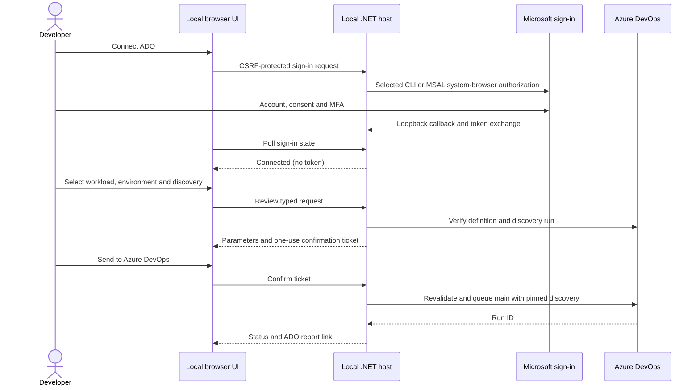

# Platform Studio: local Windows self-service portal

**4 October 2026 source update:** nine workload cards and 36 disabled targets now include [Private Data Platform](../workloads/private-data-platform/README.md). Its proposed diagram, summaries, registration pair and recovery policy are integrated. Rebuild source/packages before testing this increment; the dated seven-product package results below do not validate the new product.

[Wiki home](README.md) · [Getting started](getting-started.md) · [Status](completion-status.md)

**Recovery policies:** configure a workload and expand its recovery rules, or select a workflow under Pipeline activity → Recovery policies. These views work without sign-in and expose exclusions/requirements only; they do not assess a saved run or execute a restore. [Recovery rules](recovery-rules.md) also documents the offline source-checkout assessor. Rebuild/restart older portal processes and packages to load this increment.

**New source-draft action:** Agent workflows → Design Bicep source draft consumes a fresh Network discovery handoff and selected workload context. It downloads Bicep/modules/parameters/receipts, with missing values explicit. It cannot queue or deploy; see [operation and limits](bicep-source-drafts.md). Previously packaged binaries must be rebuilt to include this capability.

**Tag governance update (27 September 2026):** subscription evidence, deterministic checks, structured Codex advice, editable drafts, source proposals and two manual ADO pipelines are implemented locally. Apply is disabled until onboarding and live acceptance. See [the tagging guide](tag-governance.md) for current methods, source structure, permissions and limits. Earlier dated verification records remain historical.


**ADO setup:** connects the existing ADO browser identity to a reviewed registration workflow for all root pipeline YAML files. It creates missing definitions without queuing runs or changing GitHub source/permissions. Private repositories use the separate GitHub connection described below. See [registration and source-access boundaries](ado-pipeline-registration.md).

## GitHub browser sign-in

For a private repository, install GitHub CLI once from the repository root:

```powershell
./scripts/Install-GitHubCli.ps1
```

The script installs official GitHub CLI 2.102.0 for Windows ARM64 or x64 into ignored `.tools/github-cli`, verifying its SHA-256 against the official release checksums. A normal `gh.exe` installation on PATH or under Program Files also works. An administrator can set `Portal.GitHubCliPath` or `STUDIO_Portal__GitHubCliPath` to an absolute `gh.exe` path. The web UI cannot install executables or accept arbitrary CLI commands. Published packages include the installer under `repository/scripts`; run it there to use the packaged repository root.

1. In **Connections → GitHub**, choose **Sign in to GitHub**. The server starts the fixed `gh auth login --hostname github.com --web --git-protocol https --skip-ssh-key --clipboard=false` device flow.
2. Copy the one-time code shown in the panel and open **Continue GitHub sign-in**. Complete GitHub account selection and consent yourself. The portal polls its own status and verifies the returned credential against `https://api.github.com/user` before showing **Connected as …**. Login expires after ten minutes; cancellation terminates the owned CLI process.
3. If already authenticated with the local CLI, choose **Use existing GitHub CLI login** instead. No new consent flow is launched; the account is still verified. This attachment is explicit for each portal browser session.
4. Connect Azure DevOps separately, then select **ADO setup → Check registration**. Repository metadata, the main commit and root Git tree are read with the GitHub credential. Exact source hashes and review/apply checks remain enforced.

GitHub CLI uses its normal local credential store, which persists across portal restarts and can change the terminal's active GitHub account. It prefers OS secure storage, but can fall back to a plaintext local configuration file; the portal never requests `--insecure-storage`. Review the [official CLI authentication behavior](https://cli.github.com/manual/gh_auth_login). The CLI's OAuth grant can be broader than this portal's read-only GET operations. Organization SSO/OAuth restrictions may still require approval. Credentials and raw CLI output never reach page JavaScript, reports or source; only username, device code and sanitized status are projected. Inherited `GH_*`/`GITHUB_*` credential overrides are removed from child processes.

**Disconnect GitHub** cancels an in-progress flow, drops this browser's account attachment and invalidates pending registration reviews. It does not run `gh auth logout` or disconnect Azure, ADO or Codex. To remove the persistent CLI credential, use `gh auth logout --hostname github.com` from the installed CLI yourself. Revoking an OAuth authorization is a separate GitHub account action. Changing the active CLI account or losing credential access invalidates the portal attachment on the next source check; it never silently falls back from failed authenticated reads to anonymous reads.

GitHub source access does not grant ADO checkout access. Maintain the ADO GitHub App/service connection's access to the private repository independently. Sign-in does not register definitions, queue pipelines, deploy Azure resources or alter repository visibility.

**Network delivery update:** the portal now includes Network discovery, evidence-bound agent diagram rendering and reviewed AVNM pipeline submission. Setup for the real pool, protected pipeline and manual acceptance is in [the network runbook](network-discovery-and-diagrams.md). These capabilities are implemented; live cloud/model acceptance remains pending.

**New workload menus:** the portal now reads seven registered product definitions. The five additions require their ten ADO definitions to be registered using the exact names/files in [workload onboarding](workload-onboarding.md). All 28 targets remain disabled; missing onboarding settings block Preview with an explanatory report. Portable packages built at `artifacts/portal-packages/20260927-105645` include this catalog revision; both architectures passed 14 local HTTP checks. Older packages must be rebuilt.

**Latest agent packages:** `artifacts/portal-packages/20260927-124510` supersedes that catalog-only package revision. Both ARM64 and x64 packages include the Codex/MCP agent menu and passed 24 HTTP plus five AHP checks each; x64 was tested under Windows ARM emulation. Codex CLI is a separate prerequisite. See [agent setup](agent-workflows.md) and [validation evidence](validation.md#codex-agent-workflows-27-september-2026).

The portal adds a browser workspace to the seven registered ADO workload routes. It adapts the palette, typography and card conventions of Microsoft's [Azure Skills landing page](https://github.com/microsoft/azure-skills/tree/117b038edfef5d7af09848b8ffcd355f28f19956/landing-page). That upstream Astro site is a skills/install website, not an authenticated deployment application. Our local ASP.NET Core host supplies the application, session, authentication and ADO integration. This deliberately uses a small static frontend rather than adding Astro, Tailwind, Blazor and a second application build chain. See [attribution](../src/SelfService.Portal/THIRD-PARTY-NOTICES.md).

**Live IaC comparison:** workload Preview now captures live before-state through the pipeline's Microsoft Azure MCP collector, then retains predicted and observed-after phases for the portal and Codex. See [workflow, dependencies and manual acceptance](agentic-iac.md). Rebuild older portal binaries to include the new view.

## What is available

- Workload-specific resource, dependency and dated cost descriptions read from the generated YAML menus; targets and approved regions read from repository configuration.
- Discover, Preview, and Preview-and-deploy requests sent to the dedicated Discover/Deploy definitions for each offering. Disabled targets cannot deploy through the UI or API.
- Recent successful main discovery picker; review verifies the definition, YAML path, repository, age and selected instance/environment. Pipeline-side manifest/hash/provenance checks remain authoritative.
- Microsoft sign-in through **Local authentication — Azure CLI** or a registered Entra public-client app. Both have separate Azure/ADO audiences, Microsoft consent/MFA, waiting/completion/cancellation/error states and local disconnect. The themed callback belongs to the registered-app method; CLI uses Microsoft's CLI callback.
- Registered-subscription access check; it does not expand the deployment catalog based on everything a user can access.
- Eight project-local skills read from `.agents/skills`, plus [42 Microsoft Azure skill definitions](azure-skill-discovery.md) and supporting files bundled under `vendor/azure-skills`. The library displays guidance as text; seven bounded [Codex agent workflows](agent-workflows.md) have separate readiness and Run controls.
- Microsoft skill cards show **No pipeline associated yet**. A separate Azure browser-authenticated read-only inventory adapter collects approved subscription metadata, with service views and a networking profile. These are supporting facts, not full execution of each upstream workflow.
- Saved discovery analysis invoking the existing deterministic analyzer and displaying its Markdown-as-text and containment diagrams. No model or Azure connection is required.
- [Connected diagrams](portal-diagrams.md): inline visible-resource topology, proposed component diagrams for all seven workload configurations, same-subscription inventory comparison and a guarded reader for saved ADO Preview changes. Search, pagination, full-name details and SVG export are included.
- Run submission, status polling and ADO links for logs, approvals, Summary/Extensions and artifact downloads. Run history in the portal lasts for the current page session; ADO retains the actual history.

This is a **single-user desktop companion**, listening only on localhost. It is not a LAN/web-hosted multi-user identity service. The scoped MCP evidence bridge and Codex agent reviews are implemented with separate ChatGPT sign-in; live inference acceptance is pending. The [AVNM allocation path](network-discovery-and-diagrams.md) can request provider-assigned space and create a separate spoke through protected ADO stages after platform setup. Automatic workload placement/binding, runtime skill installation, general-purpose artifact browsing and in-portal environment approval remain unimplemented. The legacy Preview view reads `deployment-preview`; the new [IaC phase view](agentic-iac.md) reads its named hash-bound projection from `deployment-preview` and `deployment-result`. Skills ship as a reviewed offline bundle. Resources are still provisioned in Azure by ADO, not on your computer.

## Run from source, in order

### Combined lifecycle command

For a fresh rebuild that retains the current portal's isolated Azure CLI and Codex sign-ins, use `./scripts/Restart-PortalFresh.ps1`. It preflights the build, verifies owned processes, creates a Windows-user-protected handoff and opens a one-time resume link. GitHub uses its existing CLI login. Registered-app MSAL memory cannot be migrated. See [cache-preserving restart, privacy and recovery](portal-fresh-restart.md). The older lifecycle commands below retain their cleanup semantics.

From the `Bicep` repository root in PowerShell 7.4+, use [Manage-Portal.ps1](../scripts/Manage-Portal.ps1):

```powershell
./scripts/Manage-Portal.ps1 -Action Status
./scripts/Manage-Portal.ps1 -Action Restart
```

`Restart` checks the registered main process and configured port, calls `Stop-Portal.ps1`, confirms the portal is stopped, runs `Setup-Portal.ps1` (prerequisites, locked restore and Release build), then calls `Start-Portal.ps1` and verifies the owned listener and bootstrap workload count. It covers the backend and web UI: HTML/CSS/JavaScript live in the portal's `wwwroot`, with no separate frontend bundler. Refresh the browser after restarting. This does not publish new portable ZIP packages.

| Option | Behavior |
|---|---|
| No arguments / `-Action Status` | Read-only process, ownership, listener and bootstrap status. Does not verify provider sign-ins. |
| `-Action Start` | Requires a stopped portal with no receipt, then builds and starts it. |
| `-Action Stop` | Runs governed stop/session cleanup, then verifies the stopped state. |
| `-Action Restart` | Stops, rebuilds and starts. A failure halts the sequence; a failed build leaves the portal stopped. |
| `-WhatIf` | Inspects status and describes the requested action without stopping, building or starting. |
| `-NoBrowser` | Prevents opening a browser during Start/Restart. |
| `-InstallMissing` | For Start/Restart, allows Setup to install missing .NET/Node prerequisites. If PATH needs refreshing, setup stops and asks for a new PowerShell window. |

Status distinguishes Ready, Unhealthy, Stopped, StaleReceipt, UnownedListener, OwnershipMismatch and Unknown. Unknown inspection, mismatched ownership and an unrelated listener block lifecycle changes. A stale receipt can be cleaned through Stop/Restart. If Windows hides the running executable or command line, Status reports Unknown and blocks mutations; run it under the account that launched the portal. Bootstrap count mismatches report expected and received counts. Settings use `portal.local.json` and `STUDIO_Portal__Port` consistently with the existing launcher. The script defaults to Status so merely inspecting it does not sign users out.

Stop/Restart clear portal-owned sessions: reconnect Azure/ADO and Codex afterward. GitHub can usually use **Use existing GitHub CLI login**. Reports are retained. This command manages the main source portal only; it does not manage the separate review instance, desktop Codex, Functions/Azurite or Windows distribution packages. It performs no Azure deployment or pipeline submission.

Local orchestration regression tests: `./scripts/Test-PortalLifecycle.ps1`. These use isolated synthetic process/build adapters and do not restart a real app. Real startup readiness is checked by the lifecycle command itself; synthetic tests do not establish connected provider acceptance.

### Individual scripts

Requirements: Windows 11 ARM64 or x64, PowerShell 7.4+, Git checkout, .NET SDK compatible with `global.json` (currently 10.0.300), and Node.js 22+ for analysis. **Local authentication requires an installed Windows Azure CLI 2.54+; use a current Microsoft-supported release.** Registered-app authentication does not require Azure CLI. Bicep, Docker and Functions are not needed for portal browsing or ADO requests. Internet is needed for restore, Microsoft sign-in and ADO/Azure calls. Azure pipelines retain their existing agent/tool/network requirements.

From the `Bicep` repository root:

```powershell
./scripts/Setup-Portal.ps1
./scripts/Start-Portal.ps1
```

If a prerequisite is absent, use `./scripts/Setup-Portal.ps1 -InstallMissing`. This uses native-architecture winget packages for .NET 10 SDK or Node LTS and reports when to reopen PowerShell to refresh PATH. Existing incompatible installations are reported for upgrade, not silently replaced. PowerShell and winget themselves must already be available.

The browser opens `http://localhost:5087`. You can browse workloads/skills and analyze saved discovery without signing in. **Connections → Local authentication — Azure CLI → Sign in locally — Azure CLI** works without a custom app registration when Azure CLI is installed. Only the registered-app method requires the registration below.

```powershell
./scripts/Test-Portal.ps1
./scripts/Stop-Portal.ps1
```

Start writes an ownership receipt and logs under `.local/portal`. Stop verifies process path, creation time and command line before stopping only that portal process. Reports remain under `artifacts/portal-analysis`. Never commit those artifacts; inventories may contain private infrastructure details. Raw uploaded files are retained locally to preserve evidence. Delete specific unwanted evidence directories yourself after review. This app does not start or stop the Functions/Azurite stack.

## Configure Microsoft browser sign-in

Choose either local CLI authentication or registered-app authentication. Both use your existing user permissions. Neither changes the pipeline service connection or enables deployment targets.

### Local authentication — Azure CLI

1. Install [Microsoft Azure CLI for Windows](https://learn.microsoft.com/en-us/cli/azure/install-azure-cli-windows), if absent, then restart the portal to refresh PATH. The portal supports the official MSI/ZIP `az.cmd` layout and `az.exe`. For a non-PATH installation, set `Portal.AzureCliPath` to the absolute `az.cmd`/`az.exe` path in ignored `portal.local.json`, or `STUDIO_Portal__AzureCliPath`. The UI does not run an installer or accept arbitrary executables/commands.
2. Open **Connections** and select **Local authentication — Azure CLI** (the default). Leave Tenant ID empty to use the tenant returned by Microsoft/CLI. For a guest account or another directory, enter that tenant GUID before signing in; disconnect before changing it.
3. Click **Sign in locally — Azure CLI**. The backend invokes `az login --allow-no-subscriptions` in an isolated cache, opens your default browser, and waits up to five minutes. Complete account selection, consent and MFA on Microsoft's page. The UI polls for completion; **Cancel sign-in** terminates the owned helper and cleans an unsuccessful new session.
4. Azure becomes **Local auth · Azure CLI · Azure token connected** only after token acquisition/tenant/expiry checks. The active account and returned tenant appear in Connections. Open Network discovery, DNS & drift or Tag governance and refresh scopes to retrieve visible subscriptions. Resource permissions and coverage are checked by each workflow. The workload catalog and its deployment allowlist remain platform-controlled.
5. Click **Connect Azure DevOps** to request a separate ADO token from the same isolated CLI session. Your ADO organization must recognize that tenant/account, and your user needs the operation's existing permissions. A token alone is not proof of project access; access is checked when reading ADO or reviewing a request. ADO failure can leave the Azure connection usable.
6. **Disconnect Microsoft** clears both audiences, evidence/review tickets and this session's CLI cache. It leaves the separate Codex connection, normal terminal `az login`, browser cookies and tenant consent unchanged. Connect Codex separately under Agent workflows. Sign-in never runs an agent, queues a pipeline or grants permissions.

Implementation: `POST /api/local-auth/{azure|ado}` accepts only an optional tenant GUID. `AzureCliIdentity.Begin/Complete` runs login and qualifies the returned account; `Token/Acquire` obtains the requested audience and renews before expiry through CLI. `BrowserIdentity` routes the existing `ITokenProvider` calls to CLI or MSAL. CLI receives fixed argument arrays through the installed Python/native executable, without a command shell. `GET /api/auth` returns mode/account/tenant/status, never tokens. Auth operations preserve loopback Host, Origin and CSRF protections.

Each browser owns `.local/portal/azure-cli/<random-id>` as `AZURE_CONFIG_DIR`, with Windows permissions restricted to the current user and SYSTEM. This directory contains sensitive refresh credentials and must remain ignored. The app does not reuse your normal Azure CLI cache. WAM and the interactive subscription selector are disabled **only for that child process**, so authentication can complete in a browser without a hidden terminal prompt. Tokens are renewed using `expires_on` UTC; account/tenant changes require reconnection. Only Azure public cloud is supported by the fixed ARM/ADO adapters.

Disconnect and session expiry remove the owned cache. The governed `Stop-Portal.ps1` also invokes `Clear-PortalAzureCli.ps1` to verify and stop any surviving CLI helper and remove its credentials after stopping the portal. Abrupt OS/app termination can leave a protected ignored cache; retain the process receipt and run the stop script before restarting. Cleanup refuses linked paths and unverified processes. Never upload `.local`, token cache files or full CLI authentication output. MSAL registration remains available when tenant policy does not permit Azure CLI authentication; neither method bypasses Conditional Access.

Microsoft references: [CLI interactive authentication and browser mode](https://learn.microsoft.com/en-us/cli/azure/authenticate-azure-cli-interactively), [CLI configuration/environment isolation](https://learn.microsoft.com/en-us/cli/azure/azure-cli-configuration), and [ADO tokens using Azure CLI](https://learn.microsoft.com/en-us/azure/devops/cli/entra-tokens?view=azure-devops).

### Registered Entra application

For this alternative, a platform administrator creates a **separate, single-tenant Microsoft Entra app registration for the local desktop companion**. Do not reuse the ADO deployment service principal's client ID.

1. In the tenant connected to your ADO organization, register the app and record its Directory/tenant ID and Application/client ID.
2. Under Authentication, add **Mobile and desktop applications** and the redirect URI **`http://localhost`**. MSAL selects an ephemeral loopback port for the response. This is different from the portal's port 5087. Do not register the portal as a SPA or confidential web app; no client secret is used.
3. Add delegated **Azure DevOps → user_impersonation** permission. For optional Azure subscription checking, also add **Azure Service Management → user_impersonation**. Obtain administrator consent where tenant policy requires it. MSAL requests each resource separately with `.default`; it does not combine two token audiences.
4. Make sure the user has ADO project membership, View builds/View build pipeline and Queue builds on the intended definitions. Azure subscription Reader access is sufficient for the optional subscription check. The pipeline's `SC-AZ-A-Bicep` permissions remain a separate deployment concern.
5. Configure the local app with the actual registration IDs:

```powershell
./scripts/Setup-Portal.ps1 -TenantId '<portal-tenant-guid>' -ClientId '<portal-client-guid>'
./scripts/Start-Portal.ps1
```

If already running, stop the portal before setup/build, then restart. Setup saves only nonsecret identifiers in ignored `src/SelfService.Portal/portal.local.json`. You can copy `portal.example.json` to that name to configure Organization, Project, Port, RepositoryRoot or NodePath. Environment overrides use `STUDIO_Portal__ClientId`, `STUDIO_Portal__TenantId`, etc. Configuration is local and never editable through an HTTP endpoint.

In **Connections**, select **Browser authentication — registered Entra app**, then click Connect Azure DevOps. Microsoft opens in the system browser; select your account, accept consent and complete MFA. The portal waits up to five minutes and updates automatically. Cancellation or a denied/failed request can be retried. Azure connection is optional and must use the same account. Tenant Conditional Access may block browser public-client flows; this implementation does not bypass it or implement WAM fallback. Disconnect Microsoft clears the app's in-memory cache, not browser cookies, tenant consent or Codex.

Sources: [MSAL interactive acquisition](https://learn.microsoft.com/en-us/entra/msal/dotnet/acquiring-tokens/desktop-mobile/acquiring-tokens-interactively), [system browser and loopback](https://learn.microsoft.com/en-us/entra/msal/dotnet/acquiring-tokens/using-web-browsers), [ADO Entra delegated authentication](https://learn.microsoft.com/en-us/azure/devops/integrate/get-started/authentication/entra-oauth?view=azure-devops).

## Register the existing pipelines

The default organization/project is `enetactgames / Enetact`. Register unique definitions with these exact names and files; deploy YAML already binds its matching discovery name:

| Definition | YAML |
|---|---|
| Discover - Blob copy | `azure-pipelines-blobcopy-discover.yml` |
| Deploy - Blob copy | `azure-pipelines-blobcopy-deploy.yml` |
| Discover - Event flow | `azure-pipelines-eventflow-discover.yml` |
| Deploy - Event flow | `azure-pipelines-eventflow-deploy.yml` |

The server resolves IDs by exact definition name, checks each YAML path and always queues `refs/heads/main`. Duplicate names, unavailable definitions and mismatched paths block the request. Keep pipeline definitions/repository main protected; the local portal is not a substitute for ADO permissions, branch protection, service-connection authorization or environment checks. Commit reviewed pipeline changes to the connected GitHub main before expecting them to execute. Catalog changes in your working tree do not change ADO's checked-in source.

1. Choose a workload and environment, then **Discover resources**.
2. Click **Review pipeline request**, inspect the exact parameters, then **Send to Azure DevOps**. Opening the page or reviewing does not queue a run.
3. In Pipeline activity follow the run. ADO contains the full summary and saved artifact.
4. Return to that workload/environment, select **Preview changes**, refresh discovery and choose a successful main run from the last seven days. The list contains recent candidates; Review rejects a different environment/instance or missing parameter evidence. It never silently substitutes latest.
5. Review and send. The JSON sets `resources.pipelines.discovery.version` to the selected run ID and `executionMode` to `Preview only`. ADO validates the actual artifact and generates the resource-change report.
6. Deploy is selectable only for platform-enabled targets. It queues **Preview and deploy**, including a fresh Preview followed by Deploy and configured ADO gates. It does not resume or reuse an earlier Preview-only run as implicit approval.

Queue reviews are session-bound, single-use and expire after five minutes. Confirm revalidates the catalog and ADO handoff. The app does not automatically retry a queue POST: if the connection fails after ADO accepts it, check ADO before submitting again. Preview writes temporary Azure What-If metadata, though it does not apply workload resources. Estimates are dated retail references, not a guarantee or cost cap. See [preview](deployment-preview.md) and [costs](self-service-costs.md).

ADO API contract: [Run Pipeline](https://learn.microsoft.com/en-us/rest/api/azure/devops/pipelines/runs/run-pipeline?view=azure-devops-rest-7.1).

## ARM64 and x64 packages

```powershell
./scripts/Publish-Portal.ps1
```

Produces timestamped **win-arm64** and **win-x64** ZIPs under `artifacts/portal-packages`, with self-contained .NET runtime, application files, a read-only catalog/skill/analyzer snapshot and documentation. Pick the package matching Windows **System type**. Packages need no installed .NET SDK/runtime; Node.js 22+ remains optional unless using analysis. The copied catalog snapshot is not a Bicep development checkout and does not update itself; rebuild packages after approved platform changes. No automatic upstream skill download occurs.

Extract to a user-writable directory. In that directory create `portal.local.json` using the shape below, then run `SelfService.Portal.exe` and open `http://localhost:5087`. The executable is a foreground server; Ctrl+C stops it. Microsoft Sign-in launches its own system-browser tab only when Connect is clicked. These packages are unsigned portable distributions, not MSIX installers.

```json
{"Portal":{"TenantId":"","ClientId":"","Organization":"enetactgames","Project":"Enetact","Port":5087}}
```

Leave IDs blank for offline use or enter your registration IDs. Never add a client secret, PAT or access token. Source-local `portal.local.json` is excluded from publishing. Packaged reports are saved below `repository/artifacts/portal-analysis`.

## Structure, methods and boundaries

| Source | Responsibility |
|---|---|
| `src/SelfService.Portal/Program.cs` | Loopback host, origin/CSRF/session checks, safe errors, API routes and one-use confirmation tickets. |
| `Catalog.cs` | Read generated menu descriptions, targets, regions and local skills; validate selection; build allowlisted ADO payload. |
| `BrowserIdentity.cs` | Shared token routing, MSAL public-client browser flow, cancellation, Microsoft disconnect and session evidence clearing. |
| `AzureCliIdentity.cs` | Optional local CLI browser login, protected per-browser cache, fixed process arguments, cancellation/renewal, tenant/account qualification and cleanup. |
| `AdoGateway.cs` | Resolve definitions, verify handoff, submit once, read status and approved-subscription access. |
| `AzureDiscovery.cs` | Fixed ARM GET collections for the selected upstream skill profile; scoped pagination, projected fields, explicit partial coverage and local reports. |
| `AnalysisRunner.cs` | Size-bound file upload, isolated evidence directory, fixed analyzer command with bounded execution and safe error handling. |
| `wwwroot/` | Dependency-free UI, responsive/light-dark theme, explicit confirmation, safe text rendering and image-only SVG reports. |
| `scripts/*-Portal.ps1` | Setup, ownership-checked lifecycle, tests and architecture-specific publishing. |



MSAL 4.90.1, ModelContextProtocol 2.2.0, .NET 10, built-in System.Text.Json/HttpClient and xUnit tests are locked in package files. Self-contained packages pin runtime 10.0.12; source development uses the installed runtime associated with the compatible SDK (10.0.8 on the tested host). This app requires no Semantic Kernel, database or claims runtime. Authentication uses Microsoft's maintained OAuth library rather than application-written OAuth cryptography. Azure/ADO MSAL token caches are memory-only, separated by browser session and discarded on process exit. Codex uses a separate isolated local login cache with the cleanup and crash limits in [agent authentication](agent-workflows.md#identity-evidence-and-failure-behavior). Sessions expire after eight hours. The HTTP-only, SameSite=Strict session cookie is used only on loopback HTTP; Host, Origin and CSRF checks reject cross-site mutations and DNS-rebinding hostnames. No CORS, remote bind, credential form, command console, arbitrary pipeline ID or arbitrary upstream URL is exposed. The local OS user and repository configuration remain trusted; another process with access to that user's account is outside this isolation boundary.

## Verification and remaining acceptance

See [current validation](validation.md) for executed checks. Mocked ADO tests exercise handoff rejection and payload submission without queueing cloud work. Local browser/runtime checks do not establish live tenant login, consent or Azure deployment. Before wider rollout, retain actual ARM64/x64 package launch evidence, then test registration, successful sign-in, denied consent, MFA/Conditional Access, cancellation, expiry/reconnect, successful Discover → Preview handoff and an explicitly approved deployment through ADO. Do not mark Azure acceptance complete based on a local report.

For the actual local HTTP boundary, start an unconfigured portal and run `node tests/portal/smoke.mjs`. It exercises origin/CSRF/Host rejection and synthetic inventory analysis without cloud calls. For a published folder, run `./scripts/Test-PortalPackage.ps1 -PackageDirectory '<published-folder>' -ExpectedArchitecture Arm64` (or `X64`). The package check starts and stops its own process, verifies the bundled catalog and uses port 5088 by default. x64 emulation on an ARM64 machine is not native x64 hardware acceptance.
