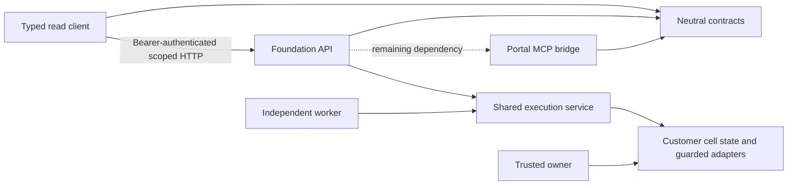

# Platform Studio application service architecture

[Commercial roadmap](platform-studio-commercial-release.md) · [Customer isolation](platform-studio-foundations-and-customer-isolation.md) · [Task handoff](../handoffs/2026-10-26-platform-studio.md)

[The application coding skill](../../.agents/skills/platform-service-architecture/SKILL.md), referenced by root `AGENTS.md`, applies this architecture to implementation and review. It is contributor guidance and appears in the existing local skill library without adding an executable workflow, discovery profile, provider permission or model approval tool.

26 October 2026. Application architecture audit and incremental refactoring. This covers application entry points, project dependencies, ownership of state and authority, and service consumption seams. It is not a complete security assessment or production scale acceptance. Pipeline definitions, infrastructure Bicep/parameter files, source-generation behavior and pipeline-facing command contracts are outside this change.

## Architectural decision

Use coarse service boundaries around cohesive business capabilities, with a dedicated customer Foundation control plane and independently owned executors. Start with shared application services inside the existing cell, expose complete operations through versioned APIs, and extract additional processes when identity, data ownership and measured capacity justify them. Shared protocol libraries contain no storage, provider, browser or credential implementation.

Microsoft recommends choosing boundaries around domain ownership and consistency requirements, beginning with coarser services when appropriate. A logical boundary can precede a separate process; a separately deployed service owns its data and logic. [Service boundaries](https://learn.microsoft.com/en-us/azure/architecture/microservices/model/microservice-boundaries) · [Data ownership](https://learn.microsoft.com/en-us/dotnet/architecture/microservices/architect-microservice-container-applications/data-sovereignty-per-microservice).

Do not split request, exact approval, job, audit and outbox commits across independent databases merely to create more services. Keep that transaction inside the customer Foundation. A service response is evidence, not a transferable activation lease, credential session or permission to perform a later write elsewhere.

## Whole-application boundary audit

| Area | Existing ownership and finding | Direction |
|---|---|---|
| Portal | Browser sessions, discovery, naming, tagging, operations, AHP/MCP and Codex orchestration. Session plans, approvals and runtime handles are in memory. | Keep the operator experience while introducing an explicit customer-aware backend-for-frontend connection. Never share one browser cache across customer replicas. |
| Foundation API | Signed API identity, server-resolved customer scope, durable plans/jobs/artifacts/audit, reviewed administration and workflow application service. | Own the customer control-plane state and operation authorization. Reuse these services from HTTP/AHP; keep routes thin. |
| Foundation core | Identity rules, SQLite, credential/recovery coordinators, dispatch admission, leases and lifecycle. | Centralize policy and complete guarded operations here; later separate internal persistence/adapters without changing security contracts. |
| Foundation worker | Previously referenced the executable web Host, which referenced the Portal executable. | Depend directly on the shared executor and core. Keep claim/fence/activation/heartbeat and outcome checks inside the owning customer cell. |
| Trusted owner CLI | Separate core-only maintenance process for provisioning, activation, backup and inspection. | Preserve the privileged operations boundary; it is not a general web API. |
| Agent/model runtime | HTTP/AHP/MCP share application handlers, but Foundation still imports the Portal executable for source and agent infrastructure. | Centralize protocol descriptions now. Extract UI-independent model/provider adapters later, preserving isolated customer/actor homes and exact human approval. |
| Evidence, audit and jobs | Scoped durable records, bounded exports, transactional outbox/inbox, uncertain-outcome reconciliation. | Offer typed commands/queries; retain state and atomic admission in Foundation. An audit outage cannot silently authorize dispatch. |
| Credentials and recovery | Trusted in-process coordinators retain actual filesystem/key/checkpoint/activation custody. Schema 15 supplies adoption-intent review only. | Future recovery service owns verification through admission, mutation and outcome. Do not expose private roots/keys or accept caller-created contexts. |
| Tagging and Operations | Existing domain libraries with Portal and CLI adapters. | Reuse the libraries behind application ports; preserve protected-stage and command behavior. |
| BlobTransfer / ProductFunctions / TransferTool | Separate data-plane entry points. TransferTool still references the Functions executable. | Preserve current behavior. A later application-library extraction must retain existing pipeline and infrastructure interfaces. |
| Telemetry and lifecycle | Shared telemetry library and governed local ownership/startup scripts. Foundation processes are not implicitly started by Studio. | Preserve private telemetry, owned lifetimes and existing profiles. Add new service lifecycle only through an explicit later contract. |

## First implemented separation

`SelfService.Foundation.Contracts` owns the seven existing Foundation tool names, exact schemas/order, AHP mappings and read protocol models. Portal and Foundation consume the same descriptions. The protocol adds no approval tool or execution permission.

`SelfService.Foundation.Client` is a thin read client with no Foundation domain, SQLite, ASP.NET, Portal or provider dependency. It reads existing scoped job and artifact endpoints. Endpoint/customer/cell/project/environment are fixed when constructed; callers supply a Foundation API token per request. Tokens are not acquired, cached or converted from desktop credentials. It checks authenticated cell/contract response headers, object scope and artifact integrity, bounds responses and time, disables redirects/cookies, and performs no automatic retry. Read results confer no execution authority. The current service remains loopback-only; future remote hosting requires separate identity/TLS/storage acceptance.

`FoundationPipelineExecutionService` owns the existing claim → reauthorization → guarded dispatch → durable outcome behavior. API and independent worker use it; the existing Host runner remains a compatibility adapter. `FoundationExecutionActivation` retains the actual lease until active use finishes, including shutdown. Worker no longer needs the web host or Portal closure.

These changes create usable code and transport boundaries. They do not configure a customer Portal service connection, remove Foundation's remaining Portal dependency, implement recovered runtime formats/adoption, create a distributed broker or qualify horizontal replicas.

## Identity, consistency and scale rules

- Authenticate each service ingress for its own API audience and allowed caller. Resolve customer/cell/project/environment authority server-side. Preserve distinct human requester/approver and workload duties; no automatic browser-to-service delegation.
- Keep ingress, post-body, transactional admission and final-send authorization checks. They protect different time boundaries; shared policy implementation must not remove current-authority checks.
- Keep `CustomerContext`, private keys, provider credentials and retained custody sessions process-local. Wire contracts carry identifiers, immutable digests, public metadata and sanitized outcomes.
- Pin connection/catalog/source versions and recheck at execution. A service call cannot turn stale intent or a model recommendation into approval.
- Keep complete guarded recovery operations inside one authority boundary. Verification in one process followed by an unrelated write in another is not safe adoption.
- Preserve idempotency, fencing, cancellation and `OutcomeUnknown`. No automatic changing-request retry or fallback to a direct provider after a service timeout. [Microsoft HTTP resilience guidance](https://learn.microsoft.com/en-us/dotnet/core/resilience/http-resilience) describes configurable retry policy; any later policy must account for operation effects.
- Retain dedicated customer databases, key namespaces, workers, quotas and private telemetry. Current SQLite qualification is on a trusted local machine; it is not a multi-host database or network-filesystem qualification.
- Treat service discovery, broker choice, production storage, independent key/latest custody and measured capacity as explicit acceptance work. More processes alone do not establish scaling or customer isolation.

## Migration order within the commercial packets

All 22 commercial packet identifiers remain unchanged. This architecture is work inside PS-07/PS-08/PS-09/PS-10/PS-13/PS-19/PS-20/PS-21/PS-22, not an exception to F0–F2.

1. **Shared contracts/client/execution boundary:** complete qualification, including dependency and unchanged-infrastructure checks. The focused and Portal suites pass, but the full Foundation profile exhausted its existing deadline and left test descendants; repair owned test-process deadline/capture handling before claiming a fresh full-suite pass. Preserve that rejected run and the unchanged application source evidence.
2. **Explicit customer Portal connection:** design the delegated API token/calling-client contract and selected-cell routing. Begin with read-only jobs/evidence, fail visibly when unavailable, and do not fall back to desktop provider authority.
3. **UI-independent adapters:** remove Foundation.Host → Portal executable coupling by extracting reviewed agent/source adapter interfaces and implementation. Preserve emitter output and Bicep/pipeline contracts; leave infrastructure assets intact.
4. **Workflow migration:** move feature groups onto customer-scoped service commands, durable drafts/plans/jobs/receipts and isolated artifacts. Prove two customers in the same directory and revocation/timeout/restart cases for each group.
5. **Recovery service:** specify authenticated recovered runtime envelopes/absence provenance, then trusted server-registered recovery selections, full-scope review, reservation, changing one-use admission and interruption reconciliation. Coordinate activation and hold release only after source-consumer fencing and independent custody requirements are met. A normal active-runtime host cannot bypass activation to operate an inactive restored cell.
6. **Gate and production qualification:** close F0 decisions and F1/F2's executable local isolation/reliability/fault evidence for the supported slice, then admit P2 work. Actual customer identity/provider permissions, production backend/storage/worker/custody, supported-host recovery and production capacity acceptance belong to later separately authorized G3 admission; local test success does not establish them.

Recovered runtime credential/proof semantics remain a necessary recovery prerequisite. The immediate task priority has broadened to application service adoption; the earlier narrow recovery-only sequence is not the complete application migration plan.

## Verification and remaining limits

Current task evidence belongs in [validation](../validation.md) and the [handoff](../handoffs/2026-10-26-platform-studio.md). Prior schema-15 results and package pins retain their original scope. New projects change dependency/distribution evidence and require fresh package qualification before any archive is promoted. No proprietary license grant or distribution clearance follows from adding projects.

The static audit covers architecture and entry-point/dependency ownership across the application. Deeper feature-by-feature security review, full Portal customer migration, production identity/provider acceptance, independent recovery custody, signing, clean-machine lifecycle and commercial review remain open. No Azure deployment, live pipeline run or real credential recovery is part of this refactor.
