# Platform Studio commercial release plan

[Wiki](../README.md) · [Foundation architecture](platform-studio-foundations-and-customer-isolation.md) · [Current implementation](../completion-status.md) · [Expansion roadmap](../self-service-expansion-plan.md)

**26 October 2026 — application service adoption is the current architecture priority.** The [application boundary audit and migration plan](platform-studio-application-service-architecture.md) covers Portal, Foundation API/core/worker/owner, agents, domain tools, data-plane entry points and telemetry. Its first refactor centralizes neutral tool/read contracts, supplies a typed scoped read client and removes the independent worker's web-host/Portal dependency through a shared execution service. This is an application-only change; pipeline definitions, Bicep/parameter assets and generation behavior remain outside scope. Qualification is recorded separately in [validation](../validation.md); earlier schema-15 tests/packages retain their original source scope. The [handoff](../handoffs/2026-10-26-platform-studio.md) records the next slices and current operational caveats. F0–F2 remain open.

**26 October 2026 — restricted adoption-intent review locally qualified. GitHub commits, tags and Releases define product history; F0–F2 remain open.** [Separate intent preparation and distinct-human approval](../foundation-restricted-recovery-adoption-intent.md) pin the exact restored hold/instance, matching source runtime binding, full binding history, actual activation/checkpoint/stage selections and proposed fresh destinations. Both phases freshly authenticate destination proofs and retain actual three-guard custody through frozen-time final all-scope authority and scoped audit commit. Additive schema 15 preserves DDL/checksums 1–14 and quarantines inherited intent authority. **3,852 Foundation tests pass with zero failures/skips; 733 portal tests pass with four native opt-ins skipped.** Fresh archive checks pass **217/608/67/65**; all **117 new dedicated cases**, the 121-case coordinator/adjacent cohort and 989 existing consumers pass in overlapping cohorts. Two contained builds finish without warnings/errors/active descendants. Cleanup removes **1,548,152,373 logical bytes / 12 targets**, zero refusals/uncertainty, retaining current builds and captured evidence. Approved intent creates no execution/admission, reservation, adoption, activation or hold-release authority. Recovered runtime formats and changing execution are next; customer UI/workflow migration, production acceptance and commercial clearance remain open. No Azure deployment, primary migration/restart or live provider operation occurs. Preserve all **22 packet identifiers**; local qualification does not complete a commercial packet.

**Whole-app status: local preview, not production complete.** Adoption-intent review is locally qualified; the current application-service refactor begins the wider migration. Completing Platform Studio also requires customer-facing workflow/UI integration with shared identity/jobs/audit controls, actual safe recovery execution, signing and rights/security/commercial decisions, plus later production identity/storage/worker/provider acceptance. The focused and Portal regressions pass; the fresh complete Foundation run is rejected after its existing deadline and needs owned-process runner repair/requalification. Passing backend tests does not close F0–F2 or admit a commercial edition. No percentage of completion is inferred from test counts.

Build the necessary bricks once: customer identity and isolation, Entra authorization, least-privilege connections, durable data, audit, reliable jobs and operational controls. Every catalog, workflow, agent and workload feature must inherit those contracts. A feature cannot invent its own credential store, customer boundary or background execution loop.

The user selected proprietary binary licensing with source offered separately. The [non-binding review draft](../commercial-license-review-draft.md) records that direction and unresolved order/support/rights terms; it changes no license grant or runtime policy. Adding the owner executable increases the undeclared first-party project count to eight. Those declarations and other dependency findings remain open until reviewed rights evidence and required notices exist.

## 1 Scope and current evidence

### Restricted adoption-intent continuation

The [separate adoption-intent protocol](../foundation-restricted-recovery-adoption-intent.md) now prepares an immutable proposal for a verified restored instance with an exact matching historical source runtime binding, full binding-history commitment, current recovery hold and trusted proposed fresh destinations. A distinct human Approver reviews the complete present-plus-absence scope union. Actual activation metadata, checkpoint and stage custody span fresh destination proof authentication and frozen-time final authority checks. Additive schema 15 retains request/approval history and quarantines inherited intent authority. All 117 dedicated cases, complete regression and fresh archive qualification pass. This is intent agreement only: there is no execution/admission API, namespace reservation, adoption, activation or hold release; previous joint verification remains read-only. Unknown/never-bound lineage remains unsupported.

### Restricted joint verification continuation

[The restricted joint protocol](../foundation-restricted-recovery-joint-verification.md) now joins the independently configured actual current checkpoint with the existing exact-stage human approval. The fixed profile, source selection and completion-proof commitment agree before keys; actual checkpoint then stage custody spans one atomic ordinary/joint Unknown admission, destination authentication and frozen-time final all-scope authority checks. Exact actual-session identity/head/receipt and the same produced result are required, followed by a clock-free dual snapshot and cancellation check immediately before atomic result/audit commit. Both ordinary and joint paths spend the same approval once. Schema 14 links customer/review/admission as one foreign-key tuple and preserves DDL/checksums 1–13. Historical completed-stage verification remains distinct from fresh staging; read-only outcomes cannot grant adoption, activation or hold release.

### Restricted complete-scope review continuation

[Restricted human review](../foundation-restricted-recovery-review.md) authorizes exactly one read-only verification across the complete present-plus-absence scope union. It pins the fixed access profile, completion proof, stage/source/namespace/key, actor versions, policy, database instance and expiry. A distinct human approver approves the exact request; a consumed Unknown admission precedes destination keys. Actual destination MAC/AES authentication and the same held session's clock-free final byte/custody/token fence precede atomic success and per-scope audit. Additive schema 13 preserves DDL/checksums 1–12 and quarantines unfinished restored authority. Restricted joint current-checkpoint verification is now locally qualified; neither read-only result grants adoption, activation or hold release.

### Restricted checkpoint custody continuation

[The restricted checkpoint protocol](../foundation-restricted-recovery-checkpoints.md) pins the accepted source-V3 namespace, signer, artifact and increasing generation under exclusive local custody. Actual retained AES/HMAC authentication precedes append, with exact prior-head CAS and final lifetime/readback checks. The configured staging wrapper retains the real current-head lease through inner staging, then holds the completed-stage guard across final checkpoint validation and the last stage byte/permission/cancellation checks. Read-only historical inspection cannot renew staging authority. Restricted complete-scope review is now locally qualified; restricted joint execution-time custody is now locally qualified; changing adoption, activation and hold release remain open.

### Restricted inactive recovery continuation

[The restricted destination protocol](../foundation-restricted-recovery-staging.md) authenticates the exact source artifact and all retained encrypted profiles/absence proofs before reserving a fresh private root. New contextual AES binds the fixed access policy and stage identity; every stage also needs a destination-keyed completion MAC. Read-only destination verification holds actual guard custody through key access and final tree/byte/permission checks, without source folders or source keys. Partial failures retain an unknown inactive stage. No existing namespace is converted, no credential/database activation occurs, and no restored-cell execution hold is released. Restricted checkpoint custody is now locally qualified; restricted complete-scope review and joint execution-time custody are now locally qualified; changing adoption and coordinated activation remain open.

### Credential/runtime binding continuation

[The new binding contract](../foundation-credential-runtime-binding.md) introduces explicit once-only trusted-owner cutover for an Active, never-restored cell with no queued, claimed or dispatched work or active worker registrations. It pins the database instance/path commitment, complete namespace and actual activation root/owner/marker custody commitment plus selected generation/head. Equal copied authority IDs cannot substitute for common lock custody. Durable binding history makes the policy required even if runtime configuration or the current binding is missing. Never-bound cells retain prior behavior; the bound transport always requires its exact current persisted binding.

The concrete transport acquires its own activation lease before store/key access and retains it through uncooperative provider waits, cancellation, response/body disposal and final authorization. Existing current job, worker, fence, scope, connection, source, catalog, role and entitlement checks remain. After HTTP admission, failures retain uncertain-effect semantics. Provisioning has no credential access; an uncertain commit requires protected status inspection rather than retry or rebind. Restored history cannot authorize the new instance or release its schema-11 hold. No default HTTP/AHP/MCP/model/worker route or live feature enables this path. For General namespaces, schema-12 binding alone does not fence direct vault consumers or custom non-store permits. The fresh restricted profile separately excludes those read paths and acquisition; issued tokens, other credential stores and other hosts remain outside it. Complete production source-use fencing is not claimed.

The selected consumer is now composed at [Foundation host registration](../../src/SelfService.Foundation.Host/FoundationApplication.cs) and the [shared in-process job runner](../../src/SelfService.Foundation.Host/FoundationWorker.cs) through a concrete mock-only typed option. It checks actual existing binding before bootstrap and holds real activation from before claim through the durable outcome. Bound/history-bearing cells refuse legacy changing transport/worker configuration; hosts without a pipeline consumer retain inspection access. [Standalone worker composition](../../src/SelfService.Foundation.Worker/FoundationWorkerProcess.cs), [credential acquisition](../../src/SelfService.Foundation/CredentialAcquisition.cs), [Codex authentication](../../src/SelfService.Foundation.Host/FoundationModelRuntime.cs) and [legacy Portal MCP credentials](../../src/SelfService.Portal/McpProviderCredentials.cs) remain distinct paths. Admit each explicitly or exclude it from the supported production recovery consumer set; one mock consumer cannot fence them. Keep this work ahead of recovery release and feature expansion.

### Restore execution and owned-build continuation

The preceding prerequisite is a [durable restore execution hold](../foundation-recovery-execution-hold.md), before credential adoption. Earlier restore logic quarantined copied jobs and approvals but did not block fresh ordinary work after database activation. Additive schema 11 binds an immutable hold to the actual restored instance; verified historical restore audit backfills older restored cells. Unknown historical source instance IDs remain explicitly unknown. Existing lifecycle, role, entitlement or activation changes cannot clear it. Current operational status distinguishes the execution hold from storage readiness and heartbeat liveness. Reads, safe reconciliation and inactive recovery preparation remain available; there is no release API.

Prospective owned builds use a fresh private generation, an exclusive lifetime guard, a contained compiler process job and proven completion before old compiler intermediates can qualify. The qualified baseline at local commit `339581d` contains two final-source builds and removes **two** superseded owned intermediate trees, **5,830,486 logical bytes**, with zero uncertain removals. Newest two complete generations and all `bin`, logs, completion evidence, packages, full/rejected test records, databases, keys, `.local` and primary runtimes remain protected. Ambiguous legacy builds retain their existing process-visibility refusal. Ownership metadata is operational evidence, not another product-version counter; physical reclaimed disk space is not attested. [Baseline validation](../validation.md#restricted-namespaces-and-bounded-build-outputs--25-october-2026) records those exact cleanup decisions; earlier dated observations retain their original scope.

### GitHub versioning and current implementation

[Commit history](https://github.com/Enetact/Bicep/commits/feature/selfservice) records source changes. Product versions use reviewed Git tags such as `v0.1.0-preview.1` or `v1.0.0`; these are naming examples, not tags created by this update. [GitHub Releases](https://github.com/Enetact/Bicep/releases) will hold release notes and approved packages for those tags. Pull requests describe changes. This roadmap tracks remaining work rather than maintaining another product-version counter or receipt history.

The preceding scoped implementation is in [commit `de4a566`](https://github.com/Enetact/Bicep/commit/de4a56606b42ec3cddc38b05547c9d8138c7d1c7). Joint verification and initial cleanup are recorded in local commit `1d7f2c7`, restore holds/contained builds in `1c754cc`, credential/runtime binding in `de65ba3`, selected consumer integration in `ed43712`, transactional admission in `7a19b61`, restricted namespaces/publisher retention in `339581d`, and restricted source recovery in `bbe726f` with progress reconciliation in `4e019d6`. Restricted inactive staging and destination verification are in local commit `6d683b0`. Restricted checkpoint custody is in local commit `62de32c`. Restricted complete-scope human review is in local commit `d7569f7`. Restricted joint verification is in local commit `13a1329`. The current adoption-intent continuation follows those local commits on `feature/selfservice`; earlier native pushes lacked usable Git authentication. No product version, release tag or GitHub Release is assigned here. Earlier numbered notes, including references in implementation guides, are dated local work packets and are retained below for context. Build/test reports remain internal evidence, not versions; no new current-receipt layer is introduced.

| Implemented locally | Verified behavior | Remaining boundary |
|---|---|---|
| Scoped destination proofs | Source AES/HMAC authenticates before fresh reservation. Exact positive profiles retain scope/generation/revocation/expiry; a pinned destination key authenticates new AES and purpose-separated absence MACs. Completed verification needs no source folders or source keys. | Inactive stage only; normal vault adoption and activation remain separate. |
| Complete-scope human review | Separate schema-v9 records require every present and absent project/environment, distinct human requester/approver, one-use admission before destination keys, and current authority again under the held guard before completion. Absence-only review works; empty scope review is denied. | Current source/connection membership never backfills legacy provenance. No default HTTP/AHP/MCP/model route is added. |
| Scoped checkpoints | Actual retained source AES/HMAC, increasing generation and exact head CAS precede append. A concrete read lease retains exact accepted selection through staging completion. | The lease ends before later exact-stage review. Promotion/adoption must jointly recheck checkpoint/review authority and coordinate database/credential activation. |
| Joint current-checkpoint and approved-stage verification | A configured checkpoint authority and independently pinned identity are matched with the approved stage. Both concrete guards span atomic ordinary/joint Unknown admission, actual destination verification, current all-scope authorization and atomic success/audit. One-use contention, uncertainty and restore quarantine share the existing review. | Read-only inactive verification; actual promotion/adoption, source fencing and coordinated credential/database activation remain open. No default HTTP/AHP/MCP/model/worker route. |
| Build retention after success | Fresh accepted full tests and exact current source/HEAD gate cleanup. Only old ordinary-check `build/obj` or `.build/obj` trees qualify; newest/current/active trees and all binaries, full-run evidence, packages, data and keys are retained. Preview/WhatIf and explicit keep paths are supported. | Local process inspection is not continuous fencing. Refused/failed cleanup preserves the successful test verdict. [Operating contract](../foundation-test-execution-evidence.md#clean-old-compiler-intermediates-after-success). |
| Restored-cell execution hold | Schema 11 binds immutable hold history to the actual restored instance, conservatively backfills verified historical restores, and blocks fresh enqueue/worker/dispatch/maintenance authority before keys/effects. Existing operations reports the hold separately from storage readiness/liveness. HTTP/AHP and customer-isolation boundaries pass. | Safe reads/preparation remain available. No release API or claim to fence generic vault consumers, issued tokens or other hosts. |
| Prospective owned compiler retention | Actual suspended launch and contained Windows Job Object must finish with zero active descendants and stable source before completion. Cleanup holds the generation and captured file handles, retaining the newest two. Two final-source builds and two actual superseded-tree removals are qualified in this continuation. | No adoption of old ambiguous trees. Legacy visibility refusal, protected state and partial-removal uncertainty remain. [Owned-build contract](../foundation-owned-build-cleanup.md). |
| Activation-held credential/runtime binding | Explicit once-only schema-12 cutover pins actual namespace, activation custody/generation and current instance. Bound store permits require the concrete session; its activation lease spans keys, HTTP/body/disposal and final authority checks. Focused mock/native checks, full regression and fresh archive qualification pass. | Complete supported production consumer coverage, reviewed recovery release/adoption, rebinding policy and coordinated activation remain open. Never-bound legacy cells retain prior behavior; no new default route or live execution is enabled. |
| Selected in-process bound consumer | Concrete mock-only typed composition reuses signed HTTP/AHP plans, approval, enqueue, durable runner and ordinary response interpretation. Read-only startup/eligibility checks, shared immutable metadata custody and actual run/host-use leases cover the selected consumer through durable outcome and shutdown. Full regression and fresh archive qualification pass. Standalone changing modes refuse bound cells before registration/claim. | Other credential paths, standalone bound-consumer integration, production consumer coverage and provider-token behavior remain open; no live mode or recovery release is enabled. |
| Transactional Foundation admission | Concrete run authority and actual stored-target eligibility are checked inside enqueue, claim, dispatch-start and execution-registration transactions, before idempotency, expiry/reaping and registry mutation. They serialize with binding quiescence; safe outcome/control paths remain available. Full regression, fresh archive and both real writer orders are locally qualified. | No general source-use fence or live execution is claimed. Complete production consumer coverage, other credential paths and recovery release remain separate gates. |
| Restricted fresh namespace | Explicit new marker kinds refuse direct token reads, generic dispatch and acquisition before key/provider callbacks. Only the actual current bound session can read a token; both signed mock provider workflows pass. Legacy formats and DDL remain unchanged. | No existing-root conversion, cryptographic ciphertext non-portability or complete production source-use fence. Separate restricted source-V3 capture/rehearsal is locally qualified. Restricted inactive staging and destination authentication are now locally qualified; restricted joint read-only custody is now locally qualified; acquisition support and live composition remain unqualified. |
| Restricted source recovery | Separate V3 signed inventory/content/signature bind the fixed access profile. Actual source guards cover authentication/capture; detached rehearsal authenticates every retained envelope and original absence proof under exact set/namespace/signer pins. Native source, adversarial and old-wire regressions plus full/archive qualification pass. | Source capture/rehearsal authenticates with available keys. The separate restricted stage is locally qualified; restricted joint read-only custody is now locally qualified; independent backups, changing approval/adoption and coordinated activation remain required. No existing vault is converted or recovery hold released. |
| Restricted inactive destination staging | Separate typed contracts preserve the fixed policy with contextual destination AES, original absence commitments and a mandatory destination-keyed completion proof for every stage, including empty. A destination-only verifier retains actual stage custody through key access and final validation. | Native Windows local qualification passes: 94 new focused tests, full regression and fresh archive checks. Restricted joint read-only custody is now locally qualified; changing adoption/activation remain open; no recovery-hold release or default HTTP/AHP/MCP/model/worker route. [Protocol](../foundation-restricted-recovery-staging.md). |
| Restricted checkpoint custody and held staging | Locally qualified: separate schema-3 authority/records preserve the fixed policy, authenticate retained AES/HMAC before append and retain a real accepted-head lease through restricted inactive staging. | 178 new focused tests, full regression and fresh archive qualification pass. Restricted joint read-only custody is now locally qualified; changing adoption/activation and recovery-hold release remain separate gates. [Protocol](../foundation-restricted-recovery-checkpoints.md). |
| Restricted complete-scope stage review | Locally qualified: distinct restricted target/approval/result and schema-13 persisted request/approval/execution records. Actual completion-MAC/AES/HMAC verification is bound to one consumed admission and a concrete clock-free final held-stage snapshot before atomic success/audit. | 127 new dedicated cases, full regression and fresh archive qualification pass. Joint current-checkpoint read-only execution is now locally qualified; changing adoption/activation, hold release and production acceptance remain separate gates. [Protocol](../foundation-restricted-recovery-review.md). |
| Restricted joint checkpoint/stage verification | Locally qualified: same schema-13 human approval and one-use ordinary admission, additional schema-14 linked joint evidence, actual checkpoint/stage custody through destination MAC/AES and frozen-time final dual snapshot before atomic outcome/audit. | 115 new dedicated cases, full regression and fresh archive qualification pass. Changing recovery approval/adoption, coordinated activation, source-consumer closure, independent custody and commercial gates remain separate. [Protocol](../foundation-restricted-recovery-joint-verification.md). |
| Restricted adoption-intent preparation and approval | Locally qualified schema-15 slice: exact restored hold/source binding and full history commitment, configured activation/checkpoint/stage custody, fresh destination authentication and separate complete-scope human intent approval. | 117 new dedicated cases, full regression and fresh archive qualification pass. No execution admission, namespace reservation, recovered runtime conversion, adoption, activation, source fence or hold release. [Protocol](../foundation-restricted-recovery-adoption-intent.md). |
| Publisher and historical output retention | Three owned SDK jobs reach zero active descendants before final archive verification and fixed scratch cleanup; 68 native safety checks and actual five-tree cleanup pass. Historical completed package/test compiler copies are separately removed through captured original handles with retained-evidence comparisons. | Preserve failed/unknown runs, archives, reports, source, data and keys. Physical reclamation, arbitrary historical-tree ownership and continuous global process visibility are not attested; ordinary owned-build gates remain unchanged. |

### Next implementation order

1. **Completed locally: restricted source, destination, checkpoints, human review and joint verification.** Policy-preserving capture/rehearsal, inactive destination proofs, checkpoint custody and exact-stage review are qualified. Schema 14 joins current-checkpoint custody to the same consumed human approval with atomic ordinary/joint outcomes and a final actual-session clock-free dual snapshot. [Dated joint evidence](../validation.md#restricted-joint-checkpoint-and-approved-stage-verification--26-october-2026) records that earlier increment; current schema-15 regression and intent-review results appear below and in [current validation](../validation.md#restricted-adoption-intent-review--26-october-2026).
2. **Completed PS-21/PS-13 prerequisites:** the immutable restore hold closes fresh-work resumption after restore. The new once-only binding pins exact vault/rollback namespace, actual authority custody/generation and current instance, with a concrete per-operation lease. History prevents configuration stripping from restoring store-permit fallback. Neither prerequisite releases recovery or completes live adoption.
3. **Completed local PS-21/PS-13 restricted joint brick:** the separate coordinator/session binds the independently pinned actual current checkpoint to the approved restricted stage. Fixed profile, source set/namespace/inventory and exact target agree; both real guards survive the shared one-use admission, destination authentication, final current all-scope authorization and atomic ordinary/joint outcome/audit. It creates no second usable admission and does not imply checkpoint currency at approval time. General joint APIs remain separate. Complete supported production consumer coverage and issued-token/other-host policy before adoption; read-only verification grants no changing recovery. Broader prospective full/focused-test compiler retention remains separate work, preserving results and newest qualified generations.
4. **Completed local restricted adoption-intent brick:** schema 15 supplies immutable preparation and distinct-human approval for the exact restored hold/instance, known source runtime-binding lineage, full binding history, current checkpoint/stage and actual activation metadata plus trusted proposed fresh destinations. Fresh destination authentication and concrete three-guard custody precede frozen-time final all-scope authority/audit. This is review-only consent: no execution admission, reservation or changing authority is introduced. Never-bound restorations and unknown/mismatched lineage are denied. **3,852 Foundation / 733 portal** pass (four portal opt-in skips), with archive checks **217/608/67/65**, **117 new dedicated cases**, the 121-case coordinator/adjacent cohort and **989 older consumers** passing in overlapping cohorts. [Current intent evidence](../validation.md#restricted-adoption-intent-review--26-october-2026).
5. **Next: recovered runtime formats and changing execution/adoption.** Define correct recovered runtime envelope and absence-proof semantics before implementing fresh destination reservation, a changing-operation capability and atomic one-use admission. Stage AES/AAD and absence/completion MACs cannot become runtime provenance by renaming files or inventing original transactions. Introduce source-use fencing, interruption/ambiguity reconciliation and coordinated credential/database activation before execution-hold release. Approved schema-15 intent records agreement with a pinned proposal; it grants none of those effects. Keep implementation/tests local with disposable cells and mock payloads until separately authorized live acceptance.
6. **Still required before retirement/migration:** independently held latest-set and key-backup custody, restoration procedures, supported-host recovery and audit evidence. Existing advisory retention does not authorize key retirement.
7. **F0–F2 gates before P2 expansion:** resolve rights/distribution findings; qualify real customer identity/least privilege and trusted connector composition; complete UI migration and production storage/worker isolation, recovery and capacity acceptance. Keep feature work on the shared contracts. No Azure deployment is part of this increment.

**Historical adoption-intent qualification (before the service refactor):** **3,852 Foundation tests pass, zero failures/skips**, with all **2,252 inputs / 17,969,990 raw bytes unchanged**. Portal **733** passes with four native opt-in skips. Fresh archive checks pass **217/608/67/65**; two contained builds finish with zero warnings/errors/active descendants. Accepted-run retention removes two superseded intermediate trees (**6,983,814 logical bytes**), retaining the newest two; publisher cleanup removes five scratch trees (**380,566,749 logical bytes**). Five separately scoped old compiler trees remove **1,160,601,810 logical bytes / 2,854 files**, retaining all 33 sibling evidence entries, with zero refused/uncertain removals. All 339 captured evidence entries and 33 siblings pass preservation with zero unexpected differences; the only allowed delta is the old `4ed...` parent write time. Newest `44dad...`/`a2bd...` compiled bin/obj/test DLLs remain intact, and primary data/auth/caches stay outside the cleanup scope. Exact preservation is recorded in [current validation](../validation.md#restricted-adoption-intent-review--26-october-2026). Primary data, auth and caches are excluded from cleanup, and the primary application is not migrated or restarted. The full test command takes **892.167 seconds** within the unchanged 900-second limit; this is not production latency/capacity qualification. Recovered runtime formats, changing execution/adoption, activation/hold release, independent latest/key custody, complete customer UI/production consumer coverage, live acceptance and commercial clearance remain open. Earlier [joint](../validation.md#restricted-joint-checkpoint-and-approved-stage-verification--26-october-2026), [human review](../validation.md#restricted-complete-scope-recovery-review--26-october-2026) and [checkpoint](../validation.md#restricted-checkpoint-custody-and-held-staging--25-october-2026) results remain dated history.

Earlier dated cleanup recorded nine obsolete unreferenced pointer descriptors recoverably archived and 145 referenced descriptors retained. Current cleanup verifies only its captured preservation scope; it does not attest availability of every historical local artifact. Earlier legacy process-visibility refusals and prospective owned-build removals retain their dated evidence. The preceding transactional-admission continuation removed two owned intermediate trees; the current accepted run removes its separately recorded two. These operational artifacts are not release versions. Eleven distribution findings, signing, independent security/rights review, supported production storage/identity and independent latest/key custody remain open. No Azure operation, live pipeline or primary portal restart occurred.

Historical local progress notes — not product versions

### Progress recorded before this continuation

The retained **revision 9** completion receipt records **892 foundation tests, 733 portal tests with four native opt-in skips, 172 package checks, 80 preview lifecycle checks, 67 dependency/SPDX checks and 77 execution-evidence contract checks**. Its actual full runner captured all 1,989 inputs unchanged before/after execution. Only four progress documents and the manifest changed afterward; a separate review verified runtime/test source unchanged and the package inputs still matched. The rejected earlier 891-pass/one-failure fixture run is preserved. The source scan's 48 public digest/identifier candidates were independently classified with none unresolved; this does not clear history, runtime caches, final binaries or commercial rights. Exact pins and boundaries are in `artifacts/commercial-release/revision9-completion.json` and [revision 9 validation](../validation.md#foundation-recovery-credential-custody-and-execution-evidence--24-october-2026). No new load measurements or live acceptance are implied.

Revision 8's retained completion receipt records **818 foundation tests, 733 portal tests with four native opt-in skips, 162 package checks, 80 preview lifecycle checks and 67 dependency/SPDX checks**, all executed checks passing. The unsigned owner-inclusive preview has 75 runtime files, eight first-party projects and 32 packages. Eleven rights/review findings continue to block distribution. The source scan's 48 candidates were independently classified as 47 public pinned digests and one public Azure DevOps resource identifier; no unresolved candidate remained, while raw `FindingsRequireReview`, history/runtime/binary and independent-security limitations were retained. Exact source/package hashes, paths and scope are preserved in `artifacts/commercial-release/revision8-completion.json` and [dated validation](../validation.md#foundation-owner-operations-identity-proposals-and-credential-lifecycle--24-october-2026).

### Revision 9 verified baseline

| Packet | Current implementation | Remaining gate |
|---|---|---|
| PS-02 | The fixed runner's 77 synthetic contracts pass. The actual full execution passed **892 tests**, with all **1,989 source inputs unchanged** before/after restore/test and a pinned fresh TRX/command/tool receipt. | Protected CI provenance, complete tool/dependency/environment custody and independent attestation. |
| PS-10 / PS-13 | Store-backed permit checks re-read current durable dispatch authority; **35 focused cases pass**. Explicit ciphertext rewrap preserves scope/expiry/revocation; **136 focused credential regressions pass**, including 23 new cases. | Trusted live adapter composition, real consent/provider/model acceptance, key retirement/recovery epochs and production custody/scale. |
| PS-21 | A current human Operator can reconcile uncertain work while Suspended/Offboarding, allowing reviewed offboarding to finish without reactivation. | Customer recovery UI, evidence-quality procedures and supported production recovery acceptance. |

These portions are implemented and locally verified. [The new dated validation entry](../validation.md#foundation-recovery-credential-custody-and-execution-evidence--24-october-2026) records **892 foundation tests, 733 portal tests with four native opt-in skips, 172 package checks, 80 preview lifecycle checks and 67 dependency/SPDX checks**, plus the source-execution evidence and exact preview pin. Revision 8 results above retain their dated scope. The preview remains unsigned and eleven distribution findings remain open; no foundation/commercial gate is marked complete.

### Revision 10 verified baseline

| Packet | Locally verified increment | Remaining gate |
|---|---|---|
| PS-13 / PS-21 | Fresh protected namespace provisioning, validation-only reopening, existing guards and bounded held reads. **192 affected credential tests pass**, including 56 native namespace cases; all are included in the new full cohort. | No real credential migration or automatic repair; protected audit composition, key retirement/recovery epochs and production custody remain open. |
| PS-10 / PS-22 | Receipt admission precedes database access; shared read-only launcher preflight precedes private logs. Trusted parent custody and Owner guards prevent cross-writes. **83 focused worker/launcher regressions pass**; the added missing-DLL refusal passes in the full cohort. Packaged preflight/private receipt checks pass. | Production service identity, ancestor custody, supported-host lifecycle and scale acceptance remain separate. |
| PS-02 | **42 new binding contracts and 28 legacy contracts pass.** The fresh full run passes **1,025 tests** with **1,998 unchanged inputs**. Qualification consumes the pinned receipt/TRX and an exact five-file progress-only review, rejecting the earlier receipt after launcher source changed. | Protected CI and independent/dependency/environment/portal attestations remain open. |

Revision 10's [dated validation](../validation.md#foundation-protected-custody-worker-receipts-and-release-binding--24-october-2026) records **1,025 foundation tests, 733 portal tests with four native opt-in skips, 178 package checks, 80 preview lifecycle checks and 67 dependency/SPDX checks**. The new unsigned 93-entry preview retains 75 runtime files/eight projects/32 packages and eleven distribution findings. Final source/evidence checks are retained in `artifacts/commercial-release/revision10-completion.json`. These results do not admit a live transport, migrate existing credentials, change customer authority or pass F0–F2. Customer UI, actual identity/provider/model acceptance, custody auditing/key retirement/recovery epochs, production identities/scale and signed clean-machine delivery remain open.

The continuation implements and tests the dedicated customer host/library, shared application emitter/MCP bridge/Codex adapter, rotating identity keys, schema migrations, reviewed standing/temporary access and lifecycle, encrypted credential/token acquisition, durable jobs/audit/artifacts/recovery, signed audit prefixes and release evidence. Model/provider exchanges use synthetic fixtures; actual DPAPI, SQLite and local cryptography are exercised. Local preview packaging and owned loopback smoke are separately labeled. No identity registration, provider permission grant, real sign-in/model turn, live pipeline, Azure operation, target enabling, publication or buyer contact occurred. Real What-If can create temporary metadata; offline previews remain **Simulated Preview**. Primary portal credentials/processes are preserved.

The source baseline is `6c51bca` plus this uncommitted increment: eleven workload types, 44 Azure target profiles with zero enabled and 30 root pipelines. The provider registry contains **seven source entries**, including Fabric and Aspire; that is not seven live-accepted catalogs. The five-provider/657-tool record is dated 17 October. Dated revisions 4–6 and earlier 20/17 October results remain historical in [validation](../validation.md). None establishes a complete successful Azure workload deployment. [Source catalog](../self-service-catalog.md), [provider implementation](../../src/SelfService.Portal/McpProviderBroker.cs).

The existing desktop portal listens on localhost; its browser identities, evidence and plans remain largely session/in-memory objects. The new foundation service is separate, with actual durable customer state and a worker; legacy workflow migration remains required. Reuse the portal's typed adapters, exact approvals, evidence digests and credential isolation during extraction. [Current portal hosting](../../src/SelfService.Portal/Program.cs), [sessions](../../src/SelfService.Portal/BrowserIdentity.cs), [workflow standard](../agent-workflow-standard.md).

### Revision 11 verified baseline

| Packet | Locally verified increment | Remaining gate |
|---|---|---|
| PS-13 / PS-21 | Opt-in fresh vaults bind a separately protected local high-water authority and exact interrupted-write reconciliation. **214 affected cases pass**, including 20 rollback cases and 58 namespace cases. Existing vaults remain unchanged. | Production rollback resistance, independent key/authority backup custody, maintenance authorization/audit and key retirement remain open. Same-owner/admin/ancestor and power-loss limits remain explicit. |
| PS-21 / PS-22 | Owner requests retain bounded read handles and validate trusted files and immediate input/output parents. NULL DACLs and partial rollback-authority directories are refused. **157 native cases pass**: 70 Owner, 74 worker receipt and 13 existing worker process. | Supported service identities, ancestor custody, production storage/recovery and customer operations UI remain separate. |
| PS-02 / PS-05 local development portion | **65 synthetic and pinned-package checks pass**. Static review finds no candidates in 27 text entries and 12,882 user strings from 37 managed assemblies. All 94 ZIP entries are admitted; 30 binary entries remain unqualified. | Signing, remaining binary surfaces, independent security/rights review and native clean-machine delivery. Static scanning grants no distribution authority. |

Revision 11's [dated validation](../validation.md#foundation-rollback-owner-custody-and-package-secret-review--24-october-2026) records **1,093 foundation tests, 733 portal tests with four native opt-in skips, 179 package checks, 80 preview lifecycle checks and 67 dependency/SPDX checks**, all executed checks passing. The final full run captures **2,005 unchanged source inputs**. The 94-entry unsigned preview retains 75 runtime files/eight projects/32 packages and eleven distribution findings. Its source/evidence pins and local progress review are retained in `artifacts/commercial-release/revision11-completion.json`. A test-harness argument reset found by final-package checking was corrected; the older successful full receipt is refused after the source change, and a fresh complete run passes on corrected source. There is no new load profile, live identity/provider/model acceptance, existing-cache migration, Azure deployment or customer pipeline submission. F0–F2 and commercial gates remain open.

### Revision 12 verified baseline

| Packet | Locally verified increment | Remaining gate |
|---|---|---|
| PS-08 / PS-13 | Human-only maintenance capabilities reuse Operator, Approver and Auditor. Exact scope, signed-role intersection, current versions and independent approval protect local Revoke/Rewrap. **79 store/identity/migration checks pass**, including scoped support and invalid-role cases. | Existing-role directory/consent acceptance and trusted production composition. No new role grant or default HTTP/MCP/model route is added. |
| PS-10 / PS-13 / PS-20 | Schema-v6 records commit one-use admission/audit before a retained vault session publishes the exact prepared candidate. Unknown effects cannot retry. **37 new executor cases** include two owned DPAPI process interruptions; all pass in the final full graph. | Remaining maintenance/unknown-outcome procedures, key retirement and independent custody. No database/filesystem atomicity or remote token-revocation claim. |
| PS-21 / PS-22 | Restore quarantines unfinished maintenance and preserves scoped public history. **95 evidence/backup checks pass**, including 16 new cases for exports, malformed v6 snapshots, stale instance authority and audit failure. | Supported service identities, protected backup/key/authority custody, operational recovery UI and production scale/SLO acceptance. |

Revision 12's [dated validation](../validation.md#foundation-reviewed-credential-maintenance-and-recovery-evidence--24-october-2026) records **1,211 foundation tests, 733 portal tests with four native opt-in skips, 180 package checks, 80 preview lifecycle checks, 67 dependency/SPDX checks and 65 static-secret checks**. The final complete run has zero failures/skips and **2,016 unchanged source inputs**. Two earlier 1,210-pass/one-failure runs are retained; corrected legacy-schema and worker-readiness fixtures pass targeted regressions and the fresh complete run. The 95-entry unsigned preview retains 75 runtime files/eight projects/32 packages and eleven distribution findings. Covered static surfaces have no findings; 30 binary entries remain unqualified. Final source/evidence pins and the reviewed progress deltas are retained in `artifacts/commercial-release/revision12-completion.json`. No new load profile, existing customer schema/credential migration, live sign-in/model turn, directory grant, Azure deployment, real pipeline or primary portal restart occurred. F0–F2 and commercial gates remain open.

### Revision 13 verified baseline

| Packet | Locally verified increment | Remaining gate |
|---|---|---|
| PS-08 / PS-13 | Existing human maintenance capabilities protect fresh independent review, exact candidate bindings, current authority and one-use observation receipts. **123 focused store/identity/migration cases pass**, including **44 new cases**. Earlier migration text/checksums and write limits remain unchanged. | Real directory/consent acceptance, production composition and remaining maintenance operations. Historical grants never supply current authority. |
| PS-10 / PS-13 / PS-20 | A read-only retained session authenticates only the existing source key and holds vault/authority guards through final audit/receipt commit. **22 focused recorder cases pass**. The original execution remains `OutcomeUnknown`; no retry, vault write or Pending reconciliation is introduced. | Independent custody/backup, key retirement and supported-host recovery qualification; no remote revocation or distributed atomicity claim. |
| PS-21 / PS-22 | Schema-v7 restore quarantines unfinished reviews and preserves immutable receipts/approvals and original uncertain history. **102 evidence/backup cases pass**, including **17 new cases**. | Operational recovery UI, protected production storage/identities, scale/SLO and full disaster-recovery acceptance. |

Revision 13's [dated validation](../validation.md#foundation-reviewed-publication-observation-and-recovery--24-october-2026) records **1,294 foundation tests, 733 portal tests with four native opt-in skips, 181 package checks, 80 preview lifecycle checks, 67 dependency/SPDX checks and 65 static-secret checks**. The full run has zero failures/skips and **2,027 unchanged source inputs**, with 83 added cases relative to revision 12. The 96-entry unsigned preview retains 75 runtime files/eight projects/32 packages and eleven distribution findings. Covered static surfaces have no findings; 30 binary entries remain unqualified. Exact source/execution/package pins and the reviewed progress-only deltas are retained in `artifacts/commercial-release/revision13-completion.json`. F0–F2 and commercial gates remain open. No new load profile, real sign-in/model turn, directory grant, Azure operation, real pipeline, existing customer schema/credential migration or primary portal restart occurred.

### Revision 14 verified baseline

| Packet | Locally verified increment | Remaining gate |
|---|---|---|
| PS-21 / PS-22 | Fresh activation provisioning atomically creates private Windows custody, requires a trusted existing parent and refuses protected namespaces or existing/competing roots. **179 affected native cases pass**, including 57 new cases. | Supported production service identities, higher ancestor custody, storage/power-loss and multi-host recovery qualification. Other provisioning OSes remain unsupported. |
| PS-05 / PS-13 / PS-22 | Stage/Verify/Repair/Readiness reject misplaced software inside credential/key/rollback and legacy namespaces without modifying their contents/ACLs. **448 final lifecycle checks pass**, including the new namespace refusal graph and actual pinned preview. | Signing, protected active-version lifecycle and native clean-machine acceptance. No customer authority or automatic activation is added. |
| PS-21 | Read-only backup admission compares required versioned tables/columns/keys/indexes/guards/history against unchanged in-memory reference definitions and refuses unrecognized executable schema before staging. **174 affected cases pass**, including 69 new cases and valid legacy upgrades. | Independent latest-checkpoint/signer/key custody and retention; complete business-row attestation and production disaster recovery. |

Revision 14's [dated validation](../validation.md#foundation-operational-custody-and-backup-schema-admission--24-october-2026) records **1,420 foundation tests, 733 portal tests with four native opt-in skips, 181 package checks, 448 preview lifecycle checks, 67 dependency/SPDX checks and 65 static-secret checks**. The complete run has zero failures/skips and **2,031 unchanged inputs**, with 126 added cases relative to revision 13. The 96-entry unsigned preview retains 75 runtime files/eight projects/32 packages and eleven distribution findings. Covered static surfaces have no findings; 30 binary entries remain unqualified. Exact source/execution/package pins and reviewed progress-only deltas are in `artifacts/commercial-release/revision14-completion.json`. F0–F2 remain open. No new production load profile, live identity/provider/model acceptance, Azure operation, real pipeline, existing customer migration or primary portal restart occurred.

### Revision 15 verified baseline

| Packet | Locally verified increment | Remaining gate |
|---|---|---|
| PS-13 / PS-21 | Exact customer/cell namespace-pinned inventory authenticates every admitted current profile, preserves expiry/revocation and records source-key/envelope commitments without credential material. **80 affected cases pass**, including 13 new cases. | Independent credential/key/authority backups, protected latest checkpoints, actual recovery protocols and production custody. |
| PS-10 / PS-13 / PS-22 | Vault-then-authority guards span source authentication and final name/byte/state checks. Pending/partial/malformed states fail as a whole; source-only key lookups and cooperative cancellation preserve custody. **41 new native boundary cases pass**. | Trusted production providers/service identities, higher-ancestor and storage/power-loss qualification. No hard return-time guarantee for an uncooperative provider. |
| PS-13 / PS-21 | Pure retention assessment unions current and explicitly retained inventory source-key references, with deterministic immutable advisory holds. **26 new cases pass** for rewrap history, exact binding, deduplication/integrity and bounds. | Managed retention enforcement, historical completeness, backup/key-material availability and independently approved retirement; all remain unqualified. |

Revision 15's [dated validation](../validation.md#foundation-authenticated-recovery-inventory-and-advisory-retention--24-october-2026) records **1,500 foundation tests, 733 portal tests with four native opt-in skips, 183 package checks, 448 preview lifecycle checks, 67 dependency/SPDX checks and 65 static-secret checks**. The complete run has zero failures/skips and **2,039 unchanged source inputs**, with 80 added cases relative to revision 14. The 98-entry unsigned preview retains 75 runtime files/eight projects/32 packages and eleven distribution findings. Covered static surfaces have no findings; 30 binary entries remain unqualified. Source/execution/package pins and the separate progress-only review are retained in `artifacts/commercial-release/revision15-completion.json`. No source parser, schema migration, credential export, key retirement, default HTTP/AHP/MCP/model operation or new role was added. F0–F2 and production/commercial gates remain open. No production load profile, live identity/provider/model acceptance, Azure operation, real pipeline, existing customer migration or primary portal restart occurred.

### Revision 16 verified continuation

| Packet | Locally verified increment | Remaining gate |
|---|---|---|
| PS-13 / PS-21 | Protected Windows checkpoint authority binds customer/cell, root/owner identity and fixed signer. Exact reviewed candidate commitment, current sequence/head and full signed-snapshot validation precede append; unknown append effects do not auto-retry. **8 core authority cases pass within the 147-case checkpoint cohort**. | Independent monotonic/backup custody, key recovery and production storage/power-loss/service identity qualification. Local history does not resist tail or whole-root rollback by the owner/admin. |
| PS-10 / PS-21 / PS-22 | Concrete verify/restore retains the current checkpoint read lease and source handle through full verification, private fresh staging and recovery holds. No packet-selected latest DTO is accepted on this path. **44 native recovery cases pass**. | Legacy caller/Owner routes require explicitly selecting this composition; customer UI, independent recovery protocol and activation/fencing remain separate. |
| PS-05 / PS-13 / PS-22 | Native custody boundary tests cover exact bindings, malformed/partial state, races and ambiguous append. Existing operational guards recognize checkpoint/staged-cell sentinels. **95 new boundary and 273 guard regressions pass**; actual preview lifecycle also passes. | Higher-ancestor custody, supported deployment identities, signed clean-machine delivery and independent security/rights acceptance. |

Revision 16's [dated validation](../validation.md#foundation-protected-backup-checkpoints-and-custody-backed-recovery--24-october-2026) records **1,661 foundation tests, 733 portal tests with four native opt-in skips, 185 package checks, 480 preview lifecycle checks, 67 dependency/SPDX checks and 65 static-secret checks**. The complete run has zero failures/skips and **2,047 unchanged inputs**, with 161 added cases relative to revision 15. The 100-entry unsigned preview retains 75 runtime files/eight projects/32 packages and eleven distribution findings. Covered static surfaces have no findings; 30 binary entries remain unqualified. Exact source/execution/package pins and reviewed progress-only deltas are in `artifacts/commercial-release/revision16-completion.json`. Schema remains v7; no key import/export/retirement, default route, activation or credential migration is added. No production load profile, live identity/provider/model acceptance, Azure operation, real pipeline or primary portal restart occurred. F0–F2 and commercial gates remain open.

### Revision 17 verified continuation

| Packet | Locally verified increment | Remaining gate |
|---|---|---|
| PS-13 / PS-21 | Signed exact recovery-set capture retains vault/rollback guards, authenticates every profile and revalidates the complete source. An opaque disposable artifact exports only through an explicit private-stream method. **10 capture/core cases pass**. | Independent confidential storage/latest-set custody, encryption/signing-key and DPAPI recovery, reviewed restoration and service identities. The set contains encrypted credential values and unencrypted metadata; its signature is not encryption. |
| PS-10 / PS-21 / PS-22 | Read-only rehearsal verifies separate exact-artifact, namespace/customer/cell and signer pins before source-key access, then authenticates actual retained profiles without opening the current vault. **25 rehearsal cases pass**. | Existing key availability at rehearsal time is not independent key backup. No destination vault, credential import/renewal, key retirement or activation is authorized. |
| PS-05 / PS-13 / PS-22 | Strict bounded parsing/signatures/content and retained-state checks refuse malformed, altered and cross-bound sets; source and key-failure boundaries have no partial-success result. **59 independent boundary cases pass**. | Independent security/rights review, supported service identities, storage/power-loss and signed clean-machine acceptance. |

Revision 17's [dated validation](../validation.md#foundation-signed-credential-recovery-sets-and-retained-byte-rehearsal--24-october-2026) records **1,755 foundation tests, 733 portal tests with four native opt-in skips, 187 package checks, 480 preview lifecycle checks, 67 dependency/SPDX checks and 65 static-secret checks**. The complete foundation run has zero failures/skips and **2,057 unchanged inputs**, with 94 added cases relative to revision 16. The 102-entry unsigned preview retains 75 runtime files/eight projects/32 packages and eleven distribution findings. Covered package static surfaces have no findings; 30 binary entries remain unqualified. Exact source/execution/package pins and reviewed progress-only deltas are in `artifacts/commercial-release/revision17-completion.json`. Schema remains v7; no default HTTP/AHP/MCP/model route, key store, authority adoption or customer migration is added. No production load profile, live identity/provider/model acceptance, real credential capture, Azure operation, live pipeline or primary portal restart occurred. F0–F2 and commercial gates remain open.

### Revision 18 verified continuation

| Packet | Locally verified increment | Remaining gate |
|---|---|---|
| PS-13 / PS-21 | Exact reviewed-plan staging binds source/customer/cell/namespace, fresh destination/owner and a domain-separated destination-key identity. One frozen destination key re-encrypts every authenticated original profile; full profile commitments preserve offset/sub-millisecond expiry and all original semantics. **10 staging/core cases pass**. | Trusted cell-owner selection is not a human/DB approval attestation. Independent latest/key custody, durable customer approval/audit, reviewed promotion/adoption and coordinated source fencing remain open. |
| PS-10 / PS-21 / PS-22 | Completed-stage verification retains its guard and checks exact tree/ACL/byte/receipt pins before resolving one frozen destination key. Actual output ciphertext and full original profile commitments are authenticated, including held historical material. **45 verification cases pass**. | This observes one permanently held stage. It does not reconcile an original unknown result, authorize retry, activate a vault or prove independent key/DPAPI recovery. |
| PS-05 / PS-13 / PS-22 | Fresh private reservation, strict stage-only schemas, source absences and retained post-reservation unknown failures are covered by **55 boundary cases**. Existing operations recognize both partial-stage sentinels; **436 guard regressions** and actual preview lifecycle pass. | Higher-ancestor/OS-owner resistance, power-loss/service-identity qualification, signed clean-machine delivery and independent security/rights acceptance. |

Revision 18's [dated validation](../validation.md#foundation-reviewed-inactive-credential-recovery-staging-and-verification--25-october-2026) records **1,889 foundation tests, 733 portal tests with four native opt-in skips, 189 package checks, 544 preview lifecycle checks, 67 dependency/SPDX checks and 65 static-secret checks**. The complete foundation run has zero failures/skips and **2,068 unchanged inputs**, with 134 added cases relative to revision 17. The 104-entry unsigned preview retains 75 runtime files/eight projects/32 packages and eleven distribution findings. Covered package static surfaces have no findings; 30 binary entries remain unqualified. Exact source/execution/package pins and reviewed progress-only deltas are in `artifacts/commercial-release/revision18-completion.json`. Schema remains v7; no live namespace adoption, key import/retirement, current-source mutation, default HTTP/AHP/MCP/model route or customer migration is added. No production load profile, live identity/provider/model acceptance, real credential recovery, Azure operation, live pipeline or primary portal restart occurred. F0–F2 and commercial gates remain open.

### Revision 19 verified continuation

| Packet | Locally verified increment | Remaining gate |
|---|---|---|
| PS-02 / PS-05 / PS-13 | Exact multi-scope recovery review requires one human requester and a distinct human approver with standing grants in every authenticated profile scope. Workload/support-only contexts and empty/unscoped-absence sets fail closed. All-scope reads and per-scope digest-only audits preserve isolation. **11 store cases and 60 independent boundary cases pass**. | Customer HTTP/AHP/MCP/model exposure, separate reviewed promotion/adoption, coordinated activation and complete absence provenance. |
| PS-10 / PS-13 / PS-21 | One durable admission precedes destination-key access. Stage guard and exact metadata/byte pins remain held through actual ciphertext authentication and completion-time reauthorization. Admitted failures remain consumed `OutcomeUnknown`. **76 coordinator/verifier cases pass**. | Activation, source fencing, independent latest/key custody and service-identity/storage qualification. |
| PS-05 / PS-21 / PS-22 | Additive schema v8 preserves all seven earlier DDL/checksums. Restore rotates instance/policy and quarantines unfinished review authority without stage/key I/O, retaining successful immutable history. **446 migration/backup/authorization regressions** and **726 affected credential cases pass**. | Supported operational topology, power-loss/scale evidence, clean-machine signing and independent security/rights review. |

Revision 19's [dated validation](../validation.md#foundation-durable-multi-scope-recovery-stage-review--25-october-2026) records **2,005 foundation tests, 733 portal tests with 4 native opt-in skips, 191 package checks, 544 preview lifecycle checks, 67 dependency/SPDX checks and 65 static-secret checks**. The full foundation run has zero failures/skips and **2,079 unchanged inputs**, with 116 added cases relative to revision 18. The 106-entry unsigned preview retains 75 runtime files/eight projects/32 packages and eleven distribution findings. Covered static package surfaces have no findings; 30 binary entries remain unqualified. Exact execution/source/package pins and reviewed progress-only deltas are retained in `artifacts/commercial-release/revision19-completion.json`. Schema v8 is implemented and locally tested; no existing customer database is migrated. F0–F2, production load/service-identity acceptance, promotion/adoption, independent key/latest custody, signing and commercial gates remain open.

### Revision 20 verified continuation

| Packet | Locally verified increment | Remaining gate |
|---|---|---|
| PS-13 / PS-21 | Fresh protected credential-set authority fixes source namespace/signer. Exact artifact review, signed retained bytes and AES authentication precede an append. A bounded chain, increasing source generations and exact head CAS retain the current accepted set. **11 core and 107 independent boundary cases pass**. | This is trusted-owner local custody; global latest state, independent storage/key recovery, service identities and owner/admin rollback resistance remain unqualified. |
| PS-10 / PS-13 / PS-21 | Concrete checkpoint-backed staging rejects older still-valid sets after a new head, before key/output access. The actual shared read lease spans provider awaits, reservation, completed output and final checkpoint revalidation. **34 staging cases pass**. | Separate human promotion approval, authenticated absence scope provenance and a credential/database activation fence. R19 verification grants no promotion authority. |
| PS-05 / PS-21 / PS-22 | Both checkpoint guard/header sentinels protect credential/key provisioning, activation, database checkpoint recovery, Owner/worker outputs and preview installation, including partial roots. **560 operational guard regressions** and **839 affected credential cases pass**. | Storage/power-loss and production scale qualification, clean-machine signing and independent security/rights acceptance. |

Revision 20's [dated validation](../validation.md#foundation-credential-set-checkpoint-custody-and-leased-staging--25-october-2026) records **2,181 foundation tests, 733 portal tests with 4 native skips, 193 package checks, 608 preview lifecycle checks, 67 dependency/SPDX checks and 65 static-secret checks**. The complete foundation run has zero failures/skips and **2,087 unchanged inputs**, with 176 added cases relative to revision 19. The 108-entry unsigned preview retains 75 runtime files/eight projects/32 packages and eleven distribution findings. Covered static package surfaces have no findings; 30 binary entries remain unqualified. Exact execution/source/package pins and reviewed progress-only deltas are in `artifacts/commercial-release/revision20-completion.json`. No SQL migration, source-set/stage wire-format change, key export/import, live namespace adoption or default HTTP/AHP/MCP/model route is added. F0–F2, independent custody, scope provenance, promotion/activation, production and commercial gates remain open.

### Revision 21 verified continuation

| Packet | Locally verified increment | Remaining gate |
|---|---|---|
| PS-13 / PS-21 | Fresh explicit source-v2 strong roots seal canonical scope, namespace, original key and first-attempt commitments before pending publication. HKDF/HMAC uses the frozen candidate AES key; abandonment preserves the exact original proof. Retry/reconciliation verifies that key and scope; successful publication removes the absence proof. **10 core and 56 independent boundary cases pass**. | Signed-set v2 capture/rehearsal and authenticated destination proofs must carry this provenance before recovery/review eligibility. Legacy hash-only absences remain unscoped. |
| PS-05 / PS-13 / PS-21 | Guard-held read-only inspection authenticates every current absence using original proof keys, revalidates complete source bytes/names/state/custody, and publishes only scope/key/hash dependencies. Global pending, missing/wrong keys, mutation and cancellation fail the whole result. **34 inspection cases pass**. | This report does not authenticate positive envelopes, include their key dependencies or grant retention/backup/customer-review authority. |
| PS-05 / PS-21 / PS-22 | Default-v1 serialization, old-mode refusal and explicit no-conversion behavior preserve existing roots. Legacy inventory/capture refuses source v2 before key/signing work. **190 compatibility checks** and **993 affected credential regressions pass**. | Retained recovery propagation, supported service identities/storage, coordinated activation, signing and independent security/rights review. |

Revision 21's [dated validation](../validation.md#foundation-fresh-source-absence-provenance-and-inspection--25-october-2026) records **2,281 foundation tests, 733 portal tests with 4 native skips, 195 package checks, 608 preview lifecycle checks, 67 dependency/SPDX checks and 65 static-secret checks**. The complete foundation run has zero failures/skips and **2,096 unchanged inputs**, with 100 added cases relative to revision 20. The 110-entry unsigned preview retains 75 runtime files/eight projects/32 packages and eleven distribution findings. Covered static package surfaces have no findings; 30 binary entries remain unqualified. Exact execution/source/package pins and reviewed progress-only deltas are in `artifacts/commercial-release/revision21-completion.json`. No existing root conversion, SQL migration, role grant, default HTTP/AHP/MCP/model route or v1 signed-set/stage/review format change is added. Customer recovery eligibility and commercial gates remain open.

### Revision 22 verified continuation

| Packet | Locally verified increment | Remaining gate |
|---|---|---|
| PS-13 / PS-21 | Separate source-v2 signed private artifacts retain exact source markers, binding/state, positive envelopes and original absence proofs. Strict structural/signature validation keeps AES/HMAC claims false; detached rehearsal actually authenticates both under exact set/namespace/signer pins and one frozen key per actual ID. **10 core and 67 independent boundary cases pass**. | Authenticated destination proof propagation, scoped latest-set acceptance and complete present-plus-absence human scope authorization. V1 consumers do not accept scoped artifacts. |
| PS-05 / PS-13 / PS-21 | Guarded full inventory/capture authenticates both current categories, includes their exact key union and revalidates all source bytes/names/state/custody after provider awaits and before returning. Pending, missing proofs/keys, mutation and cancellation fail the whole result. **44 source cases pass**. | Independent key backup/latest custody, complete history and supported operating-system/storage/service identity qualification. |
| PS-05 / PS-21 / PS-22 | Separate immutable metadata-only retention holds preserve current and supplied historical envelope/proof dependencies, with bounded history/key union and no retirement authority. **20 accounting cases, 190 legacy compatibility checks and 1120 affected credential regressions pass**. | Separately reviewed promotion/adoption, coordinated activation, signing, independent security and commercial rights acceptance. |

Revision 22's [dated validation](../validation.md#foundation-scoped-signed-retained-recovery--25-october-2026) records **2,422 foundation tests, 733 portal tests with 4 native skips, 196 package checks, 608 preview lifecycle checks, 67 dependency/SPDX checks and 65 static-secret checks**. The complete foundation run has zero failures/skips and **2,109 unchanged inputs**, with 141 added cases relative to revision 21. The 111-entry unsigned preview retains 75 runtime files/eight projects/32 packages and eleven distribution findings. Covered static package surfaces have no findings; 30 binary entries remain unqualified. Exact execution/source/package pins and reviewed progress-only deltas are in `artifacts/commercial-release/revision22-completion.json`. No existing root conversion, SQL migration, role grant, default HTTP/AHP/MCP/model route or v1 signed-set/stage/review/checkpoint format change is added. Customer review, production recovery and commercial gates remain open.

## 2 Architecture decisions before feature work

Use a **modular ASP.NET Core application with a durable store and workers**, initially **one customer per deployment cell**. Each cell has its own configuration, database/artifact boundary, credential/key namespace, workers and telemetry access boundary. The executable local increment uses SQLite, an optional hosted worker and separate worker processes on the same trusted local machine under [ADR 0001](../adr/0001-foundation-dedicated-cell-sqlite.md). Real process competition/crash fixtures qualify local transactions and recovery; they do not qualify SQL Server, a network filesystem or a multi-host cluster. SQL Server remains a production candidate requiring its own adapter, migrations and supported x64 test environment. No Azure database is needed for local qualification.

Define an immutable internal **CustomerId**, separate from EntraTenantId, subscription ID, email domain and license. Two customers may share a directory; an MSP user may belong to both. Authenticate first, then resolve customer/project/environment membership and CellId server-side. Carry this authorized CustomerContext through API, SQL, artifacts, cache, jobs, connections, model context, audit, telemetry and exports. Missing or mismatched context fails closed.

Keep Platform Studio application permissions, Entra administration/consent, and downstream Azure/ADO/GitHub/Fabric rights independent. Prefer stable app roles with scoped in-app grants. An app administrator or paid entitlement does not confer Azure rights. API/worker identities have no default subscription-wide write role; each adapter operation has a versioned least-privilege permission manifest. Use customer/environment-specific managed identity or supported federation where appropriate, and a separate privileged bootstrap/IAM path.

| Proposed application role | Scope and duties | Not implied |
|---|---|---|
| Viewer | Assigned catalog/status and redacted evidence | Secrets or changes |
| Requester | Draft and submit within assigned projects/environments | Privileged self-approval or unapproved execution |
| Approver | Approve/reject the exact immutable plan within policy | Editing an approved plan or bypassing ADO checks |
| Operator | Dispatch/cancel/reconcile permitted approved work | Rewriting approval or replaying unknown effects blindly |
| CustomerAdmin | Customer membership/configuration/connector references | Cross-customer access, raw secrets or Azure grants |
| Auditor | Authorized audit/evidence access and redacted export | History mutation or execution |
| Cell/Platform Operator | Software/runtime health through a separate operations identity | Standing customer data/cloud access |
| Support delegate | Purpose-bound, time-limited customer-approved support | Universal support access |

Privileged requester/approver separation and controlled role elevation are required. Web/API, workers, audit writer, database migrator, discovery connector, deployment principal, bootstrap/RBAC principal, ADO integration, model bridge and release signer have separate machine duties. Exact proposed permissions, token validation, storage/worker isolation, audit schema and customer lifecycle are specified in the [foundation architecture](platform-studio-foundations-and-customer-isolation.md).

This is an intentional foundation for later scale, not a plan to introduce microservices or pooled SaaS immediately. Dedicated customer cells can be automated and workers scaled after their boundaries are proven. Shared multi-customer hosting requires a new isolation review.

## 3 Priorities and mandatory foundation gates

| Priority | Work | Exit |
|---|---|---|
| **P0 Architecture and customer/security contracts** | PS-01, PS-19, PS-07; PS-02/PS-03 baseline and rights/threat review in parallel | F0 signed design/acceptance contract; no feature-parity expansion |
| **P1 Implement and qualify the platform bricks** | PS-08, PS-09, PS-20, PS-10, PS-13, PS-21, PS-22 | F1 identity/isolation/data/audit, then F2 reliable execution and scale qualification |
| **P2 Product features and commercial delivery** | PS-04/PS-11/PS-12/PS-14/PS-15/PS-16, then relevant PS-05/PS-06/PS-17/PS-18 | Feature and release evidence using the passed foundation contracts |

Baseline testing, threat/legal review, internal synthetic experiments, development packaging and narrowly scoped existing-defect repairs may proceed in parallel. They do not satisfy the foundation gate or justify shipping shared-customer features. Full UX redesign, new catalog/automation capabilities, customer-capable demos and new workload/agent packs follow F2.

| Foundation gate | Required exit evidence |
|---|---|
| **F0 Architecture contract** | PS-01/PS-03/PS-19/PS-07 decisions: customer topology/membership, human/machine roles, permission manifests, context/data/job/audit interfaces, threat model, supported DB/runtime and measurable load/failure objectives. |
| **F1 Identity, isolation, data and audit** | PS-08/PS-09/PS-20 implement the customer contract. Valid requests are scoped/stored/audited; invalid tokens, membership or cross-customer references fail before data/adapter access. Test two customers sharing the same Entra directory. |
| **F2 Reliable and scalable foundation** | PS-10/PS-13/PS-21/PS-22 and PS-02's mandatory test profile pass. One existing workflow crosses identity → scoped intent → audit/outbox → worker → fake connector → receipt/reconciliation. Restart, duplicates, revocation, restore, private telemetry and measured customer limits are proven locally. |

F0 is a design decision. F1/F2 require implemented, executable proof; writing this roadmap does not pass them. Local identity authorities and fake connectors do not establish real Entra/provider/cloud acceptance.

```mermaid
flowchart LR
  A[P0 Customer and security contracts] --> F0[F0 Architecture contract]
  F0 --> B[P1 Identity data audit jobs and isolation]
  B --> F1[F1 Identity isolation data audit]
  F1 --> F2[F2 Reliability scale and lifecycle proof]
  F2 --> C[P2 Catalog workflows features and delivery]
  C --> D[Later authorized external acceptance]
  D --> E[Production admission per edition and pattern]
```

## 4 P0 Architecture and baseline work packets

The tables describe packet acceptance requirements. Status is **In progress** only for the implemented portions listed below; remaining requirements stay Planned. These dependencies do not authorize resource creation.

| Packet portions advanced | Implemented locally | Still required for packet/gate completion |
|---|---|---|
| PS-02 / PS-07 / PS-19 | Dedicated-cell ADR, signed two-customer/same-directory and noisy-cell isolation tests; before/after source-bound execution receipts and an actual TRX/hash release index; nine named AHP checks; manifest-only source scan driver; local preview package path. | Commercial pattern freeze, qualified threat/rights/legal review, protected release provenance and production objectives. |
| PS-08 / PS-09 / PS-20 | Strict signed tokens/OIDC rotation, role intersection, reviewed privileges/support, scoped SQLite schema-15 state/exports/audit/anchors and local TLS. Schema 15 adds separate restored restricted adoption-intent preparation/approval; DDL/checksums 1–14 remain fixed. Entra proposals emit fixed human/worker roles, administrator-consent scope, v2/idtyp and exact caller metadata without directory calls or grants. | Actual app/client/service-principal provisioning, federation/consent/role assignments and live Entra acceptance; complete customer-flow extraction, production hosting/PKI/custody, external anchoring and backend acceptance. |
| PS-10 / PS-13 | Durable jobs/outbox/inbox and crash recovery; owned workers; shared Bicep/AVM/MCP/AHP and bounded model adapter. Credential lookup never provisions keys; explicit provisioning, serialized revocation/rotation at send admission, linked deadlines, explicit one-profile ciphertext rewrap and a store-backed permit source are mock/native-qualified. Fresh fenced vaults add a separately protected local high-water authority and exact pending-write reconciliation. Reviewed local revoke/rewrap now compose human-only scope, separate approval, gate-held admission and durable public outcomes. | Real customer/provider/model consent and acceptance, trusted live adapter composition, complete maintenance/recovery procedures, key retirement/production rollback-resistant custody, complete UI extraction and production worker/broker scale profile. |
| PS-21 / PS-22 | Reviewed lifecycle/exports/retention and inactive human-Operator reconciliation, signed audit/backups, recovered-work holds, instance rotation and local activation leases. Owner CLI validates trusted request-file and input/output-parent custody, inspects state, initializes only fresh private cells and verifies/stages signed recovery before exact activation. Quotas, metrics and local load/crash profiles remain implemented. | Secure physical erasure/custody, multi-host/administrator threat controls, production disk/encryption/exporter/alerting, supported-host recovery and production SLO acceptance. |
| PS-05 local development portion | API/worker/owner LocalPreview closure, strict source/runtime separation, stable-input checks, actual SBOM/notices and ZIP/smoke verification. Static archive review covers ordinary text and managed user strings with redacted results; other binary surfaces remain unqualified. Owner-bound portable staging verifies pins/bytes, restages repair into fresh generations and checks runtime prerequisites without an active pointer or customer-data mutation. | First-party declarations, unresolved source/license-transition review, signing, uninspected binary surfaces and independent review, protected activation/update/rollback/uninstall, ARM64/x64 clean-machine lifecycle and full distribution acceptance. |

These are development results, not a signed F0 review or F1/F2 completion. P2 feature expansion remains behind the full foundation gates.

| ID | Deliverable and prerequisites | Owner | Acceptance |
|---|---|---|---|
| **PS-01** | Freeze buyer, editions and supported patterns; no prerequisite. | Product + architect | Define a focused Microsoft/ADO/Bicep offer, intended customer/hosting model, capability evidence matrix and 2–3 first supported patterns. Proposed defaults remain Private Storage, Key Vault and HTTP Functions API; confirm before freezing. Other offerings remain Preview until separately qualified. |
| **PS-02** | Reproducible baseline and release evidence; PS-01. | QA/release | Index source/build/dependencies, architecture, actual test outcomes/skips, artifacts and blockers. Derive package/AHP counts from verified results; the retained AHP qualification records nine named checks, and counts must continue to follow the selected execution evidence. Define disconnected test filters; existing native login-protocol fixtures are excluded/mocked. This packet runs again at foundation and release gates. |
| **PS-03** | Threat, commercial rights and distribution review; PS-01. | Security + business + qualified legal reviewer | F0 exit is the ownership/provenance, customer/admin threat, third-party license, distribution/export policy and initial scoped source/dependency review, with unresolved findings explicit. Distinguish Learn CC BY content and MIT code. Final archive/SBOM/secret/license evidence belongs to PS-05/PS-17 and can trigger re-review; it is not required before those artifacts exist. No legal/publication clearance is inferred. |
| **PS-19** | Customer boundary and isolation contract; PS-01/PS-03. | Architect + security | Define CustomerId/CellId, approved directories, principals/memberships, project/environment hierarchy, connection ownership, support access and isolation matrix across every data path. Approve two-customer/same-directory test fixtures and customer lifecycle requirements. |
| **PS-07** | Foundation ADRs and implementation interfaces; PS-19. | Architect + identity/data/platform leads | Decide token/role model, runtime/provider identities, data/key topology, SQL test support, job/outbox/audit contract, worker claims and capacity targets. Produce a vertical-slice plan and revised estimates before feature work. |

## 5 P1 Necessary platform bricks

| ID | Deliverable and prerequisites | Owner | Acceptance |
|---|---|---|---|
| **PS-08** | Entra authorization and server-resolved customer context; PS-07/PS-19. | Identity/application | Validate issuer/audience/signature/lifetime/token type/role/scope and approved calling client (`azp`/`appid`) with the customer/cell service-principal policy; use stable principals and scoped membership. Enforce product roles/separation of duties, allowlisted directories and explicit MSP context switches. Roles, client IDs, customer selectors and license flags alone grant no access. Two customers in one Entra directory remain isolated. |
| **PS-09** | Durable customer-owned data and artifact service; PS-08. | Data/application | Store requests, immutable plan/evidence versions, grants, connection metadata and artifacts with customer-bound references and concurrency. Require context in repositories, cache keys and downloads. Separate customer databases/roots initially; no credentials in domain rows/job payloads. Qualify migrations and tamper rejection using the actual selected DB engine. |
| **PS-20** | Audit and security history foundation; PS-08/PS-09. | Security/data | Durable append-only product interfaces capture customer/cell, actors/approver/executor, scope, digests, policy/connection versions, correlation and outcomes. Commit required intent/audit/outbox atomically before dispatch. Scope reads/exports; exclude credentials/raw private payloads. State administrator trust, retention and integrity limits. F1 exits only when denial and successful paths are proven. |
| **PS-10** | Durable jobs, outbox/inbox and reconciliation; F1. | Platform/application | Atomic customer-bound claims, leases/fencing generations, checkpoints, bounded retries/backoff, deduplication and cancellation. Duplicate delivery or lease loss cannot automatically replay a possibly completed changing effect. Crash at each dispatch boundary produces safe progress or Outcome unknown and reconciliation, never invented success. |
| **PS-13** | Customer-scoped connection, agent and MCP execution controls; PS-10. | Agent/platform + security | Resolve only approved customer connection generations and runtime homes. Separate machine duties and version permission manifests; recheck membership, policy, source/catalog, scope, exact approval and cloud authority before dispatch. Preserve PrivateRead, secret redaction and effect gates. AHP/MCP/model output cannot create authority. |
| **PS-21** | Customer lifecycle, backup/restore and support isolation; PS-09/PS-20/PS-13. | Data/operations + security | Prove onboarding, suspension/offboarding, scoped retention/export/deletion, protected key namespaces, isolated restoration and time-bound support access. Restored jobs/approvals/credentials cannot resume automatically. License expiry cannot delete cloud resources or strand safe administration. |
| **PS-22** | Operational scale, limits and foundation qualification; PS-10/PS-13/PS-21. | Platform/SRE + QA | Customer quotas/backpressure, worker/API health, isolated telemetry, configuration/schema versioning, progressive update strategy and measured load/failure targets. A noisy/failing cell cannot consume another customer's executor/data/keys. Pass F2's complete local isolation/fault matrix and document supported capacity. |

The foundation's first vertical slice should reuse one existing bounded workflow and fake provider. It must prove authorization, scoped persistence, audit, durable dispatch and reconciliation before introducing new catalog or workflow features. Preserve existing validators, source bindings and broker checks. Do not serialize BrowserSession/native caches into shared state, broaden the current localhost listener into a Teams service, or use one operator's ChatGPT/GitHub/Azure cache for all customers.

## 6 P2 Features and commercial delivery after F2

These retain their original identifiers but move behind the foundation gate. Each feature must adopt the definition of done in section 7.

| ID | Deliverable and prerequisites | Owner | Acceptance |
|---|---|---|---|
| **PS-04** | Complete workflow continuity/UX; F2. | Product/application | Stable draft identity/fields across redraw/navigation; edits/scope changes invalidate old findings/approval; stale responses cannot replace current state. Keyboard/accessibility and error/partial/unknown states tested. A narrow existing draft-loss repair may occur earlier as maintenance, without bypassing F2 for feature release. |
| **PS-11** | Shared catalog, ownership and scorecards; F2. | Product/platform | Authorized service/resource/environment records, owners, relationships, source/provenance and supported actions. Unknown/stale/denied data cannot receive a passing readiness score. Ownership edits grant no execution rights. |
| **PS-12** | Versioned self-service templates and task shell; F2/PS-04/PS-11. | Product/application | Consistent scope → evidence → assessment → optional agent → draft → preview → approval → verify. Authorized runs/evidence picker; resumable progress/cancellation/export; immutable template/approval version binding. |
| **PS-14** | APIs/webhooks and opt-in automation; F2/PS-12. | Platform/security | Same customer context, permissions, quotas, audit and jobs for each trigger. Signed/replay-protected webhooks; first schedules read-only with explicit workload identity. No inherited browser authority or autonomous changing schedules in the initial release. |
| **PS-15** | Inventory, drift and cost features; F2/PS-11/PS-12. | Domain/QA | Distinguish observed/desired/predicted/verified-after and accepted baselines. DNS400/denied/partial remains Unknown. Costs show date/currency/region/SKU/exclusions and stale/unsupported as Unavailable, not zero. Actual billing/budget/optimization claims require later connector acceptance. |
| **PS-16** | Admitted workload/lifecycle extensions; F2/PS-01. | Azure/ADO + QA | Effective parameter/ownership rules, main/stack/parameter compilation, nested coverage and preserved shared resources. Define supported update/verify/recovery behavior; retain exclusions, no generic rollback. New Fabric/MDP/AKS/module breadth follows admitted core patterns and demand. |
| **PS-05** | Qualify binary/source release packages; F2/PS-02/PS-03. | Release/QA | Native ARM64/x64 clean-machine install/start/update/repair/uninstall. Pinned dependencies, release ID/hashes, SBOM/notices and final-archive scans; no caches/secrets/customer inventories. Source-required operations ship a complete checkout or accurate prerequisites. Default production binary signing; reviewed exceptions explicit. |
| **PS-06** | Customer-capable disconnected demo; F2/PS-04/PS-05. | Product/QA | Synthetic/labeled recorded estate assessment, AVM composition and simulated ADO approval/receipt journeys run with network denied and no real login/provider/model/cloud calls. Actual UI download bytes verified; exports cannot be mistaken for live qualified evidence. |
| **PS-17** | Licensing, support and release operation; F2/PS-03/PS-05/PS-21. | Business/release/support | Separate internal/source/OEM rights, maintained notices/SBOM, privacy/security/support policies, upgrade/export/recovery guides and bounded commitments. Entitlement/expiry tests preserve data and safe administration; license checks never replace cloud authorization. |
| **PS-18** | Sales/demo/due-diligence package; F2 and G1/G2/G3 for corresponding claims. | Product/business | Locally prepared product brief, feature/limitations matrix, walkthrough, architecture/data-flow, evidence export, install guide and price/support scope match actual release. Demo, quote and acquisition inquiries are separate. Publication, marketplace submission and buyer contact need separate authorization. |

Development packaging, legal drafts and internal synthetic UI experiments can continue in parallel; shipping a customer-capable package or adding shared-customer features cannot use that exception to bypass F2. A proof-of-concept demo is not evidence of customer isolation.

Port and Cycloid already advertise catalogs, governed workflows, approvals, AI/MCP and organizational controls. The competitive target is a supported Microsoft-specific experience built on the same foundations, not feature-count parity. [Port workflows](https://docs.port.io/workflows/overview/), [Port agent management](https://docs.port.io/agent-management/overview/), [Cycloid self-service](https://www.cycloid.io/solutions/infrastructure-automation/).

## 7 Definition of done for every new feature

A feature packet must specify and test:

1. Server-resolved customer/cell/project/environment context and all data relationships.
2. Allowed human roles, separation of duties and executing machine identity/permission manifest.
3. Evidence/secret classification, authorized provider/model projection and artifact/download/export policy.
4. Durable job/outbox, idempotency, retry/cancellation/reconciliation and exact-plan/approval behavior.
5. Audit/security events, provenance, retention and customer-scoped telemetry/support handling.
6. Per-customer quotas, capacity targets, feature flags and entitlements; none grant authority.
7. Cross-customer negative tests, including two customers sharing an Entra directory, and fault/restore tests.
8. Source/configuration/schema migration, package/support evidence and clearly stated external acceptance still required.

F2 is a hard dependency in the backlog, not a check waived for UI-only triggers or a new MCP server. Every entry point uses the same policy and jobs; no ad hoc background loops or direct UI-to-cloud bypass.

## 8 Local proof and commercial gates

The matrix below defines acceptance requirements. Current implementation and actual executed local results are recorded separately in [validation](../validation.md); remaining production and commercial requirements are not marked complete by those tests.

| Local proof group | Required result |
|---|---|
| Identity/customer isolation | Two customers with the same Entra tenant, overlapping local IDs and separate cells; distinct users and an MSP member of both. Deny forged context/roles, wrong audience/issuer/token type, unapproved calling client, wrong-customer service principal and cross-customer SQL/artifact/cache/job/credential/model/telemetry/export references. Denied tests reach no real adapter. |
| Audit and state | Atomic intent/audit/outbox, authorized history, immutable plan revisions, required redaction, tamper rejection, store/audit outage, migration/backup/restore and retention/suspension behavior. |
| Jobs and execution | Crash before/after dispatch/receipt, duplicate/out-of-order messages, lease expiry/stale workers, same key/different payload, revocation after enqueue, changed approval/connection and uncertain provider effect. No automatic duplicate changing operation. |
| Operations/scale | Recorded hardware/workload and target limits; customer queue flood/slow provider, quotas/backpressure, worker/API health, isolated telemetry and progressive configuration/schema updates. |
| Compatibility and delivery | Fake-provider failure/schema/effect cases; installed native probes with network denied; pinned guidance/source integrity; typed AVM/parameter positive/negative checks; native ARM64/x64 final package and built-UI/download tests. |

Reuse existing .NET, native opt-in, guidance/MCP/UI, product/preview/stack/recovery, AVM composition, lifecycle and package suites. Report real pass/fail/skip counts for the release revision. Unsupported-platform skips remain qualification gaps. In [AgentTests.cs](../../tests/SelfService.Portal.Tests/AgentTests.cs), `NativeHostHasIsolatedUnauthenticatedAccountAndNoInheritedMcp` starts then cancels a real login protocol; filter/mock that section for the disconnected profile. Unauthenticated/no inference does not prove zero external requests.

| Commercial gate | Exit evidence | Allowed claim |
|---|---|---|
| **G0 Scoped architecture/baseline** | F0 and a truthful supported-feature matrix. | Proposed design; internal experiments explicitly labeled. |
| **G1 Operator Developer Preview** | **F2 required**, plus PS-04/PS-05/PS-06 and minimum PS-17 terms/support for the preview. | Customer-capable evaluation/source accelerator, with explicit limits; not production-qualified. |
| **G2 Teams Release Candidate** | F2 plus selected P2 catalog/workflow/operation scope, PS-05 packages, applicable PS-17 terms/support and mandatory local matrices. | Customer-hosted candidate for evaluation; no real Entra/cloud acceptance inferred. |
| **G3 Production admission** | F2, applicable G1/G2 local edition/release criteria, full PS-17 and later authorized identity/provider/ADO/Azure acceptance with operational handover per edition/version/pattern. | Production support only for admitted scope. |

There is no early Operator preview route around customer foundations. Operator production admission may still be scoped separately from the broader Teams feature set after F2. Any open critical/high security issue, authority bypass, isolation failure or unqualified advertised core workflow blocks the corresponding claim.

## 9 Later external acceptance stays separately authorized

Prepare tests locally now; execute only after authorization of exact identities, scope, budget and operations. All 44 Azure targets stay disabled in this phase.

- Real Entra issuer/consent/claims and revocation; least-privilege Azure/ADO/GitHub/Fabric/model connections and intended provider effects.
- Real ADO expansion, source/artifact provenance, protected environment/service-connection checks, approval ordering and locks. Local YAML parsing is not server acceptance.
- Actual Azure Preview/What-If, create, update, direct read-back/Verify, cancellation and unknown-outcome reconciliation per admitted pattern.
- Effective private DNS/TCP/TLS, managed identity and service data-plane checks. Fabric private restrictions and MDP consumer jobs have independent gates.
- Customer install/upgrade, operational recovery/support and actual billing/cost behavior where advertised.

No general all-eleven-workload production claim is permitted without corresponding proof. Local tests may expose design defects, and later cloud tests may require further implementation; G3 is not ceremonial.

## 10 Implementation order and sizing

The first implementation sequence is:

**PS-01 + PS-02/PS-03 → PS-19 → PS-07 → F0 → PS-08 → PS-09 → PS-20 → F1 → PS-10 → PS-13 → PS-21/PS-22 → F2 → P2 features and release delivery → later G3.**

Begin with one narrow vertical slice: authorize a customer-scoped existing request, commit it and audit/outbox atomically, execute through a leased worker against a fake connector, then verify isolation/reconciliation during failure. Do not start by redesigning the dashboard or adding another product card.

The latest user direction broadens the next work from recovery alone to application-wide service adoption. Preserve the completed recovery protocols and continue in this order:

1. Qualify the [application service boundary refactor](platform-studio-application-service-architecture.md), then introduce explicit customer-aware Portal service connections and extract UI-independent adapters in bounded slices. Restricted joint verification and separate schema-15 adoption-intent review are already locally qualified. Recovered runtime envelope/absence-proof semantics remain the next recovery prerequisite, followed by fresh reservation, a changing capability and one-use admission, source-use fencing, interruption reconciliation and coordinated activation. Complete supported consumer coverage and issued-token/other-host policy before hold release. General V1/V2 protocols remain closed to restricted artifacts. Independent latest/key backups and supported-host recovery remain prerequisites for migration or key retirement; local checkpoints and approval do not prove independent recoverability or a global latest-state witness.
2. Complete supported service-identity, storage/power-loss and recovery qualification, then repeat measured quota/load/failure profiles against the chosen customer-cell topology. Local owner checks do not establish administrator or multi-host isolation.
3. Finish protected CI provenance, signing and native clean-machine install/update/rollback/uninstall acceptance. Review remaining binary surfaces and the eleven commercial rights findings before distribution.
4. Close F0–F2 evidence and decision gates, then migrate the customer workflow UI onto the same identity, jobs, audit and approval contracts. Feature breadth and separately authorized live identity/provider/Azure acceptance follow those gates.

Revision 1's **20–32 engineer-week allowance and early 4–6-week preview allowance are superseded**: they assumed preview delivery before foundation implementation. Do not quote them as the revised schedule. Re-estimate after F0 and the first identity/store/audit/worker vertical slice, using measured work, native DB/test-machine availability and decisions on hosted model/credential execution. Product, identity/security, application/data, platform/SRE, QA/release and commercial/legal responsibilities need named owners before committing dates. No Azure purchase or service setup is needed to produce the local estimate.

Track isolation failures, unauthorized-dispatch attempts, durable acceptance/receipt completeness, queue age, restart/reconciliation correctness, capacity under customer quotas, clean-install success and time to a valid result. Later compare qualified customer workflow time with their existing ADO/Bicep process. Tool count and roadmap size are not success measures.

## 11 Existing roadmap alignment and deferred scope

| Existing plan | Relationship to this sequence |
|---|---|
| [Foundation architecture](platform-studio-foundations-and-customer-isolation.md) | Customer/identity/data/job/audit/operational invariants and F0–F2 proof; required before feature delivery. |
| [UX U1–U5](portal-ui-ux-review.md) | Narrow existing draft-loss repair can run as maintenance; larger continuity/task-shell/evidence features follow F2. Protected restart handoff already exists. |
| [Enhanced self-service V0–V5](enhanced-self-service-validation.md) | Retains evidence/compatibility/domain qualification gates; foundation-first commercial priority is controlled here. |
| [Composition G0–G5](bicep-composition-and-module-audit.md) | Reuse implemented contracts/drafts; complete admitted-pattern parameter and ownership rules after F2. Domain gate names are independent of commercial gates. |
| [Operations O0–O6](operations-workflow-suite.md) | Shared analysis interfaces remain useful; new baseline/automation/day-2 features inherit the foundations. |
| [Recovery R1–R4](deployment-state-and-recovery.md) | Durable customer evidence/lifecycle comes first; configuration-recovery eligibility and protected restore remain distinct from ordinary history. |
| [Private networking](private-networking-self-service.md) | Preserve shared ownership, identity/DNS and allocation authority. No automatic allocation or blanket IAM grant is a prerequisite for the limited release. |

Defer pooled multi-customer SaaS, broad multi-cloud provisioning, general visual workflow design, unrestricted plugins/scripts, autonomous remediation, generic rollback, full chargeback/budget enforcement and new workload breadth. Reconsider them after foundation/feature evidence and buyer demand. An MSP console initially routes explicitly authorized metadata to dedicated customer cells; it does not become a shared superuser credential. Connected AI/MCP functions are not air-gapped because the UI is local.

A future ADE migration recipe is a P2/later opportunity, not a foundation dependency or current certification. Microsoft lists a **22 February 2027** retirement and replacement approaches including Bicep/AVM and ADO/GitHub workflows. [Official guidance](https://learn.microsoft.com/en-us/azure/deployment-environments/deployment-environments-retirement-guide).

The buyer package ultimately includes distinct binary/source deliverables, reviewed license/order scope, notices/SBOM, installation/update and support/security/privacy policies, known limitations, architecture/data flow and labeled demonstration. Sales discovery, publication and contact are separate authorized actions. The separately tested local foundation increment is described above; this plan itself is neither a production qualification nor an identity/cloud permission grant.
