# Platform Studio commercial release plan

[Wiki](../README.md) · [Foundation architecture](platform-studio-foundations-and-customer-isolation.md) · [Current implementation](../completion-status.md) · [Expansion roadmap](../self-service-expansion-plan.md)

**Revision 6, 24 October 2026. P0/P1 local implementation and qualification have advanced; F0–F2 commercial gates remain open.** [The customer service](../foundation-service.md) reuses application Bicep/AVM, MCP and Codex code through signed customer HTTP/AHP workflows, reviewed access/lifecycle and durable state. The next foundation work adds [cell-specific operational metrics](../foundation-cell-metrics.md), [signed backup custody envelopes](../foundation-signed-backups.md), [measured local load/recovery qualification](../foundation-load-qualification.md) and [dependency/license evidence](../foundation-dependency-evidence.md). Independent workers, paged exports, reviewed configuration/technical entitlements and schema v4 remain the existing foundation. [Security/operations](../foundation-security-operations.md) records actual controls and limits. This supersedes revision 5's implementation limits. Preserve all **22 packet identifiers**; no packet is declared commercially complete solely by local mock results.

Build the necessary bricks once: customer identity and isolation, Entra authorization, least-privilege connections, durable data, audit, reliable jobs and operational controls. Every catalog, workflow, agent and workload feature must inherit those contracts. A feature cannot invent its own credential store, customer boundary or background execution loop.

## 1 Scope and current evidence

The continuation implements and tests the dedicated customer host/library, shared application emitter/MCP bridge/Codex adapter, rotating identity keys, schema migrations, reviewed standing/temporary access and lifecycle, encrypted credential/token acquisition, durable jobs/audit/artifacts/recovery, signed audit prefixes and release evidence. Model/provider exchanges use synthetic fixtures; actual DPAPI, SQLite and local cryptography are exercised. Local preview packaging and owned loopback smoke are separately labeled. No identity registration, provider permission grant, real sign-in/model turn, live pipeline, Azure operation, target enabling, publication or buyer contact occurred. Real What-If can create temporary metadata; offline previews remain **Simulated Preview**. Primary portal credentials/processes are preserved.

The source baseline is `dfd4124` plus the documented uncommitted increment: eleven workload types, 44 Azure target profiles with zero enabled and 30 root pipelines. The provider registry contains **seven source entries**, including Fabric and Aspire; that is not seven live-accepted catalogs. The five-provider/657-tool record is dated 17 October. Revision 4's disconnected baseline was **605 foundation tests passed** and **732 portal tests passed, zero failed, four native opt-in skips**; revision 5 evidence is recorded separately in [validation](../validation.md). Earlier 20 October 653/0/4 and 17 October native-enabled 650/0/0 records remain historical. None establishes a complete successful Azure workload deployment. [Source catalog](../self-service-catalog.md), [provider implementation](../../src/SelfService.Portal/McpProviderBroker.cs).

The existing desktop portal listens on localhost; its browser identities, evidence and plans remain largely session/in-memory objects. The new foundation service is separate, with actual durable customer state and a worker; legacy workflow migration remains required. Reuse the portal's typed adapters, exact approvals, evidence digests and credential isolation during extraction. [Current portal hosting](../../src/SelfService.Portal/Program.cs), [sessions](../../src/SelfService.Portal/BrowserIdentity.cs), [workflow standard](../agent-workflow-standard.md).

## 2 Architecture decisions before feature work

Use a **modular ASP.NET Core application with a durable store and workers**, initially **one customer per deployment cell**. Each cell has its own configuration, database/artifact boundary, credential/key namespace, workers and telemetry access boundary. The executable local increment uses SQLite, an optional hosted worker and separate worker processes on the same trusted local machine under [ADR 0001](../adr/0001-foundation-dedicated-cell-sqlite.md). Real process competition/crash fixtures qualify local transactions and recovery; they do not qualify SQL Server, a network filesystem or a multi-host cluster. SQL Server remains a production candidate requiring its own adapter, migrations and supported x64 test environment. No Azure database is needed for local qualification.

Define an immutable internal **CustomerId**, separate from EntraTenantId, subscription ID, email domain and license. Two customers may share a directory; an MSP user may belong to both. Authenticate first, then resolve customer/project/environment membership and CellId server-side. Carry this authorized CustomerContext through API, SQL, artifacts, cache, jobs, connections, model context, audit, telemetry and exports. Missing or mismatched context fails closed.

Keep Platform Studio application permissions, Entra administration/consent, and downstream Azure/ADO/GitHub/Fabric rights independent. Prefer stable app roles with scoped in-app grants. An app administrator or paid entitlement does not confer Azure rights. API/worker identities have no default subscription-wide write role; each adapter operation has a versioned least-privilege permission manifest. Use customer/environment-specific managed identity or supported federation where appropriate, and a separate privileged bootstrap/IAM path.

| Proposed application role | Scope and duties | Not implied |
|---|---|---|
| Viewer | Assigned catalog/status and redacted evidence | Secrets or changes |
| Requester | Draft and submit within assigned projects/environments | Privileged self-approval or unapproved execution |
| Approver | Approve/reject the exact immutable plan within policy | Editing an approved plan or bypassing ADO checks |
| Operator | Dispatch/cancel/reconcile permitted approved work | Rewriting approval or replaying unknown effects blindly |
| CustomerAdmin | Customer membership/configuration/connector references | Cross-customer access, raw secrets or Azure grants |
| Auditor | Authorized audit/evidence access and redacted export | History mutation or execution |
| Cell/Platform Operator | Software/runtime health through a separate operations identity | Standing customer data/cloud access |
| Support delegate | Purpose-bound, time-limited customer-approved support | Universal support access |

Privileged requester/approver separation and controlled role elevation are required. Web/API, workers, audit writer, database migrator, discovery connector, deployment principal, bootstrap/RBAC principal, ADO integration, model bridge and release signer have separate machine duties. Exact proposed permissions, token validation, storage/worker isolation, audit schema and customer lifecycle are specified in the [foundation architecture](platform-studio-foundations-and-customer-isolation.md).

This is an intentional foundation for later scale, not a plan to introduce microservices or pooled SaaS immediately. Dedicated customer cells can be automated and workers scaled after their boundaries are proven. Shared multi-customer hosting requires a new isolation review.

## 3 Priorities and mandatory foundation gates

| Priority | Work | Exit |
|---|---|---|
| **P0 Architecture and customer/security contracts** | PS-01, PS-19, PS-07; PS-02/PS-03 baseline and rights/threat review in parallel | F0 signed design/acceptance contract; no feature-parity expansion |
| **P1 Implement and qualify the platform bricks** | PS-08, PS-09, PS-20, PS-10, PS-13, PS-21, PS-22 | F1 identity/isolation/data/audit, then F2 reliable execution and scale qualification |
| **P2 Product features and commercial delivery** | PS-04/PS-11/PS-12/PS-14/PS-15/PS-16, then relevant PS-05/PS-06/PS-17/PS-18 | Feature and release evidence using the passed foundation contracts |

Baseline testing, threat/legal review, internal synthetic experiments, development packaging and narrowly scoped existing-defect repairs may proceed in parallel. They do not satisfy the foundation gate or justify shipping shared-customer features. Full UX redesign, new catalog/automation capabilities, customer-capable demos and new workload/agent packs follow F2.

| Foundation gate | Required exit evidence |
|---|---|
| **F0 Architecture contract** | PS-01/PS-03/PS-19/PS-07 decisions: customer topology/membership, human/machine roles, permission manifests, context/data/job/audit interfaces, threat model, supported DB/runtime and measurable load/failure objectives. |
| **F1 Identity, isolation, data and audit** | PS-08/PS-09/PS-20 implement the customer contract. Valid requests are scoped/stored/audited; invalid tokens, membership or cross-customer references fail before data/adapter access. Test two customers sharing the same Entra directory. |
| **F2 Reliable and scalable foundation** | PS-10/PS-13/PS-21/PS-22 and PS-02's mandatory test profile pass. One existing workflow crosses identity → scoped intent → audit/outbox → worker → fake connector → receipt/reconciliation. Restart, duplicates, revocation, restore, private telemetry and measured customer limits are proven locally. |

F0 is a design decision. F1/F2 require implemented, executable proof; writing this roadmap does not pass them. Local identity authorities and fake connectors do not establish real Entra/provider/cloud acceptance.

```mermaid
flowchart LR
  A[P0 Customer and security contracts] --> F0[F0 Architecture contract]
  F0 --> B[P1 Identity data audit jobs and isolation]
  B --> F1[F1 Identity isolation data audit]
  F1 --> F2[F2 Reliability scale and lifecycle proof]
  F2 --> C[P2 Catalog workflows features and delivery]
  C --> D[Later authorized external acceptance]
  D --> E[Production admission per edition and pattern]
```

## 4 P0 Architecture and baseline work packets

The tables describe packet acceptance requirements. Status is **In progress** only for the implemented portions listed below; remaining requirements stay Planned. These dependencies do not authorize resource creation.

| Packet portions advanced | Implemented locally | Still required for packet/gate completion |
|---|---|---|
| PS-02 / PS-07 / PS-19 | Dedicated-cell ADR, signed two-customer/same-directory and noisy-cell isolation tests; actual TRX/hash release index; nine named AHP checks; manifest-only source scan driver; local preview package path. | Commercial pattern freeze, qualified threat/rights/legal review, protected release provenance and production objectives. |
| PS-08 / PS-09 / PS-20 | Strict signed tokens, OIDC/JWKS rotation, role intersection, reviewed privileges and <=1-day support, scoped SQLite v4 state/paged metadata exports, transactional audit and signed audit prefixes. | Live Entra acceptance, complete legacy customer-flow extraction, protected database/backup/signer custody, external anchoring/retention and production backend acceptance. |
| PS-10 / PS-13 | Durable jobs/outbox/inbox, fences/retries/cancel/reconciliation; independently owned local workers and process crash fixtures; existing Bicep/AVM emitter/MCP bridge through shared HTTP/AHP; bounded Codex adapter; encrypted custody and mocked token acquisition/transport. | Real customer/provider/model consent/rights and acceptance, trusted auth callback provisioning, complete legacy workflow/UI extraction and production worker/broker scale profile. |
| PS-21 / PS-22 | Reviewed lifecycle/access, paged frozen metadata exports and retention; signed audit and backup envelopes; restored-work holds; logical quotas; isolated operational metrics; local queue-flood/slow-cell and process recovery qualification. | Secure physical erasure/custody, externally fenced DR activation, production OS/disk/encryption/exporter/alerting boundaries, supported-host recovery and production SLO acceptance. |
| PS-05 local development portion | Framework-dependent LocalPreview builder, strict runtime/source/secret separation, unchanged build-input checks, dependency/SBOM/license-metadata evidence and final ZIP/hash/smoke checks. | Signing, independent final-binary/rights/SBOM review, ARM64/x64 clean-machine install/update/repair/uninstall and full distribution acceptance. |

These are development results, not a signed F0 review or F1/F2 completion. P2 feature expansion remains behind the full foundation gates.

| ID | Deliverable and prerequisites | Owner | Acceptance |
|---|---|---|---|
| **PS-01** | Freeze buyer, editions and supported patterns; no prerequisite. | Product + architect | Define a focused Microsoft/ADO/Bicep offer, intended customer/hosting model, capability evidence matrix and 2–3 first supported patterns. Proposed defaults remain Private Storage, Key Vault and HTTP Functions API; confirm before freezing. Other offerings remain Preview until separately qualified. |
| **PS-02** | Reproducible baseline and release evidence; PS-01. | QA/release | Index source/build/dependencies, architecture, actual test outcomes/skips, artifacts and blockers. Derive package/AHP counts from results rather than the current hardcoded five. Define disconnected test filters; existing native login-protocol fixtures are excluded/mocked. This packet runs again at foundation and release gates. |
| **PS-03** | Threat, commercial rights and distribution review; PS-01. | Security + business + qualified legal reviewer | F0 exit is the ownership/provenance, customer/admin threat, third-party license, distribution/export policy and initial scoped source/dependency review, with unresolved findings explicit. Distinguish Learn CC BY content and MIT code. Final archive/SBOM/secret/license evidence belongs to PS-05/PS-17 and can trigger re-review; it is not required before those artifacts exist. No legal/publication clearance is inferred. |
| **PS-19** | Customer boundary and isolation contract; PS-01/PS-03. | Architect + security | Define CustomerId/CellId, approved directories, principals/memberships, project/environment hierarchy, connection ownership, support access and isolation matrix across every data path. Approve two-customer/same-directory test fixtures and customer lifecycle requirements. |
| **PS-07** | Foundation ADRs and implementation interfaces; PS-19. | Architect + identity/data/platform leads | Decide token/role model, runtime/provider identities, data/key topology, SQL test support, job/outbox/audit contract, worker claims and capacity targets. Produce a vertical-slice plan and revised estimates before feature work. |

## 5 P1 Necessary platform bricks

| ID | Deliverable and prerequisites | Owner | Acceptance |
|---|---|---|---|
| **PS-08** | Entra authorization and server-resolved customer context; PS-07/PS-19. | Identity/application | Validate issuer/audience/signature/lifetime/token type/role/scope and approved calling client (`azp`/`appid`) with the customer/cell service-principal policy; use stable principals and scoped membership. Enforce product roles/separation of duties, allowlisted directories and explicit MSP context switches. Roles, client IDs, customer selectors and license flags alone grant no access. Two customers in one Entra directory remain isolated. |
| **PS-09** | Durable customer-owned data and artifact service; PS-08. | Data/application | Store requests, immutable plan/evidence versions, grants, connection metadata and artifacts with customer-bound references and concurrency. Require context in repositories, cache keys and downloads. Separate customer databases/roots initially; no credentials in domain rows/job payloads. Qualify migrations and tamper rejection using the actual selected DB engine. |
| **PS-20** | Audit and security history foundation; PS-08/PS-09. | Security/data | Durable append-only product interfaces capture customer/cell, actors/approver/executor, scope, digests, policy/connection versions, correlation and outcomes. Commit required intent/audit/outbox atomically before dispatch. Scope reads/exports; exclude credentials/raw private payloads. State administrator trust, retention and integrity limits. F1 exits only when denial and successful paths are proven. |
| **PS-10** | Durable jobs, outbox/inbox and reconciliation; F1. | Platform/application | Atomic customer-bound claims, leases/fencing generations, checkpoints, bounded retries/backoff, deduplication and cancellation. Duplicate delivery or lease loss cannot automatically replay a possibly completed changing effect. Crash at each dispatch boundary produces safe progress or Outcome unknown and reconciliation, never invented success. |
| **PS-13** | Customer-scoped connection, agent and MCP execution controls; PS-10. | Agent/platform + security | Resolve only approved customer connection generations and runtime homes. Separate machine duties and version permission manifests; recheck membership, policy, source/catalog, scope, exact approval and cloud authority before dispatch. Preserve PrivateRead, secret redaction and effect gates. AHP/MCP/model output cannot create authority. |
| **PS-21** | Customer lifecycle, backup/restore and support isolation; PS-09/PS-20/PS-13. | Data/operations + security | Prove onboarding, suspension/offboarding, scoped retention/export/deletion, protected key namespaces, isolated restoration and time-bound support access. Restored jobs/approvals/credentials cannot resume automatically. License expiry cannot delete cloud resources or strand safe administration. |
| **PS-22** | Operational scale, limits and foundation qualification; PS-10/PS-13/PS-21. | Platform/SRE + QA | Customer quotas/backpressure, worker/API health, isolated telemetry, configuration/schema versioning, progressive update strategy and measured load/failure targets. A noisy/failing cell cannot consume another customer's executor/data/keys. Pass F2's complete local isolation/fault matrix and document supported capacity. |

The foundation's first vertical slice should reuse one existing bounded workflow and fake provider. It must prove authorization, scoped persistence, audit, durable dispatch and reconciliation before introducing new catalog or workflow features. Preserve existing validators, source bindings and broker checks. Do not serialize BrowserSession/native caches into shared state, broaden the current localhost listener into a Teams service, or use one operator's ChatGPT/GitHub/Azure cache for all customers.

## 6 P2 Features and commercial delivery after F2

These retain their original identifiers but move behind the foundation gate. Each feature must adopt the definition of done in section 7.

| ID | Deliverable and prerequisites | Owner | Acceptance |
|---|---|---|---|
| **PS-04** | Complete workflow continuity/UX; F2. | Product/application | Stable draft identity/fields across redraw/navigation; edits/scope changes invalidate old findings/approval; stale responses cannot replace current state. Keyboard/accessibility and error/partial/unknown states tested. A narrow existing draft-loss repair may occur earlier as maintenance, without bypassing F2 for feature release. |
| **PS-11** | Shared catalog, ownership and scorecards; F2. | Product/platform | Authorized service/resource/environment records, owners, relationships, source/provenance and supported actions. Unknown/stale/denied data cannot receive a passing readiness score. Ownership edits grant no execution rights. |
| **PS-12** | Versioned self-service templates and task shell; F2/PS-04/PS-11. | Product/application | Consistent scope → evidence → assessment → optional agent → draft → preview → approval → verify. Authorized runs/evidence picker; resumable progress/cancellation/export; immutable template/approval version binding. |
| **PS-14** | APIs/webhooks and opt-in automation; F2/PS-12. | Platform/security | Same customer context, permissions, quotas, audit and jobs for each trigger. Signed/replay-protected webhooks; first schedules read-only with explicit workload identity. No inherited browser authority or autonomous changing schedules in the initial release. |
| **PS-15** | Inventory, drift and cost features; F2/PS-11/PS-12. | Domain/QA | Distinguish observed/desired/predicted/verified-after and accepted baselines. DNS400/denied/partial remains Unknown. Costs show date/currency/region/SKU/exclusions and stale/unsupported as Unavailable, not zero. Actual billing/budget/optimization claims require later connector acceptance. |
| **PS-16** | Admitted workload/lifecycle extensions; F2/PS-01. | Azure/ADO + QA | Effective parameter/ownership rules, main/stack/parameter compilation, nested coverage and preserved shared resources. Define supported update/verify/recovery behavior; retain exclusions, no generic rollback. New Fabric/MDP/AKS/module breadth follows admitted core patterns and demand. |
| **PS-05** | Qualify binary/source release packages; F2/PS-02/PS-03. | Release/QA | Native ARM64/x64 clean-machine install/start/update/repair/uninstall. Pinned dependencies, release ID/hashes, SBOM/notices and final-archive scans; no caches/secrets/customer inventories. Source-required operations ship a complete checkout or accurate prerequisites. Default production binary signing; reviewed exceptions explicit. |
| **PS-06** | Customer-capable disconnected demo; F2/PS-04/PS-05. | Product/QA | Synthetic/labeled recorded estate assessment, AVM composition and simulated ADO approval/receipt journeys run with network denied and no real login/provider/model/cloud calls. Actual UI download bytes verified; exports cannot be mistaken for live qualified evidence. |
| **PS-17** | Licensing, support and release operation; F2/PS-03/PS-05/PS-21. | Business/release/support | Separate internal/source/OEM rights, maintained notices/SBOM, privacy/security/support policies, upgrade/export/recovery guides and bounded commitments. Entitlement/expiry tests preserve data and safe administration; license checks never replace cloud authorization. |
| **PS-18** | Sales/demo/due-diligence package; F2 and G1/G2/G3 for corresponding claims. | Product/business | Locally prepared product brief, feature/limitations matrix, walkthrough, architecture/data-flow, evidence export, install guide and price/support scope match actual release. Demo, quote and acquisition inquiries are separate. Publication, marketplace submission and buyer contact need separate authorization. |

Development packaging, legal drafts and internal synthetic UI experiments can continue in parallel; shipping a customer-capable package or adding shared-customer features cannot use that exception to bypass F2. A proof-of-concept demo is not evidence of customer isolation.

Port and Cycloid already advertise catalogs, governed workflows, approvals, AI/MCP and organizational controls. The competitive target is a supported Microsoft-specific experience built on the same foundations, not feature-count parity. [Port workflows](https://docs.port.io/workflows/overview/), [Port agent management](https://docs.port.io/agent-management/overview/), [Cycloid self-service](https://www.cycloid.io/solutions/infrastructure-automation/).

## 7 Definition of done for every new feature

A feature packet must specify and test:

1. Server-resolved customer/cell/project/environment context and all data relationships.
2. Allowed human roles, separation of duties and executing machine identity/permission manifest.
3. Evidence/secret classification, authorized provider/model projection and artifact/download/export policy.
4. Durable job/outbox, idempotency, retry/cancellation/reconciliation and exact-plan/approval behavior.
5. Audit/security events, provenance, retention and customer-scoped telemetry/support handling.
6. Per-customer quotas, capacity targets, feature flags and entitlements; none grant authority.
7. Cross-customer negative tests, including two customers sharing an Entra directory, and fault/restore tests.
8. Source/configuration/schema migration, package/support evidence and clearly stated external acceptance still required.

F2 is a hard dependency in the backlog, not a check waived for UI-only triggers or a new MCP server. Every entry point uses the same policy and jobs; no ad hoc background loops or direct UI-to-cloud bypass.

## 8 Local proof and commercial gates

The matrix below defines acceptance requirements. Current implementation and actual executed local results are recorded separately in [validation](../validation.md); remaining production and commercial requirements are not marked complete by those tests.

| Local proof group | Required result |
|---|---|
| Identity/customer isolation | Two customers with the same Entra tenant, overlapping local IDs and separate cells; distinct users and an MSP member of both. Deny forged context/roles, wrong audience/issuer/token type, unapproved calling client, wrong-customer service principal and cross-customer SQL/artifact/cache/job/credential/model/telemetry/export references. Denied tests reach no real adapter. |
| Audit and state | Atomic intent/audit/outbox, authorized history, immutable plan revisions, required redaction, tamper rejection, store/audit outage, migration/backup/restore and retention/suspension behavior. |
| Jobs and execution | Crash before/after dispatch/receipt, duplicate/out-of-order messages, lease expiry/stale workers, same key/different payload, revocation after enqueue, changed approval/connection and uncertain provider effect. No automatic duplicate changing operation. |
| Operations/scale | Recorded hardware/workload and target limits; customer queue flood/slow provider, quotas/backpressure, worker/API health, isolated telemetry and progressive configuration/schema updates. |
| Compatibility and delivery | Fake-provider failure/schema/effect cases; installed native probes with network denied; pinned guidance/source integrity; typed AVM/parameter positive/negative checks; native ARM64/x64 final package and built-UI/download tests. |

Reuse existing .NET, native opt-in, guidance/MCP/UI, product/preview/stack/recovery, AVM composition, lifecycle and package suites. Report real pass/fail/skip counts for the release revision. Unsupported-platform skips remain qualification gaps. In [AgentTests.cs](../../tests/SelfService.Portal.Tests/AgentTests.cs), `NativeHostHasIsolatedUnauthenticatedAccountAndNoInheritedMcp` starts then cancels a real login protocol; filter/mock that section for the disconnected profile. Unauthenticated/no inference does not prove zero external requests.

| Commercial gate | Exit evidence | Allowed claim |
|---|---|---|
| **G0 Scoped architecture/baseline** | F0 and a truthful supported-feature matrix. | Proposed design; internal experiments explicitly labeled. |
| **G1 Operator Developer Preview** | **F2 required**, plus PS-04/PS-05/PS-06 and minimum PS-17 terms/support for the preview. | Customer-capable evaluation/source accelerator, with explicit limits; not production-qualified. |
| **G2 Teams Release Candidate** | F2 plus selected P2 catalog/workflow/operation scope, PS-05 packages, applicable PS-17 terms/support and mandatory local matrices. | Customer-hosted candidate for evaluation; no real Entra/cloud acceptance inferred. |
| **G3 Production admission** | F2, applicable G1/G2 local edition/release criteria, full PS-17 and later authorized identity/provider/ADO/Azure acceptance with operational handover per edition/version/pattern. | Production support only for admitted scope. |

There is no early Operator preview route around customer foundations. Operator production admission may still be scoped separately from the broader Teams feature set after F2. Any open critical/high security issue, authority bypass, isolation failure or unqualified advertised core workflow blocks the corresponding claim.

## 9 Later external acceptance stays separately authorized

Prepare tests locally now; execute only after authorization of exact identities, scope, budget and operations. All 44 Azure targets stay disabled in this phase.

- Real Entra issuer/consent/claims and revocation; least-privilege Azure/ADO/GitHub/Fabric/model connections and intended provider effects.
- Real ADO expansion, source/artifact provenance, protected environment/service-connection checks, approval ordering and locks. Local YAML parsing is not server acceptance.
- Actual Azure Preview/What-If, create, update, direct read-back/Verify, cancellation and unknown-outcome reconciliation per admitted pattern.
- Effective private DNS/TCP/TLS, managed identity and service data-plane checks. Fabric private restrictions and MDP consumer jobs have independent gates.
- Customer install/upgrade, operational recovery/support and actual billing/cost behavior where advertised.

No general all-eleven-workload production claim is permitted without corresponding proof. Local tests may expose design defects, and later cloud tests may require further implementation; G3 is not ceremonial.

## 10 Implementation order and sizing

The first implementation sequence is:

**PS-01 + PS-02/PS-03 → PS-19 → PS-07 → F0 → PS-08 → PS-09 → PS-20 → F1 → PS-10 → PS-13 → PS-21/PS-22 → F2 → P2 features and release delivery → later G3.**

Begin with one narrow vertical slice: authorize a customer-scoped existing request, commit it and audit/outbox atomically, execute through a leased worker against a fake connector, then verify isolation/reconciliation during failure. Do not start by redesigning the dashboard or adding another product card.

Revision 1's **20–32 engineer-week allowance and early 4–6-week preview allowance are superseded**: they assumed preview delivery before foundation implementation. Do not quote them as the revised schedule. Re-estimate after F0 and the first identity/store/audit/worker vertical slice, using measured work, native DB/test-machine availability and decisions on hosted model/credential execution. Product, identity/security, application/data, platform/SRE, QA/release and commercial/legal responsibilities need named owners before committing dates. No Azure purchase or service setup is needed to produce the local estimate.

Track isolation failures, unauthorized-dispatch attempts, durable acceptance/receipt completeness, queue age, restart/reconciliation correctness, capacity under customer quotas, clean-install success and time to a valid result. Later compare qualified customer workflow time with their existing ADO/Bicep process. Tool count and roadmap size are not success measures.

## 11 Existing roadmap alignment and deferred scope

| Existing plan | Relationship to this sequence |
|---|---|
| [Foundation architecture](platform-studio-foundations-and-customer-isolation.md) | Customer/identity/data/job/audit/operational invariants and F0–F2 proof; required before feature delivery. |
| [UX U1–U5](portal-ui-ux-review.md) | Narrow existing draft-loss repair can run as maintenance; larger continuity/task-shell/evidence features follow F2. Protected restart handoff already exists. |
| [Enhanced self-service V0–V5](enhanced-self-service-validation.md) | Retains evidence/compatibility/domain qualification gates; foundation-first commercial priority is controlled here. |
| [Composition G0–G5](bicep-composition-and-module-audit.md) | Reuse implemented contracts/drafts; complete admitted-pattern parameter and ownership rules after F2. Domain gate names are independent of commercial gates. |
| [Operations O0–O6](operations-workflow-suite.md) | Shared analysis interfaces remain useful; new baseline/automation/day-2 features inherit the foundations. |
| [Recovery R1–R4](deployment-state-and-recovery.md) | Durable customer evidence/lifecycle comes first; configuration-recovery eligibility and protected restore remain distinct from ordinary history. |
| [Private networking](private-networking-self-service.md) | Preserve shared ownership, identity/DNS and allocation authority. No automatic allocation or blanket IAM grant is a prerequisite for the limited release. |

Defer pooled multi-customer SaaS, broad multi-cloud provisioning, general visual workflow design, unrestricted plugins/scripts, autonomous remediation, generic rollback, full chargeback/budget enforcement and new workload breadth. Reconsider them after foundation/feature evidence and buyer demand. An MSP console initially routes explicitly authorized metadata to dedicated customer cells; it does not become a shared superuser credential. Connected AI/MCP functions are not air-gapped because the UI is local.

A future ADE migration recipe is a P2/later opportunity, not a foundation dependency or current certification. Microsoft lists a **22 February 2027** retirement and replacement approaches including Bicep/AVM and ADO/GitHub workflows. [Official guidance](https://learn.microsoft.com/en-us/azure/deployment-environments/deployment-environments-retirement-guide).

The buyer package ultimately includes distinct binary/source deliverables, reviewed license/order scope, notices/SBOM, installation/update and support/security/privacy policies, known limitations, architecture/data flow and labeled demonstration. Sales discovery, publication and contact are separate authorized actions. The separately tested local foundation increment is described above; this plan itself is neither a production qualification nor an identity/cloud permission grant.
