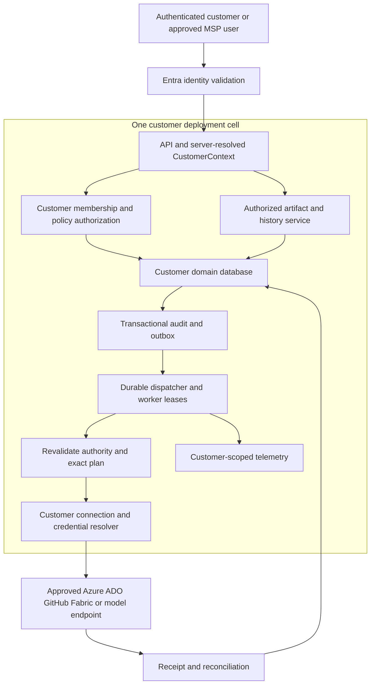

# Platform Studio foundations and customer isolation architecture

**26 October 2026 — current architecture snapshot:** dedicated customer cells now use additive SQLite schema 15, including restricted joint verification and separately approved adoption intent. Adoption/activation/hold release remain unavailable. The [application service audit and migration](platform-studio-application-service-architecture.md) now advances shared contracts, a typed read client and a web-independent worker executor while preserving the customer transaction and custody boundaries. F0–F2 remain open. The numbered increment notes below are historical context, not the current product version.

Revision 23 adds [destination AES/MAC proof authentication](../foundation-scoped-recovery-staging.md), [complete-scope human review](../foundation-scoped-recovery-review.md) and [scoped checkpoint custody through staging](../foundation-scoped-recovery-checkpoints.md). Separate schema-v9 review tables retain immutable history, one-use admission and restore quarantine. Later promotion/adoption must recheck current checkpoint and review authority together and coordinate database/credential activation; neither capability grants that authority today.

Revision 22 carries [source-v2 proofs through signed retained recovery](../foundation-scoped-recovery.md). One complete inventory accounts for current envelopes and original absence proofs; detached rehearsal authenticates retained AES/HMAC and advisory history keeps both kinds of key references. The next brick is authenticated destination proof propagation, followed by complete present-plus-absence scope authorization. Existing v1 stage/review/checkpoint boundaries remain closed to scoped artifacts.

Revision 21 adds [fresh source absence scope proofs](../foundation-absence-scope-provenance.md): proof creation precedes first pending publication, abandonment retains the original key-bound scope and retries reject retargeting. [Inspection](../foundation-absence-scope-inspection.md) authenticates every current absence before producing a redacted report. This source capability does not close retained recovery or human review eligibility; signed-set/stage proof propagation and full scope-union authorization remain open. No legacy root is migrated or repaired.

Revision 20 adds [local credential-set checkpoint custody](../foundation-credential-recovery-checkpoints.md) and [leased staging](../foundation-credential-checkpoint-staging.md). Exact namespace/signer/artifact pins, full retained-byte authentication, increasing source generations and head CAS supply a durable current accepted selection. A read lease retains it through staging. This trusted-owner boundary is separate from human scope approval and independent storage/key custody. Authenticated absence provenance, separately reviewed promotion/adoption and coordinated credential/database activation remain open.

Revision 19 adds [durable all-scope recovery review](../foundation-credential-recovery-review.md) and [held read-only verification](../foundation-credential-recovery-review-execution.md). Separate human approval, one-use admission, completion-time reauthorization and per-scope audit records form the next isolation brick. Schema v8 preserves frozen earlier migrations. Actual promotion/adoption, coordinated activation, independent key/latest custody and service-identity qualification remain open.

Revision 18 adds [fresh inactive credential recovery staging](../foundation-credential-recovery-staging.md) plus [completed-output verification](../foundation-credential-recovery-stage-verification.md). The exact reviewed plan binds source/customer/cell/namespace, destination path/owner commitment and key identity. Full profile commitments preserve expiry offsets and sub-millisecond precision as well as scope, kind, generation and enabled state. Stage-only rollback commitments preserve absent entries without adopting original paths or creating a live vault. Activation, independently protected latest authority, key/DPAPI recovery, durable customer authorization and service-identity qualification remain open.

Revision 17 adds explicit [signed credential recovery sets](../foundation-credential-recovery-set.md) and [retained-byte rehearsal](../foundation-credential-recovery-rehearsal.md). Capture and verification preserve the original namespace/cell boundary; rehearsal authenticates the selected encrypted bytes with existing source keys without adopting source directories or writing a destination vault. These local owner APIs supply neither latest authority nor permission to restore/import/retire keys. Independent storage, key/DPAPI recovery, reviewed restoration and service-identity qualification remain open.

[Commercial roadmap](platform-studio-commercial-release.md) · [Current implementation](../completion-status.md) · [Security](../security-and-rbac.md) · [Workflow standard](../agent-workflow-standard.md)

**Architecture with executable disconnected increments; production qualification remains open.** This is the foundation contract for the commercial roadmap. [Implemented scope and limits](../foundation-service.md) distinguish actual code from the remaining architecture. P0 establishes architecture/security contracts; P1 implements and proves them; P2 customer features depend on passed foundation gates. Existing desktop/session controls are preserved during extraction.

The local recovery boundary now includes an optional separately protected credential high-water authority. Fresh vaults must explicitly opt in; normal namespaces and caches are not migrated. Back up that authority independently of vault/key state, and keep interrupted writes pending until exact owner reconciliation. These checks do not establish malicious-owner resistance, production KMS custody or an immutable audit service. [Credential rollback contract](../foundation-credential-rollback.md). Owner command files and their immediate parents also require trusted write custody before any operation; public read-only input remains possible.

## 1 Customer boundary and initial topology

The schema-v6 maintenance bridge reuses validated human contexts, current scoped grants, separate exact approval and append-only audit. A retained credential-vault gate protects the exact target while SQLite commits one-use admission before the local write. Uncertain outcomes remain consumed; recovery rotates the database instance and quarantines unfinished requests. This is an explicit local revoke/rewrap composition, with no default model/HTTP executor, provider token revocation or transaction spanning SQLite and custody files. [Contract](../foundation-credential-maintenance.md) · [Evidence and restore limits](../foundation-credential-maintenance-evidence.md).

Schema v7 adds a separately reviewed [current-publication observation](../foundation-maintenance-observation.md) for an original `OutcomeUnknown`. Current requester/approver/recorder authority binds the current database instance and exact authenticated candidate while vault and optional independent authority guards remain held. The immutable observation receipt leaves the original execution unchanged. [Recovery](../foundation-maintenance-observation-evidence.md) quarantines unfinished reviews and retains historical evidence without touching credential files.

Revision 14 strengthens local operational custody before further recovery features: atomic fresh [activation authority](../foundation-cell-activation.md), credential-safe [software staging](../foundation-preview-installation.md), and read-only versioned [backup schema admission](../foundation-signed-backups.md). Existing namespaces and malformed snapshots cannot be adopted or repaired to make admission succeed. Independent checkpoint/key custody, supported service identities and production recovery/scale remain separate gates.

Revision 15's [recovery inventory](../foundation-credential-recovery-inventory.md) is pinned to one customer/cell vault namespace and authenticates current encrypted profiles under existing guards. [Advisory source-key holds](../foundation-credential-recovery-retention.md) combine current and explicitly retained inventory metadata without treating missing historical evidence as safe retirement. There is no credential export, managed independent checkpoint, deletion authority or production recovery guarantee. These local owner APIs do not become customer/model capabilities by appearing in documentation.

Revision 16 introduces a [local backup checkpoint authority](../foundation-backup-checkpoint-custody.md) whose immutable identity binds customer/cell, signer and protected custody. Its guarded monotonic history supplies the latest authority to [concrete verification/staged restore](../foundation-backup-checkpoint-recovery.md). The incoming packet cannot choose its own latest checkpoint on that path. The authority is a local cooperating-owner control, not an independently operated monotonic service or protection against rollback of its own root. Customer UI, real service identities and independent key/authority recovery remain gated.

Use an immutable internal **CustomerId** for the commercial/security boundary. It is distinct from an Entra directory tenant ID, user ID, subscription, email domain, project or license. Two customers can share one Entra directory; one MSP user can have separately approved membership in both. Each customer maps explicitly to approved workforce issuers, users/workloads, projects/environments and external connection scopes.

Start with **one customer per deployment cell**: its own application/worker configuration, database, artifact roots, credential/key namespace and telemetry boundary. Use distinct protected process/service identities or qualified container/host isolation; separate directory names alone are insufficient. An initial cell can run on customer-controlled non-Azure infrastructure. Keep CustomerId in application contracts even with dedicated deployment, so a later MSP/fleet layer cannot silently erase isolation. Shared multi-customer databases/control planes are deferred and require a new threat model and isolation qualification. Customer hosting and horizontal worker scaling do not require a microservice split.

Build a modular ASP.NET Core application with a durable domain store and workers. Modules own identity/access, catalog, requests/plans, jobs, audit, connections and artifacts behind explicit interfaces. The local implementation uses a dedicated SQLite database, hosted worker and [independent local worker](../foundation-independent-worker.md) under [ADR 0001](../adr/0001-foundation-dedicated-cell-sqlite.md). Actual local worker competition, crash/recovery and fixed load fixtures are qualified within their dated scope. SQL Server remains a production candidate; its adapter, migrations and supported x64 qualification are pending. This ARM64 development machine is not assumed to support native SQL Server. Production multi-host fencing, horizontal scale and supported capacity remain pending. No Azure database is needed for local development.

Microsoft describes dedicated versus shared tenant infrastructure as an isolation/cost/operations trade-off. The dedicated-cell choice here is a product decision, not a claim that physical separation alone enforces every application permission. [Tenancy models](https://learn.microsoft.com/en-us/azure/architecture/guide/multitenant/considerations/tenancy-models).

The diagram is the proposed logical boundary, not deployed infrastructure. AHP transports authorized typed interactions; it supplies neither customer membership nor durable execution. A model receives only approved customer-scoped evidence/tool results. It cannot select a customer, mint approval or acquire credentials.

## 2 Identity and authorization

Keep three independent permission planes:

1. **Platform Studio:** application roles plus customer/project/environment membership and operation policy.
2. **Entra administration:** app registration, consent and identity lifecycle, administered by the customer's authorized identity team.
3. **External services:** Azure RBAC, ADO pipeline rights, GitHub installation permissions, Fabric workspace/item rights and model entitlements.

An application CustomerAdmin or Approver grants no Entra administrator role or downstream Azure rights. A successful sign-in or catalog discovery grants no execution authority.

Use supported Microsoft identity middleware. Validate signature, allowed issuer/directory, audience, expiry and the expected role/scope/token type. Also authorize the calling application: validate `azp` for v2 or `appid` for v1 tokens against approved API/bridge/workload clients and the appropriate customer/cell service-principal assignment. A valid audience, client ID or role alone is insufficient. APIs validate their own access tokens; ID tokens are not API authorization. Identify a workforce principal by the validated `(tid, oid)` pair in the configured workforce directory; handle guest/MSP membership explicitly. App-only callers require tenant/subject/client/token-type checks on an explicit workload-identity path and cannot masquerade as human requesters or approvers. Do not authorize by email, UPN or display name. [Claims validation](https://learn.microsoft.com/en-us/entra/identity-platform/claims-validation).

Resolve an immutable **CustomerContext** server-side for every operation: CustomerId, CellId, authenticated principal, membership/grant version, project/environment scope and correlation. A route/header/body value requests a customer; it never proves membership. Verify that the requested customer matches the configured cell and the actor's grants before any data fetch. Revalidate at background dispatch; never accept model-supplied context. Customer switching creates a new authorized context and cannot change an in-flight request's ownership.

Use a small set of stable Entra app-role categories and separately stored scoped grants. Avoid an app role for every customer or resource. Delegated API scopes and app roles are distinct; service-principal assignments require an explicit application-permission policy. Keep allowlisted issuer/audience and token-freshness rules in customer-owned configuration. Define revocation/session-cache behavior, including external RBAC propagation delays; do not promise instantaneous cancellation of already dispatched effects. [App roles](https://learn.microsoft.com/en-us/entra/identity-platform/howto-add-app-roles-in-apps), [API scopes](https://learn.microsoft.com/en-us/entra/identity-platform/quickstart-configure-app-expose-web-apis).

The initial runtime should need OIDC sign-in and its explicitly exposed API scopes, not broad Graph permissions such as Directory.Read.All or Group.ReadWrite.All. Optional directory/group lookup is a separately reviewed connector permission, not a prerequisite for authorizing validated roles and stored membership. Initial customer-administrator enrollment uses a reviewed, server-owned bootstrap binding to an approved principal/group; no first-sign-in self-administration or email-domain auto-enrollment.

### Proposed human application roles

Every grant is scoped; these are product role names, not Azure RBAC or Entra directory administrator roles.

| Role | Permitted duties | Explicit limits |
|---|---|---|
| Viewer | Assigned catalog/status and redacted evidence. | No secrets, changes or other customers' data. |
| Requester | Create drafts, assessments and operation requests in assigned projects/environments. | Cannot approve privileged work merely because it was requested; no unapproved dispatch. |
| Approver | Approve/reject the exact immutable plan allowed by scope/risk policy. | Cannot edit approved contents, bypass downstream checks or approve their own privileged request. |
| Operator | Dispatch/cancel/reconcile permitted approved jobs. | Cannot rewrite approval, change credential bindings or blindly retry unknown effects. |
| CustomerAdmin | Manage customer membership, project configuration and approved connector references. | No raw credential retrieval, cross-customer access or implied Azure grant. Privileged membership/role changes have independent review/elevation policy. |
| Auditor | Read permitted audit records and redacted exports. | No history mutation or workflow execution; private prompts/telemetry require separately authorized access. |
| Cell/Platform Operator | Maintain runtime health, updates and infrastructure under a separate operations identity. | No default application/customer data or cloud execution grant. Trusted infrastructure administrators remain part of the threat model. |
| Support delegate | Explicit, purpose-bound, time-limited customer-approved support access. | No standing cross-customer access; support sessions/exports are audited. |

Requester/approver separation is mandatory for privileged effects. Lower-risk policy exceptions must be explicit/versioned; they are not a model decision. Membership changes, elevation and break-glass have reason, duration, approver and audit. A customer administrator's ability to administer their own installation is not cryptographically eliminated by application roles.

### Machine identities and least privilege

| Identity | Minimum intended capability | Boundary |
|---|---|---|
| Web/API runtime | Customer application reads/writes and request admission. | No standing Azure write or database schema administration. |
| Job worker | Claim assigned customer jobs, read necessary state and resolve approved connections. | No migration role, unrestricted secret-store enumeration or other customer queue. |
| Audit appender / exporter | Append defined events through a narrow database interface; export through a separately scoped identity if needed. | Application/runtime roles cannot edit/delete audit history through normal paths. |
| Database migrator | Approved schema migration for one cell. | Separate from runtime credentials; not used to serve requests. |
| Discovery connector | Operation-specific control-plane reads at approved scopes. | No data-plane secret access or blanket tenant-wide discovery grant. |
| Azure deployment principal | Customer/environment/pattern-specific workload identity federation and admitted resource operations. | Narrow resource scopes; no universal subscription Owner/Contributor profile. |
| Bootstrap/RBAC principal | Separately reviewed resource-group/bootstrap or constrained IAM assignment stage. | No standing role-assignment privilege in the ordinary runtime/deployer. |
| ADO integration | Read permitted runs/artifacts and queue named authorized pipelines when policy allows. | No general Project Administrator, pipeline editing or all-pipeline service-connection authorization. |
| GitHub/Fabric integration | Named repository/installation or workspace/item operations. | Separate customer connections; service-principal support verified per operation. |
| Model bridge | User-owned isolated runtime, or separately qualified customer service model. | No shared human ChatGPT/CLI cache or credential handoff to a model. |
| Release signer | Approved software signing/release duties. | No customer operational identity or deployment credentials. |

Maintain a **versioned permission manifest per adapter/operation**: identity mode, service/audience, Azure Actions/DataActions or service permissions, exact allowed scope, rationale, privileged bootstrap needs, approval policy and validation/revocation tests. Prefer scoped custom read roles when supported; a scoped Reader role may be appropriate for admitted inventory, but it is not an automatic product-wide requirement. Metadata can still be private.

Azure What-If must not be treated as a Reader-only operation: Microsoft documents deployment-equivalent resource/deployment permission requirements. Exact permissions depend on the admitted pattern and scope. Separate subscription-level group creation and constrained role-assignment provisioning from ordinary application delivery. Prefer managed identity when hosted appropriately, or supported workload identity federation; authorize ADO connections to specific pipelines. Do not copy obsolete issuer/subject examples into new deployments. [Azure RBAC](https://learn.microsoft.com/en-us/azure/role-based-access-control/best-practices), [What-If permissions](https://learn.microsoft.com/en-us/azure/azure-resource-manager/bicep/deploy-what-if), [constrained IAM delegation](https://learn.microsoft.com/en-us/azure/role-based-access-control/delegate-role-assignments-overview), [ADO federation](https://learn.microsoft.com/en-us/azure/devops/pipelines/release/configure-workload-identity?view=azure-devops).

## 3 Isolation across the complete data path

| Surface | Required boundary |
|---|---|
| API and domain commands | Mandatory authorized CustomerContext; project/environment checks; cross-customer object references rejected before reads or dispatch. |
| SQL records and relationships | CustomerId on ownership-bearing rows; composite foreign keys/uniqueness enforce same-customer references. Repository interfaces require context; no unscoped default queries. Separate customer databases initially. |
| Shared-storage future | Row-level security and scoped identities are defense in depth, not substitutes for API/worker checks. Test pooled connection/session-context reset before allowing shared SQL. Shared storage is not part of the first release. |
| Artifacts, downloads and exports | Customer-owned roots/objects, server-side authorization and protected indirect handles; paths/IDs alone are not authority. Expiring links bind customer/purpose; archive extraction prevents traversal and links. |
| Caches and search/vector data | Keys include cell/customer/scope/version; eviction and invalidation are isolated. Future search/embedding indexes require partitions and access checks. No cross-customer prompt/evidence cache reuse. |
| Jobs/outbox/inbox | Immutable customer/cell binding and context references validated at admission, claim, dispatch and completion. Deduplication keys include customer and operation. |
| Connections and secrets | Customer-owned connection registry with approved external tenant/subscription/project/repository/workspace, identity mode and generation. Store protected references, not tokens in payloads. Key protection/rotation and credential resolution stay within the cell. |
| MCP/Codex/agent state | Dedicated process homes, sessions, tool catalogs, context and result storage by customer and principal/approved workload identity. Preserve existing scope/effect/approval/redaction rules; no inherited/shared desktop caches. |
| Telemetry/Aspire | Server-assigned customer/cell metadata, protected collection/query scope, redaction and retention. PrivateRead remains private. A shared collector with UI-side filtering is not an isolation boundary; use separate collection/access boundaries initially. |
| Audit/support/billing metadata | Customer-authorized access and exports; do not send raw prompts, token values or customer payloads in global health/support logs. Operational health can use minimal non-content aggregates. |
| Backups, restoration and deletion | Same customer ownership/key policy; restore into an isolated disabled cell, verify binding before use. Restored approvals and credentials are quarantined/revalidated, never automatically replayed. |

Use separate customer data-protection/credential namespaces and protect key material according to the chosen hosting platform. Encryption protects defined at-rest/transit threats; it does not negate privileged infrastructure administrators with access to data and keys. SSRF/path protections and the external endpoint allowlist must prevent a connection or model-provided URL from escaping the approved service/customer scope. Customer-provided metadata remains untrusted input.

## 4 Durable domain model and reliable execution

The proposed durable model contains Customer, WorkforceDirectory, Principal, Membership/RoleGrant, Project, Environment, Connection/Generation, WorkflowVersion, Request/PlanRevision, Approval, Job/ExecutionAttempt, Outbox/Inbox, EvidenceSnapshot, Artifact, AuditEvent and Usage/Quota. Required customer/cell ownership must survive serialization, imports, migrations and restoration. Keep data classification, source revision, timestamps and schema versions with evidence/artifacts. Use optimistic concurrency for mutable drafts/configuration; immutable approved plans are replaced by new revisions, not edited in place.

Define the job protocol before implementing schedules or new workflows:

1. Validate actor, customer, policy, input and required evidence. Generate customer-scoped request/idempotency keys; a repeated key with different content is rejected.
2. Atomically commit request/plan reference, initial audit event and durable job/outbox entry in the domain database. Do not report accepted work that has no durable record.
3. Deliver outbox notifications with bounded retries. Consumers use an inbox/deduplication record; notification delivery is not itself execution completion.
4. Claim jobs atomically with customer/cell identity, a lease and fencing generation; use database-consistent time and explicit deadlines.
5. Before each external effect, revalidate current membership/delegation, policy, connection generation, source/catalog/plan digest and approval expiry/separation. Persisting authority does not renew it. Resolving a credential happens only after these checks.
6. Record dispatch intent, actor/approver/executor and operation correlation durably. Job payloads carry credential references, never bearer tokens or CLI auth files.
7. Perform only the typed admitted operation. Apply provider idempotency controls where they exist; keep bounded timeouts and result classification.
8. Store the receipt and corresponding audit/outbox records transactionally for local state. Late/stale workers cannot overwrite a newer attempt's state.
9. If an effect may have occurred without a trustworthy receipt, set Outcome unknown/Reconciliation required. Do not automatically replay a changing operation merely because its lease expired. External APIs may not honor a fencing token; an expired worker can still have an in-flight effect.
10. Reconciliation uses qualified read-back/provider correlation or an explicitly reviewed manual decision. It preserves uncertainty and may require a fresh plan/approval. Cancellation distinguishes Not dispatched from Effect may have occurred.

Use per-operation retry/backoff/jitter limits, dead-letter/reconciliation queues and customer-visible progress. Read retries are bounded; changing retries need an operation-specific contract. No exactly-once external-effect claim is made. Microsoft documents the limits of duplicate delivery and the need for idempotent consumers. [Idempotent consumer](https://learn.microsoft.com/en-us/azure/architecture/patterns/idempotent-consumer).

Browser closure does not erase a durable job. Customer offboarding, principal revocation or policy changes block subsequent dispatch. An already dispatched effect requires reconciliation; revocation is not a rollback guarantee. Unattended jobs require an approved workload identity and explicit customer policy, not a silently inherited user/browser refresh session.

## 5 Audit, history and operational foundations

Persist audit events for identity/authorization decisions, customer/context switches, membership/policy/connection changes, requests and plan revisions, approvals/rejections, dispatch, retries, cancellation, denied effects, reconciliation, evidence exports, lifecycle actions and support access. A customer event includes EventId, CustomerId/CellId, project/environment, authenticated actor, initiator/approver/executing identity where applicable, action/target, UTC time, correlation/causation, source/plan/evidence digests, policy/connection versions, outcome and bounded reason code.

Pre-context authentication/authorization failures go to a separate minimal cell/platform security stream. Do not treat a forged requested customer ID as an authenticated customer label or expose another customer's existence. Record tokens/credentials/raw sensitive bodies nowhere in ordinary audit. Protect private content behind separate classification and authorization.

State-changing intent and audit/outbox should commit atomically in the same cell database through a restricted append/transaction interface, not by calling an asynchronous remote audit service. A secondary audit sink can consume the outbox with its own scoped exporter identity. Failures to durably record required intent fail closed before dispatch. If receipt storage fails after an external effect, recover from the pre-dispatch intent as potentially completed/unknown and reconcile; do not claim a complete trail was persisted during a storage outage. Audit history has append-only product interfaces and restricted database roles. Retention/hold/export and administrator trust are explicit. Hash chaining/signatures can detect defined tampering; independently immutable storage/checkpointing is a separate later production option, not guaranteed by a local JSON file or database table.

P1 operating foundations also include versioned configuration/schema migration, health/readiness, customer-scoped metrics, queue age, attempt/lease failures, denied actions, audit persistence failures, backpressure, bounded artifact retention and per-customer concurrency/storage/model-usage budgets. Set measured load/SLO targets and hardware in PS-07; F2 must prove them. License entitlements, feature flags and cloud authority are separate checks: an enabled/paid feature never grants membership or execution rights.

Scale stateless API instances only after session/key/configuration and concurrency behavior are qualified; scale workers through safe claims/leases and customer limits. Prove one slow/failing customer cell cannot consume another cell's executor, credential namespace or data. Database migrations, progressive update/rollback of application versions and backup/restore must be rehearsed locally before fleet growth. Do not introduce Kubernetes, a general workflow designer or microservices merely to label the architecture scalable.

## 6 Customer lifecycle

Onboarding creates a cell/customer binding, initial administrator through a reviewed bootstrap procedure, approved directory/membership mappings and no external connection by default. Adding a connection verifies customer ownership, exact service scope and identity mode before admitting operations. Membership/elevation changes require independent policy/audit.

Suspend/offboard disables new admission and dispatch, handles in-flight/unknown work explicitly, revokes customer-issued access where authorized, and provides customer-scoped export and retention/deletion choices. License expiry is not offboarding authority: it must not delete cloud resources, erase audit or strand safe administration. Restoring a cell validates CustomerId, key ownership, connection generations, job state and approvals before any connector can run.

An eventual MSP/fleet console should initially aggregate explicitly authorized metadata and route to dedicated cells. It must not become a universal execution credential or implicit support access. Pooled SaaS hosting, cross-customer search and pooled executors require separate ADRs and new isolation tests.

## 7 Foundation gates and proof before feature delivery

**F0 Architecture contract** is design approval under PS-01/PS-03/PS-19/PS-07: customer model, topology, roles, identity modes, permission manifests, data/worker/audit interfaces, threat model and measured acceptance targets have owners.

**F1 Identity, isolation, durable state and audit** requires implemented PS-08/PS-09/PS-20 plus contract enforcement from PS-19. A customer-scoped request can be authorized, stored and audited; denied requests cannot access data or adapters. Local test identity is not live Entra acceptance.

**F2 Reliable and scalable foundation** adds PS-10/PS-13/PS-21/PS-22 and the PS-02 release evidence profile. One existing workflow traverses identity → customer-scoped intent → audit/outbox → worker → fake connector → receipt/reconciliation without a real provider. Fault, isolation, restoration and measured capacity checks pass. This gate, not a design document alone, admits P2 feature work and customer-capable previews.

Required disconnected fixtures include two customers A/B **with the same Entra directory ID**, overlapping resource/local names and separate cells; users limited to A/B plus an explicitly approved MSP user belonging to both. Use only local test tokens, fake services and network-denied native probes.

| Proof | Required result |
|---|---|
| Missing/forged context, wrong issuer/audience/client, expired token, role without membership, wrong-customer service principal, app-only token on human route | Denied before data access/external adapter; appropriately scoped security event. |
| Cross-customer API IDs, SQL joins, artifact handles, exports and cache keys | No data/existence leakage; correct boundary survives overlapping IDs and crafted relationships. |
| MSP switches customer during an active request | Original request/context cannot change; new context independently authorized and audited. |
| Wrong-customer job/outbox/inbox, credential reference, provider result or model thread | Rejected; no secret resolution or provider dispatch for the wrong customer. |
| Actor/approver revoked after enqueue, policy/connection/source digest changes | Future dispatch blocked or requires fresh approval; no authority restored merely from history. |
| Duplicate messages, same idempotency key with changed content, stale lease/worker and process loss around dispatch | No automatic duplicate changing action; uncertain effects remain visible until reconciliation. |
| Audit/store outage, archive tamper, customer suspension, backup restore or wrong key namespace | Fail closed where dispatch is unsafe; scoped recovery/export; no automatic approval/job replay. |
| Telemetry/private-read/support export contains another customer's record | Withheld/rejected; no client-side filtering accepted as the security boundary. |
| Customer overload, queue flood, oversized prompts/artifacts and worker failure | Enforced quotas/backpressure; recorded capacity target met; no cross-customer executor or storage escape. |

Every P2 feature specification must identify CustomerContext, human roles, machine identity/permission manifest, evidence/secret classification, immutable plan rules, job/retry/reconciliation behavior, audit/retention, quotas, entitlements/flags and cross-customer tests. Feature code cannot establish its own bypass identity, shared cache or ad hoc background loop.

## Implementation boundary

Use the commercial plan's work packets and gate evidence as the implementation sequence. [The dedicated service](../foundation-service.md) reuses the application Bicep/AVM emitter, MCP bridge and isolated Codex adapter through signed HTTP/AHP, with rotating identity keys, reviewed access/configuration, technical entitlements, additive SQLite schema-15 migrations, encrypted credentials, audit, exports, independent workers and admission controls. Optional pinned loopback HTTPS and separately protected activation leases extend local hosting/recovery. [Current packet status](platform-studio-commercial-release.md#4-p0-architecture-and-baseline-work-packets) records local qualification and remaining requirements. The [service architecture](platform-studio-application-service-architecture.md) defines the application extraction sequence without changing infrastructure or pipeline contracts.

Existing browser workflows still use their session boundary; their complete customer-UI/workflow migration remains open. Typed least-privilege manifests are proposals only. Local identity/credential/model/agent/lifecycle/storage controls are implemented; actual tenant/model/provider consent and permissions, production TLS/OS/disk/encryption/backup/signer custody, cross-architecture packaging, full export/retention and measured recovery/scale acceptance remain open. No real identity registration, cloud role assignment, service connection or Azure resource was created. All Azure targets remain disabled, and local tests do not complete F0–F2 or authorize P2 expansion.
