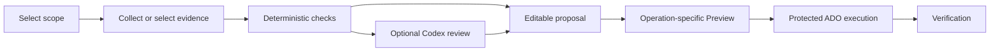

# Portal UI review and improvement plan

[Wiki home](../README.md) · [Portal setup](../local-portal.md) · [Workflow standard](../agent-workflow-standard.md)

**Reviewed 5 October 2026. Status: review completed; redesign proposed, not implemented.** The actual ARM64 Release application was rebuilt and launched on `http://localhost:5099/`. The primary app on port 5087 and its authentication were left running. This review used disconnected screens and synthetic form input; it did not invoke Azure discovery, ADO pipelines, Codex inference or deployments.

**24 October 2026 sequencing note, revision 2:** the [foundation-first commercial roadmap](platform-studio-commercial-release.md) reuses U1–U5 after customer identity/isolation, durable data/audit and reliable execution pass F2. A narrow existing draft-loss repair may proceed as maintenance; it cannot qualify a customer release or bypass the gate. This review's historical claim that a credential-preserving restart is unimplemented is superseded by [the implemented 17 October protected restart handoff](../portal-fresh-restart.md). The remaining UX findings retain their original evidence and proposed status.

The platform exposes substantial capabilities and useful evidence boundaries. Its main usability problem is continuity: developers must navigate independent tools and translate scopes, connection requirements and run IDs between them. Improve that journey before adding more top-level forms.

**24 October maintenance update:** naming intent, salt and instance UUID now survive workload redraws and operation changes in memory, with separate bounded drafts per workload/target/environment/region. A server-generated opaque identity marker and disconnect clear all drafts; starting a new draft explicitly creates a new UUID. Old async results cannot populate a redrawn scope. Registered preview-instance selection also survives ordinary redraws. No private draft input is written to browser storage. Four deterministic DOM/state tests and an isolated browser fixture verify these cases without provider calls. This closes the narrow naming-reset finding; the broader U1–U5 redesign remains gated by F2.

## Rebuild and authentication

A new backend build requires a process restart to become active on the primary port. For this review, isolated build output and a separate process avoided disrupting current sessions. Port-specific session cookies prevent the review browser from overwriting the primary portal cookie. The review instance is not a replacement for connected acceptance on the primary instance.

| Connection | After a normal primary stop/start |
|---|---|
| Azure | Reconnect. Portal sessions are in memory; the governed stop script clears portal-owned Azure CLI session state. Browser single sign-on may shorten the flow. |
| Azure DevOps | Reconnect the separate ADO audience/session; an Azure connection alone does not establish ADO access. |
| Codex | Reconnect the portal-owned Codex session. The governed stop script cleans up its owned processes and auth files. Desktop Codex authentication is separate. |
| GitHub | Use **Use existing GitHub CLI login** when available. CLI credentials persist across portal restarts; a fresh browser login is not always necessary. |

Visual review and local naming calculation do not require these sign-ins. A connected test requires only the providers used by that action; Codex remains optional for deterministic analysis. Authentication must never start a discovery, model turn or pipeline automatically. An auth-preserving primary restart handoff is not implemented.

## Observed findings

Priority P1 means fix before relying on the affected journey; P2 means a substantial usability improvement. These are UX findings, not evidence of an authorization bypass.

| Priority | Observation in the rebuilt app | Impact and proposed response |
|---|---|---|
| P1 | Switching the workload Action from Preview to Discover clears an entered stack display name and replaces the generated instance UUID. | Preserve user intent and identity across navigation. Invalidate calculated results when inputs change; do not silently create a different stack identity. |
| P2 | The global badge says **Not connected**, while Microsoft/GitHub controls are under Connections and Codex controls are under Agent workflows. | Present four explicit provider states in a shared connection panel and show the exact missing provider next to each blocked action. |
| P2 | Configure workload displays local naming drafts, conceptual topology, pipeline options and saved-run loaders together. | Guide one task at a time. Distinguish local calculation from source registration and a real Azure Preview; make the next available action explicit. |
| P2 | The Preview instance picker offers only existing target naming when no source-registered instances exist. | Explain the empty state and link to draft/source registration guidance. A calculated draft must not appear deployable. |
| P2 | UUID, subscription GUID and collision salt occupy primary form space. | Resolve scope through readable selectors; show stable identity read-only by default and put exceptional overrides under Advanced. |
| P2 | Saved Preview/After/tag evidence requires manual run IDs; Pipeline activity covers only runs submitted in the current browser session. | Add an authorized run/evidence picker with scope, phase, status, branch/revision and age. Retain manual IDs as an advanced fallback. |
| P2 | Network discovery displays unconfigured AVNM allocation controls immediately below discovery. | Make allocation a contextual, separately governed next step after evidence qualification. Keep analysis useful without allocation setup. |
| P2 | Disconnected pages use inconsistent affordances: some action buttons are disabled, while network/tag controls appear available. | Standardize prerequisite explanations and disabled/ready/busy/failed states. Backend authorization remains authoritative. No cloud button was invoked in this review. |
| P2 | Workload cards contain long infrastructure descriptions, especially the data platform. | Lead with purpose and included resources; expand dependencies, implementation detail and cost assumptions on demand. |

### Reproducing the draft-loss bug

1. Choose **Blob copy → Configure workload**.
2. Select **Preview changes** and enter a synthetic stack display name.
3. Change Action to **Discover**.
4. Observe that the display name is blank and the instance UUID has changed.

The browser reproduction agrees with source: `selectionChanged()` calls `drawProposal()` in `wwwroot/app.js`, which calls `renderNamingEditor()` in `wwwroot/naming.mjs`. The renderer replaces its children, initializes empty fields and calls `crypto.randomUUID()` each time. Environment/region changes share this rendering path. This review records the defect; it does not claim a fix.

## Proposed experience

Reuse the [platform workflow builder](../../.agents/skills/platform-workflow-builder/SKILL.md) and existing typed adapters. This is a presentation and state-management improvement, not a replacement for AHP, scoped MCP evidence, deterministic rules or protected ADO execution.

Analysis-only workflows end at their result. Missing onboarding must remain visible; the interface must not imply every workflow has an executable Apply path.

Proposed navigation:

| Area | Contents |
|---|---|
| Workloads | Product choice, configuration, included resources, naming and Preview journey. |
| Discover & analyze | Network, private DNS, tags, drift and imported evidence; domain-specific visuals within a common workflow shell. |
| Runs & evidence | Authorized run history, saved artifacts, before/Preview/verified-after comparisons and contextual recovery information. |
| Platform setup | ADO registration, target readiness and privileged configuration. |
| Connections | Global panel for Azure, ADO, GitHub and Codex, including task-specific prerequisites. |

Keep Skills library and standalone Agent workflows available as advanced tools. Offer **Review with Codex** directly from relevant evidence instead of requiring users to reconstruct the scope on another page.

The main workspace should show the current step and one clear primary action. A context panel should summarize workload, environment, subscription, region, stack identity, readiness and costs with their assumptions. On narrow screens, collapse that panel into an accessible summary. Advanced identifiers and platform settings should be progressively disclosed.

Separate result views must say **Observed**, **Calculated proposal**, **Azure What-If**, or **Verified after**, with collection time, scope and coverage. Agent interpretation must remain explicitly advisory. Do not merge calculated names into old observations or saved What-If artifacts. Fresh runs create fresh evidence; historical receipts remain immutable.

## State and API boundaries

Keep user-authored intent, calculated outputs, observed evidence, agent advice and reviewed execution requests as distinct state objects. Preserve the draft per workload within the browser session. Generate an instance UUID once, and replace it only through an explicit new/reset action. A scope change must invalidate dependent calculations and approvals while preserving compatible input and explaining conflicts.

Use existing typed APIs rather than constructing Azure/ADO calls in UI components. Bind evidence to its scope, run and digest. Reject late asynchronous results after a selection changes. Never persist access tokens, CSRF values or approval tickets in browser local storage. Durable draft/history storage is a separate design decision requiring session isolation and retention rules.

## Implementation phases and acceptance

| Phase | Delivery | Required acceptance |
|---|---|---|
| U1 — continuity | Draft state separated from rendering; stable UUID; consistent prerequisite prompts; visible app/build/port context. | Switching actions and navigating away/back preserves inputs and identity. Scope edits invalidate results and queue approvals. Reset explicitly creates a new draft. Out-of-order requests cannot show stale results. |
| U2 — guided configuration | Shared workflow shell, context summary, progressive disclosure and clear empty states. | A developer can select a product, understand its resources, calculate names and identify the next required step without entering internal IDs unnecessarily. All nine workloads retain their specific gates. |
| U3 — evidence handoff | Authorized run picker, phase/provenance badges and contextual before/Preview/after views. | Wrong-scope, stale, partial, failed and inaccessible artifacts remain distinct. Existing saved receipts are unchanged. Selecting a run never queues another run. |
| U4 — consistent analysis | Apply the shell to network, DNS/drift and tags; contextual optional Codex review and recovery details. | Deterministic analysis works without Codex. Model execution is explicit and receives only the selected frozen evidence through the existing AHP/MCP path. No advisory result becomes an execution approval. |
| U5 — acceptance | Keyboard and screen-reader review, narrow/wide layouts, connection loss/cancellation and connected read-only acceptance. | Cover empty subscriptions, denied/partial evidence, expired auth and unknown outcomes. Build the actual app and test it in a browser. Do not treat mocked adapters as Azure/ADO acceptance. Deployment is outside this review scope. |

Prioritize U1 before a visual redesign: the draft-loss issue can change resource identity. Implement subsequent phases incrementally behind the existing operation-specific validation and request gates.

## Verification record

- Actual Release build: `dotnet build src/SelfService.Portal/SelfService.Portal.csproj -c Release --artifacts-path artifacts/ui-review-20261005/build`; **zero warnings and zero errors**.
- Rebuilt ARM64 app started on port 5099 with explicit repository/content roots. Bootstrap reported **nine products**. Process receipt and logs are under ignored `artifacts/ui-review-20261005/`.
- Browser review: workload catalog, Blob copy configuration and Discover/Preview switching, Connections, Network discovery, Agent workflows, Pipeline activity and Tag governance. Normal in-app browser viewport; no full accessibility or cross-device certification.
- Source checked for lifecycle/auth and the draft renderer. Primary port 5087 remained running; no primary restart or sign-in was performed.
- No Azure/ADO/model requests, new saved discovery/What-If results, deployment, target enablement or distribution package publication. No full regression suite rerun is claimed for this documentation increment.

The separate review process is temporary. Its existence does not mean the primary backend or a distributable package has been upgraded. A future primary activation should use the governed lifecycle scripts and explicitly account for reconnecting portal sessions.
