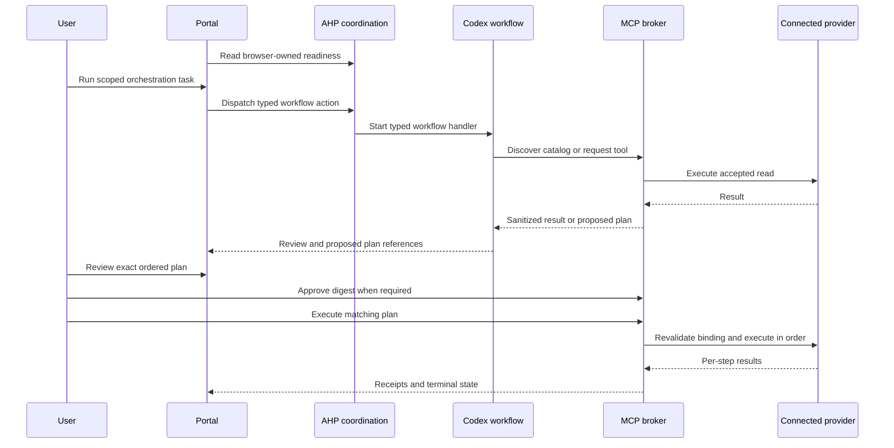

# Connected MCP providers and orchestration

[Wiki home](README.md) · [Agent workflows](agent-workflows.md) · [Local portal](local-portal.md) · [Security and RBAC](security-and-rbac.md)

Platform Studio has a browser-session MCP provider broker for Azure Bicep, Microsoft Azure, Azure DevOps, GitHub and Microsoft Learn. It discovers each server's complete tool catalog and exposes those tools to the explicit **MCP orchestration** agent workflow. Existing scoped review workflows retain their frozen evidence and skill tools.

Implementation and offline verification are separate from live acceptance. Installing a server does not prove its current catalog, service permissions or a successful authenticated call. Complete the acceptance steps below with the intended account before treating a provider as ready for a real workflow. Connecting providers does not run model inference, queue pipelines or deploy resources.

**17 October 2026 acceptance snapshot:** all five providers are connected on the final rebuilt host, with **657 discovered tools**: Bicep 0.48.1 **14**, Azure MCP 3.0.0 **504**, ADO MCP 2.10.0 **40 supported business tools across nine domains**, GitHub **96** and Microsoft Learn **three**. The user completed Microsoft sign-in on this host, the ADO audience was attached, and Bicep was rediscovered to attach the isolated Azure CLI cache. GitHub requests the full toolsets; the experimental ADO `mcp_apps_ping` transport helper is excluded from the application's business-tool surface. Browser-owned attachment still requires renewal after a restart. Public-only model orchestration, the GitHub identity read and the human-approved bounded Azure/ADO read plan all passed as recorded below. Mutation/admin rights, protected deployments and the nine existing scoped reviews/drafts remain separately unqualified.

## Installation and connections

From the `Bicep` repository root, use the existing [portal lifecycle commands](local-portal.md) to stop the portal before rebuilding. Install the additional provider dependencies with:

```powershell
./scripts/Setup-McpProviders.ps1
./scripts/Setup-McpProviders.ps1 -VerifyOnly
```

The setup script uses checkout-local tools and caches. It does not start sign-in or alter global npm/.NET tool installations. Node.js 22 or later and .NET are required. Rebuild and start the updated portal using its existing lifecycle scripts.

| Provider | Launch and catalog | Identity supplied by the application |
|---|---|---|
| Azure Bicep | Pinned `Azure.Bicep.McpServer` 0.48.1 under `.tools/mcp/bicep`; configurable `Portal.BicepMcpPath` | Local source operations use repository paths. Resource-backed operations also need the configured Azure identity. |
| Microsoft Azure | Pinned `@azure/mcp` 3.0.0, started with `server start --mode all` | The connected browser's isolated Azure CLI cache. Use **Local authentication — Azure CLI** in Connections. |
| Azure DevOps | Pinned `@azure-devops/mcp` 2.10.0, local stdio process | ADO access token from the connected Microsoft identity, passed through the provider's dedicated environment variable. |
| GitHub | Streamable HTTP at `https://api.githubcopilot.com/mcp/`, requesting all toolsets | Token resolved from the verified, attached GitHub CLI identity. The separate Codex desktop GitHub connector is not this application's credential. |
| Microsoft Learn | Streamable HTTP at `https://learn.microsoft.com/api/mcp` | Public documentation access; no Microsoft account token is attached. |

The provider catalog is the live server's `tools/list` result. Tool counts can vary with a server release, a feature's availability or the account's granted access. A local catalog entry does not grant the service permission needed to execute it. The pipeline IaC collector retains its independently pinned Azure MCP version and its service-connection boundary; these interactive providers do not replace it.

1. Open **Connections**. Connect Azure through local CLI authentication, then connect Azure DevOps as needed. For GitHub, sign in or attach an existing verified CLI account.
2. In **MCP tool servers**, choose **Connect provider** for each server. A connected provider displays its actual discovered tool count. Missing executables, sign-in failures and connection failures remain visible.
3. Expand **Browse every discovered tool** to inspect names, descriptions, effect classification and input schemas. Search by provider or tool. **Rediscover full catalog** creates a new connection and invalidates plans bound to the previous connection/catalog.
4. Complete account consent or role assignments through the service's normal administration process when a call is denied. The broker does not elevate roles, create service principals or replace ADO protected approvals.

New GitHub CLI browser sign-in requests the additional `workflow` scope alongside the CLI's default scopes, enabling workflow-file authoring where the account/repository grants permit it. Attaching an existing CLI login does not silently broaden that token's scopes. Organization administration and other privileged features still require their own account grants and organization policies; requesting all MCP toolsets does not grant those rights.

Credentials are obtained by the host. Never enter a password, token or connection string in a task description or tool argument. Recognized credential-bearing field names and duplicate argument keys are rejected by the broker. Provider processes receive explicit environments, and provider HTTP authentication stays in the host transport. Connection credentials are excluded from model context and connection diagnostics. Azure's vendor `_meta.SecretHint` is preserved independently of tool names: sensitive calls require approval and their output is withheld, including sensitive steps within a mixed plan. JSON wrapped in MCP `content[].text` is inspected recursively for redaction; credential-shaped plain text is withheld. Other results use bounded pattern-based redaction and can still contain private metadata.

## Guidance files and updates

The complete project guidance lives under `.agents/skills/platform-mcp-orchestration/`. Five nested provider pairs contain compact `SKILL.md` routing and provider-specific lowercase `instruction.md` decisions. Shared instructions cover the broker tools, scope, authorization, concrete ordered plans and recovery; provider files add service-specific choices instead of duplicating those rules.

| File or bundle | Purpose |
|---|---|
| [Generated top-level SKILL.md](../.agents/skills/platform-mcp-orchestration/SKILL.md) | Self-contained runtime instructions with all normative provider guidance and examples embedded. Edit its indexed sources and regenerate it. |
| [Common instruction.md](../.agents/skills/platform-mcp-orchestration/instruction.md) | Shared orchestration and authorization contract. |
| Bicep [SKILL.md](../.agents/skills/platform-mcp-orchestration/providers/bicep/SKILL.md) / [instruction.md](../.agents/skills/platform-mcp-orchestration/providers/bicep/instruction.md) | Schema/module selection, source transformation, Azure snapshots and dependency boundaries. |
| Azure [SKILL.md](../.agents/skills/platform-mcp-orchestration/providers/azure/SKILL.md) / [instruction.md](../.agents/skills/platform-mcp-orchestration/providers/azure/instruction.md) | Service families, isolated CLI scopes, effect classification and sensitive output. |
| ADO [SKILL.md](../.agents/skills/platform-mcp-orchestration/providers/ado/SKILL.md) / [instruction.md](../.agents/skills/platform-mcp-orchestration/providers/ado/instruction.md) | Nine business domains, consolidated schemas and conservative approval of unannotated reads. |
| GitHub [SKILL.md](../.agents/skills/platform-mcp-orchestration/providers/github/SKILL.md) / [instruction.md](../.agents/skills/platform-mcp-orchestration/providers/github/instruction.md) | Repository/ref selection, workflow grants, collaboration, Actions and security operations. |
| Learn [SKILL.md](../.agents/skills/platform-mcp-orchestration/providers/learn/SKILL.md) / [instruction.md](../.agents/skills/platform-mcp-orchestration/providers/learn/instruction.md) | Focused documentation/sample research, version checks and citations. |
| [guidance.json](../.agents/skills/platform-mcp-orchestration/guidance.json) / [guidance.lock.json](../.agents/skills/platform-mcp-orchestration/guidance.lock.json) | Explicit index of 16 normative sources, source/output hashes and the generated bundle identity. |
| [Workflow recipes](../.agents/skills/platform-mcp-orchestration/references/workflows.md) / [provenance](../.agents/skills/platform-mcp-orchestration/references/provenance.md) | Cross-provider patterns and pinned official source/package references. |
| [Public read](../.agents/skills/platform-mcp-orchestration/assets/public-read.plan.json), [scoped read](../.agents/skills/platform-mcp-orchestration/assets/scoped-read.plan.json), [branch proposal](../.agents/skills/platform-mcp-orchestration/assets/github-branch-change.plan.json) | Concrete JSON examples; replace illustrative scope and discover live schemas before proposing execution. |
| [OpenAI metadata](../.agents/skills/platform-mcp-orchestration/agents/openai.yaml) | Authoring/discovery display metadata, hashed as a bundle resource; it grants no runtime tools or service permissions. |

After editing guidance sources, run from the repository root:

```powershell
./scripts/Update-McpGuidance.ps1
./scripts/Update-McpGuidance.ps1 -Check
node ./scripts/mcp/verify-skill-sources.mjs
```

The [compiler](../scripts/mcp/update-guidance.mjs) validates indexed paths and content, embeds the 16 sources, rewrites internal reference links and emits the generated skill and lock. The portal reads the selected top-level `SKILL.md` from disk for each run, freezes it into `platform_skill`, copies it into the isolated Codex home and records its `skillHash`. Therefore a regenerated guidance-only update is consumed by the next workflow without restarting the portal or losing sign-in. Editing a companion file without regeneration leaves the runtime bundle stale; the check rejects that state. Existing receipts retain their original skill hash. The new [AVM research acceptance](avm-end-to-end-validation.md) used this expanded bundle and checked its generated output hash; earlier acceptances below retain their recorded scopes and hashes.

The application catalog remains **53 entrypoints: 42 Azure and eleven project skills**. Nested provider pairs do not add independent catalog workflows. Full official authoring packages now preserve **52 skills** separately: the [existing 42 Azure definitions](../vendor/azure-skills/bundle.json), [seven ADO skills](../vendor/azure-devops-skills/bundle.json) and [three Learn skills](../vendor/microsoft-learn-skills/bundle.json). Their supporting files, licenses/notices, source pins and hashes remain packaged. They are authoring references, rather than automatically loaded runtime instructions, installed plugins, executable grants or additional application catalog entries. The [source verifier](../scripts/mcp/verify-skill-sources.mjs) checks the new ADO/Learn packages against their pinned file bytes, SHA-256, Git blobs and inventories. Portal publication checks the generated guidance and these packages before copying `.agents/`, `vendor/` and documentation.

## Agent and AHP orchestration

The AHP root and session snapshots advertise provider readiness alongside the existing agent state. The session's top-level `customizations` contains one `type: "mcpServer"` record per provider, including its connection metadata, catalog digest/count and connection state. Delegated sign-in remains in the portal's browser-owned **Connections** controls; this is not generic OAuth forwarding or full MCP App channel conformance.

The bounded `workflow-orchestration` profile is based on AHP 0.9.0. Session-bound `dispatchAction` supports `platform/workflowRun`, `platform/mcpConnect`, `platform/mcpDisconnect`, `platform/mcpPlan` and `platform/mcpRun`, reusing the same typed application handlers and browser/session checks. The UI starts a selected workflow through typed AHP dispatch when the channel is available; it uses HTTP only when AHP was unavailable before dispatch. A failed or timed-out dispatch is not automatically replayed over HTTP. Approval remains exclusively at the separate `POST /api/mcp/plans/{id}/approve` HTTP route. General AHP host conformance, arbitrary chat dispatch, continuous multi-client replay and a generic MCP side-channel are not claimed. The runtime's model/effort/speed policy is unchanged.

Choose **MCP orchestration** in **Agent workflows**, describe the intended task and scope, and run it explicitly. The tenth typed workflow uses the project skill `platform-mcp-orchestration` and adds four host-mediated tools alongside its two evidence/skill tools:

- `platform_mcp_catalog`: page/search the connected provider catalogs.
- `platform_mcp_call`: request a discovered tool call. Accepted reads can execute; changing, sensitive or unclassified calls produce a plan awaiting human approval.
- `platform_mcp_plan`: prepare a sequence of ordered calls for review.
- `platform_mcp_run`: execute an existing exact plan only when ready or already approved by the human; attempted changes cannot be replayed.

The model never receives the Azure, ADO or GitHub bearer credentials, and cannot approve its own plan. Agent-created plans appear under **Plans prepared in this session** after the run; use **Refresh saved plans** if necessary. Existing review workflows do not acquire these four orchestration tools merely because a provider is connected. Orchestration has a 48-call bridge budget. Bicep composition retains two scoped tools and permits 32 calls for its frozen index, complete contracts, settings and pages; other scoped reviews retain 12 calls.

**Broker-only model runtime:** startup disables apps, plugins, remote plugins, code-mode hosting, browser/computer/image tools and dependency tools before account-backed plugins can register. Before inference, the host reads the actual configured MCP server names, disables those entries in the isolated thread, then verifies the complete paginated thread-scoped capability inventory. Disabled registrations with zero tools, resources and templates are allowed; active or unverified capabilities block the workflow. Provider access therefore stays behind the host's broker tools and approval contract. A failed configuration preflight preserves a valid Codex login and does not establish a model turn or provider execution.

The model sees the host tools within the dedicated `platform_studio` namespace: two tools for scoped reviews and six for orchestration. The runtime explicitly disables code mode while allowing direct calls only to that namespace (`features.code_mode.enabled = false`, `direct_only_tool_namespaces = ["platform_studio"]`); it does not enable general JavaScript execution to expose those callbacks. Terminal model completion alone is insufficient: both evidence/skill callbacks must be recorded before the workflow result is accepted. Preflight failures and completed output rejected by validation preserve the valid login; an in-flight failure or cancellation still stops the owned inference process. End-to-end orchestration acceptance remains separate from these configuration and validation rules.

The isolated runtime explicitly configures and verifies `tool_output_token_limit = 16384` before inference. This token limit and the broker's 256 KiB result cap have different units: an accepted provider result can still be too large for complete model consumption. Prefer focused queries and pagination, record withheld or incomplete output and inspect per-step receipts. [Bicep composition](bicep-source-drafts.md#complete-frozen-contract-delivery) uses complete responses of at most 12,000 bytes plus a selected-contract delivery gate. MCP research and source composition remain separate registered workflows with separate receipts; their dated acceptance is recorded in [AVM end-to-end validation](avm-end-to-end-validation.md).



## Manual tool plans and execution

The **Review and run a tool plan** panel also works without a model turn. Choose a connected provider and one of its discovered tools, inspect the schema, enter JSON object arguments, then add the step. Add up to 20 steps, move them into the desired order and choose **Review exact plan**. Calls run sequentially; the first failed or uncertain step stops the sequence. There is no rollback or automatic retry.

The host classifies tools conservatively. Known documentation/metadata reads and sufficiently annotated read tools can run as reads. Changing, destructive, sensitive or unclassified tools require approval. A server's annotation alone is not authority to change a target. Full catalog discovery therefore preserves tool visibility while retaining an execution gate.

Review the complete provider, tool, arguments and target for every step. **Approve this exact plan** binds the human action to the plan digest. **Execute ordered plan** is a separate UI action; the orchestration run tool or bounded AHP run action can also execute the same already-approved plan. None of those execution routes can mint approval. The plan binds its browser session, ordered arguments, provider connection generation, identity and catalog digest; it expires after ten minutes. Changing draft steps hides the prior reviewed plan. Reconnecting an account/provider or changing its catalog requires a fresh plan.

Some native tools request an additional MCP confirmation form. Only during that same approved invocation can the transport accept one recognized boolean confirmation, or Azure's known `decision: accept/reject` form matched to the active Azure tool. Discovery, unapproved calls, additional forms, URL requests, account grants and credential-entry forms are declined. This bounded confirmation relays the existing exact plan approval; it creates no broader consent or reusable permission.

| State | Meaning and next action |
|---|---|
| `Ready` | Read-only plan is reviewed and can be explicitly executed. |
| `AwaitingApproval` | Review every step, then approve the exact digest. |
| `Approved` | Exact plan can be explicitly executed while its bindings remain valid. |
| `Running` | Ordered calls are in progress. |
| `Completed` | All calls returned successfully; inspect results and perform domain verification. |
| `Failed` | A step failed. Review per-step receipts before preparing another plan. |
| `UnknownOutcome` | A changing call may have reached its target before timeout, cancellation or lost authorization. Reconcile external state before any retry. |

Execution receipts are written under ignored `artifacts/portal-mcp/<session>/` and can be downloaded from the panel. They can contain private infrastructure/repository metadata and should remain private. Provider results are redacted and bounded; output above 256 KiB is withheld with a digest. A `Completed` tool sequence does not prove domain correctness or that a resulting deployment passed its application acceptance checks.

Bicep file arguments are normalized against repository source and checked against protected runtime, credential, artifact and Git directories, credential filenames, outside-repository paths and reparse links. Before and after Bicep build, parameter build, format, deployment snapshot, file-reference and legacy diagnostic calls, the host preflights literal source dependencies and reconciles the pinned server's native `get_file_references` result. Native Bicep 0.48.1 can omit local ARM JSON modules from that result, so native references alone are insufficient.

`BicepSourceInputs` scans comments, escaped strings and interpolation expressions before the first native compiler probe. Literal local modules, reviewed type/function imports, `using` templates and file-content loaders pass through the same path policy. Local ARM JSON/JSONC templates are parsed recursively: external `templateLink`/`linkedTemplates`, nonlocal `$ref` values and duplicate keys are rejected. The nearest compiler configuration is parsed and hashed as well; only built-in `analyzers.core` and `formatting` sections are supported. Cloud profiles, registry aliases, implicit extensions and alternate cache settings require a separate adapter. Source/template/configuration hashes are rechecked after native probes.

Unsupported dynamic/interpolated dependency paths, directory metadata loading, environment-variable reads, `extends`, tests, extensions/legacy providers and unrecognized import forms fail before native compilation. These are application boundaries; some are valid Bicep features. See Microsoft's [file functions](https://learn.microsoft.com/en-us/azure/azure-resource-manager/bicep/bicep-functions-files), [parameter-file functions](https://learn.microsoft.com/en-us/azure/azure-resource-manager/bicep/bicep-functions-parameters-file) and [extendable parameters](https://learn.microsoft.com/en-us/azure/azure-resource-manager/bicep/bicep-extend).

Every returned source, module, auxiliary-data and configuration path must pass policy before following another source. The guard permits at most 256 compiler probes, 2,048 files, 1 MiB per Bicep/configuration source, 8 MiB per input, 32 MiB of cumulative host reads and 45 seconds per pass. Nonlocal/UNC or query/fragment-bearing URIs and malformed, empty, incomplete or error replies block execution without exposing raw diagnostics. JSON decompile tools retain direct-path checks only.

A dependency preflight failure prevents the requested file-backed call and yields `Failed`. If the scope cannot be verified after an attempted call, its output is withheld; a potentially changing call yields `UnknownOutcome` and needs reconciliation. This is a source-path/dependency guard, not an OS filesystem sandbox or protection against adversarial concurrent filesystem changes. File-changing Bicep tools still need an exact approved plan.

Native protocol verification used the installed Bicep 0.48.1 server with synthetic files: an allowed `loadTextContent` dependency passed, while a synthetic protected dependency was reported by native `get_file_references` and rejected by the path policy. This check used no actual private files, cloud calls or authentication. It verifies that dependency-check boundary; the separate model-orchestration evidence follows below.

General provider capabilities use the connected service identity and are subject to that service's access controls. Direct Azure/ADO/GitHub tool operations do not automatically pass through the workload target registry, domain Preview validators or deployment pipelines. Their execution gate is the exact broker plan plus the service's authorization; choose a protected domain workflow when its additional checks are required. Pipeline runs retain any approval/environment controls enforced by their own definitions and ADO configuration.

## Live acceptance

**Expanded guidance and AVM source generation accepted — 17 October 2026:** research run `0a456becc7a44789bb9e01dfe53a66c3` completed ten Bicep/Learn reads through AHP/Codex, followed by complete seven-contract source-draft run `19966c45ec7a499a98e5fb206de8f58a` and offline verification of all seven modules/child collections. [Exact evidence and limits](avm-end-to-end-validation.md). Azure/ADO/GitHub catalogs were restored; their named operation acceptances below retain their original scope.

**Bounded public-only orchestration accepted — 17 October 2026:** workflow `c444b19dc53247598c13db54c7ded9e7` completed at 12:30:11 PM America/Chicago (`17:30:11 UTC`). Its receipt records `hostTransport: "ahp"` and six successful bridge callbacks: skill, evidence, two catalog reads and two provider calls. Bicep `get_bicep_best_practices` plan `1076cfdb4b5a42ab85f2226630dc3dda` and Learn `microsoft_docs_search` plan `165dad64fff54d49ad9f729399a7b801` both completed with successful tool results. The portal displayed the completed review and Codex remained ready. This establishes the real AHP → Codex → broker → Bicep/Learn public-read path. It issued no Azure, ADO or GitHub resource queries and made no changes.

**Separate authenticated GitHub read accepted:** broker plan `b4dd5afd64dd47bfb2d504cfec1f96b5` called `get_me` and completed successfully. This was an explicitly executed manual `Ready` read plan, with no approval, mutation or model turn. It verifies the attached GitHub identity through the actual provider; repository operations and write permissions remain separately qualified.

**Bounded Azure/ADO authenticated reads accepted:** the user approved exact plan `582306b7c33e4041a296f8450893ce7d` in the UI at 12:38:16 PM America/Chicago (`17:38:16 UTC`), after which both ordered steps completed successfully. Azure `subscription_list` with `{}` returned status 200 and one visible subscription. ADO `core_list_projects` with `{"top":1,"projectNameFilter":"Enetact"}` returned the matching `Enetact` project. Azure was classified `Read`; ADO omitted its read-only annotation, so its intended read was conservatively classified `ChangeOrUnknown` and executed only after exact human approval. That metadata gate did not indicate tool unavailability. These calls performed read-only operations; no changes or model turn were involved. The UI showed completion and all five provider connections remained ready.

Baseline provider reads are accepted only for the calls and visible scopes described above. Other scoped review workflows, broader Azure/ADO/GitHub resource or administrative operations, actual changes, protected deployments and independent change read-back still require their own qualification. No mutation/admin grant or successful deployment is inferred from these read results.

For each intended account/tenant/organization, record the following separately:

1. Successful provider connection and the discovered catalog digest/count.
2. A bounded authenticated read with the expected account, scope and visible result. A connection alone is insufficient.
3. An approved test change to an explicitly selected test target, followed by independent read-back and preserved-state checks. Do not use production as the initial qualification target.
4. Rejection of expired, modified, reused and reconnected-identity plans, plus receipt inspection for a partial failure or uncertain outcome.
5. An explicit orchestration model run that discovers the appropriate tools and prepares the expected ordered plan without receiving credentials.

No source test, mock provider result or installed package substitutes for these live checks. Keep cloud acceptance, ADO protected approvals, GitHub repository grants and Codex model execution as separately recorded evidence.

Implementation entry points: `McpProviderBroker`, `McpProviderTransport`, `AgentMcpBridge`, `AgentWorkflows`, `AgentHostChannel` and `wwwroot/mcp.mjs`. The earlier local audit at `artifacts/mcp-auth-audit/2026-10-17/audit.json` records partial integration before these changes; this ignored local artifact is historical evidence rather than a repository link. Its static Bicep baseline listed 13 tools; the actual pinned 0.48.1 server subsequently reported 14 through live discovery.
