# Private AKS Foundation and Helm delivery

[Wiki](../../docs/README.md) · [Current status](../../docs/completion-status.md) · [Foundation source](main.bicep) · [Helm chart](../../charts/platform-app/Chart.yaml)

**Implemented source; local checks only. All four AKS targets and all four Helm profiles are disabled. No AKS cluster, namespace, role assignment, image publication or ADO definition was created by this increment. Live Azure/ADO/Kubernetes acceptance remains required.**

## Choose the right manual pipeline

| Entry | What the run does | Evidence |
|---|---|---|
| [azure-pipelines-aksapps-discover.yml](../../azure-pipelines-aksapps-discover.yml) | Read subscription inventory for `private-aks` / `aksapps`; no cluster credentials or Kubernetes discovery. | Existing versioned discovery manifest and offline resource report. |
| [azure-pipelines-aksapps-deploy.yml](../../azure-pipelines-aksapps-deploy.yml) | Defaults to **Preview only**. Consumes the selected discovery run, validates the reviewed environment, performs ARM What-If and optionally deploys the qualified Template Spec/Deployment Stack. | Existing Preview README, resource changes/diagram, bundle and infrastructure receipt. |
| [azure-pipelines-helm.yml](../../azure-pipelines-helm.yml) | Defaults to **Preview only**. Renders and validates five application objects, compares cluster state, and optionally runs a protected Helm release. | `helm-preview`: README, chart package, values, rendered manifests, Kubernetes diff, before-state and plan; `helm-receipt`: final receipt and after-state when available. |

The portal product card, proposed topology, workload advisor and existing Discover/Deploy request path recognize the foundation. **ADO setup** includes all three definitions. Helm is currently launched from its native ADO menu; it has no separate portal queue endpoint, rendered Kubernetes diff screen or automatic AHP executor. The Azure Kubernetes skills remain guidance/read-only resource inventory; this increment does not turn them into unrestricted Kubernetes agents.

```mermaid
flowchart LR
  Inventory[Saved subscription discovery] --> Inputs[Reviewed AKS source settings]
  Inputs --> WhatIf[Bicep validation and ARM What-If]
  WhatIf --> Approval[Protected foundation approval]
  Approval --> AKS[Private AKS and application identity]
  AKS --> Bootstrap[Platform namespace and RBAC onboarding]
  Bootstrap --> Render[Helm lint and render]
  Render --> Compare[Server dry-run and kubectl diff]
  Compare --> AppApproval[Protected application approval and lock]
  AppApproval --> Recheck[Recheck source, artifact, identities and drift]
  Recheck --> Helm[Helm upgrade/install]
  Helm --> Verify[Rollout, replica and image verification]
```

## Foundation ownership and settings

The stack owns Standard-tier AKS, an application user-assigned identity and exact service-account federation, and control-plane diagnostic settings. AKS manages its own node resource group, private API endpoint and node resources; do not adopt them into a separate stack. The application identity starts without Azure data access grants.

The initial profile has three system nodes and an autoscaled user pool starting at three, bounded to 3–10 nodes, spread across zones 1/2/3. Both pools use Azure Linux 3, no public node IPs, managed OS disks and one-node upgrade surge. System nodes carry `CriticalAddonsOnly`. It enables Entra/Azure RBAC, disables local accounts and public API FQDN, uses Azure CNI Overlay with Cilium, OIDC/workload identity, Azure Policy, Key Vault CSI rotation, Defender integration and patch/NodeImage upgrade channels. Control-plane logs are sent to existing Log Analytics. Container Insights, managed Prometheus/Grafana, application dashboards and alert delivery are **not configured** by this profile.

Source settings live in [environment parameter files](environments/main.dev.bicepparam) and [disabled targets](../../self-service/targets/aksapps.dev.json). Required bindings include:

- Supported exact Kubernetes patch, `Standard_D4ds_v5` or `Standard_D8ds_v5`, reviewed node maximum, owner and cost center. Verify regional SKU/zone capacity and vCPU quota before enablement.
- Existing same-subscription/eastus2 node subnet, /24 or larger, with NAT egress and no delegation or custom route table; Azure-provided DNS only. Private agent, registry and workload endpoints must have independently reviewed connectivity. NAT is not a firewall or a guarantee of effective reachability.
- Existing directly linked `privatelink.eastus2.azmk8s.io` zone, private Premium ACR with admin credentials/public access disabled and classic AcrPull authorization, and Log Analytics.
- Separate existing control-plane and kubelet managed identities. The control-plane identity needs **Network Contributor** on the approved VNet, **Private DNS Zone Contributor** on the exact zone and **Managed Identity Operator** on the kubelet identity. The kubelet identity needs **AcrPull** on the approved registry. This stack validates these grants but does not create or broaden them. Conditional/custom-role and ACR ABAC variants need separate qualification.
- Reviewed Entra administrator group object IDs, node-independent pod/service CIDRs, DNS service IP, application namespace and service-account name. The validator rejects overlap between pod/service ranges and the selected VNet/visible connected peers. **This is not authoritative estate-wide IPAM or a free-IP test.** Reserve/approve ranges through the platform IPAM process and review transit/on-premises routing before onboarding.

The pipeline service connection separately needs the existing stack/Template Spec permissions plus read access to shared dependencies, provider/version metadata and role assignments. Shared resources must exist and be readable; absent/denied evidence blocks Preview rather than silently creating substitutes. The initial profile deliberately requires platform-owned dependencies.

Cluster configuration changes/upgrades are blocked by the generic change gate pending a qualified maintenance workflow; tag-only changes needed by the existing foundation/release lifecycle are allowed. Pinning a version does not disable the configured patch/NodeImage channels. Review maintenance windows, PDB/drain behavior and upgrade ownership before production use; this increment supplies no cluster maintenance scheduler or downgrade path.

## Helm application onboarding

1. Qualify the foundation and read its `applicationClientId`, `clusterResourceId` and OIDC outputs. Platform administrators separately review/apply [namespace-bootstrap.yaml](namespace-bootstrap.yaml), and grant the delivery principal cluster-user credential access, namespace read access and namespace-scoped Kubernetes/Azure RBAC permissions for Helm release Secrets and the five allowed kinds. Do not grant cluster-admin or use `--admin` credentials. Inspect aggregate grants and configure an exclusive namespace/release owner.
2. Prepare the self-hosted `windows-default` pool with private API/DNS/ACR connectivity, PowerShell 7.4+, Git, Azure CLI, **Helm 4.3.0**, a kubectl version supported by the selected cluster and Azure kubelogin. The pipeline checks prerequisites; it does not download tools during a deployment. Both Windows ARM64 and x64 need their matching binaries. Kubernetes `diff` also requires an available diff utility on Windows agents, such as Git for Windows `diff.exe` on PATH. No Microsoft-hosted fallback can reach this private API automatically.
3. Build/scan/publish your application image through its own trusted build process. Configure [config/helm-targets.json](../../config/helm-targets.json) with the approved registry ARM ID, repository, **sha256 digest**, foundation application client ID, namespace/release and values. The service connection needs read/pull access to the registry manifest; Preview verifies that the digest exists. No build, image signing verification, image publication or OCI chart push is performed here.
4. The image must run as UID/GID 1654, use a read-only root filesystem with writable `/tmp`, listen on the configured port and expose `/health/ready` and `/health/live`. Use the schema-bounded CPU/memory sizes and 3–6 replicas. The supplied chart has no arbitrary values, environment secrets, init containers, volumes, hooks or templated code input.
5. Default network policy permits only same-namespace clients explicitly labeled `platform-studio/client: allowed` to reach the app, plus CoreDNS egress. Add only reviewed HTTPS destination CIDRs to `egressCidrs` when needed. Workload identity federation alone does not allow token endpoint or Azure service traffic through network policy; review token endpoint routing and app data-role grants separately. There is no public ingress or gateway controller. New ingress should use a separately qualified Gateway API design.
6. Configure branch control, approval and **exclusive lock** on `aksapps-<environment>` in ADO. YAML cannot create those protections. Register definitions through the portal's reviewed ADO setup; enable deployment in the source profiles only after onboarding review. Preview can run with a disabled Helm profile once its required settings are complete.
7. Run **Preview only**, inspect the Extensions summary and download the artifact. To deploy, queue **Preview and deploy**, which produces a new Preview then pauses at the configured environment approval. The artifact is valid only for that run/source/profile for two hours; approval delays beyond that require a new run.

## Methods, state and failures

`Get-AksParameterKeys` → `Assert-AksParameters` validates typed source intent. `Assert-AksDiscovery` requires exact shared resource IDs. `Test-AksPrerequisites` reads live subnet/NAT/DNS, identity/role, registry and AKS version evidence. The existing product adapter freezes this evidence and rechecks it before Apply. `Test-AksInfrastructure` verifies the private API, identity/network flags, pool state and DNS, but does not claim application readiness.

`Invoke-HelmDelivery.ps1` uses `helm-common.ps1` to validate the registered profile and exact clean main-branch commit, verify Azure subscription/cluster/application federation/private registry bindings, then obtain **user** credentials in a temporary kubeconfig. Azure CLI authentication supplies kubelogin; kubeconfig/credentials are not published and are removed in `finally`. Helm plugins and external diff overrides are disabled for the operation.

Preview runs Helm lint/package/template, checks exactly Deployment, Service, ServiceAccount, PodDisruptionBudget and NetworkPolicy, then reads the existing namespace/release/objects. Foreign objects, failed/pending releases, unreviewed chart object sets and non-restricted namespaces block. `kubectl apply --dry-run=server` validates admission; `kubectl diff` exit 1 means changes, greater than 1 fails. The diff is **not ARM What-If and not an exact Helm three-way patch**. Neither command applies resources.

Deploy verifies all six artifact hashes, the same source/profile/run, fresh plan, packaged chart bytes against source, a repeat render, the namespace UID, current object specs/UIDs and Helm revision. It revalidates server admission, then runs `helm upgrade --install --wait=watcher --no-hooks`, verifies rollout and reads back the digest/replicas. It never creates namespaces, adopts foreign resources, invokes hooks or automatically rolls back. The protected environment must serialize concurrent writers; read/check/apply is not a distributed transaction with arbitrary external cluster administrators.

Receipts distinguish `Blocked`, `Previewed`, `OutcomeUnknown`, `Applied`, `VerificationFailed` and `Verified`. `Verified` covers Helm wait, rollout and declared probes/ready replicas, not business transactions or external side effects. On a timeout/interruption after a write, reconcile Helm revision and actual objects before retrying. Preserve artifacts with restricted access: they contain topology, labels, annotations and desired manifests, although this chart contains no Secrets.

## Recovery and acceptance

Both foundation and Helm map to **ManualRecovery**. Retain before-state and exact desired source/image, investigate current state, review compatibility and prepare a new forward Preview. No rollback button, inverse Bicep deployment, automatic Helm rollback, PVC backup or database recovery is implied.

Required live acceptance: service-connection grants; available Kubernetes/VM SKU/quota; private DNS and registry image pull; Azure Policy/Defender/diagnostics; Entra access without local admin; federated identity token/data permissions; namespace quotas; network-policy allow/deny probes; first Helm install; changed-digest upgrade; stale-plan/foreign-resource/concurrent-writer rejection; failed rollout and unknown-outcome reconciliation; three-zone scheduling and node drain. Record real ADO run IDs and receipts before declaring production readiness.

Costs include Standard control plane, **at least six VMs plus disks**, private Premium ACR, shared NAT/DNS/private endpoints, Defender, ingestion and transfer. There is no reviewed total-price snapshot, free-tier claim or spending cap.

## Official design references

- [AKS baseline architecture](https://learn.microsoft.com/en-us/azure/architecture/reference-architectures/containers/aks/baseline-aks) informs the private, governed foundation. This implementation is a bounded subset, not a claim to implement every baseline control.
- [Private clusters and custom DNS identity roles](https://learn.microsoft.com/en-us/azure/aks/private-clusters) define the network/identity prerequisite model.
- [Workload identity](https://learn.microsoft.com/en-us/azure/aks/workload-identity-overview) describes the service-account federation used here.
- [AKS app routing](https://learn.microsoft.com/en-us/azure/aks/app-routing) documents the NGINX transition; no new NGINX controller is installed.
- [Helm upgrade](https://docs.helm.sh/docs/helm/helm_upgrade/) and [chart practices](https://docs.helm.sh/docs/chart_best_practices/) inform the separate application path. The qualified local renderer is pinned to 4.3.0.
