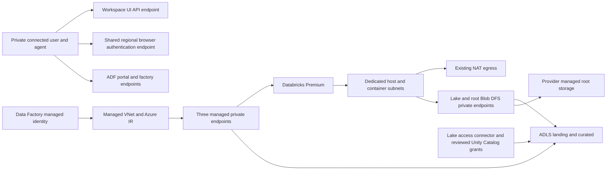

# Private Data Platform

**Optional naming / Preview:** this workload accepts the shared typed `resourceNames` map; omission preserves legacy names. All four standard/legacy environment pairs compile locally. Use a source-reviewed instance in the dedicated Deploy menu with Preview only; the map and stack identity are frozen and checked. Existing/shared IDs and application children remain contracts. Named Deploy is blocked. See [setup, generated names and acceptance limits](../../docs/resource-naming.md).

[Workload catalog](../../docs/workload-catalog.md) · [Delivery plan](../../docs/plans/private-data-platform.md) · [ADO onboarding](../../docs/self-service.md)

An infrastructure offering for **Azure Databricks Premium and Azure Data Factory v2**, registered as `private-data-platform` / `dataplat`. It uses the existing saved-discovery, Preview, Template Spec, Deployment Stack and verification workflow. Four environment profiles are checked in **disabled**. Local compilation and mocked contracts are not Azure acceptance.

See [manual ADF/Databricks recipes](recipes.md) for the pre-bound staging pipeline, optional native Job launcher, three-task Databricks bundle and quick setup exporter.

## Developer experience

Choose **Private Data Platform** in the updated portal. Its resource/cost summary and proposed diagram describe this offering only. Use [azure-pipelines-dataplat-discover.yml](../../azure-pipelines-dataplat-discover.yml), then [azure-pipelines-dataplat-deploy.yml](../../azure-pipelines-dataplat-deploy.yml). Both are manual entries in the existing bulk ADO registration catalog. The Deploy menu defaults to **Preview only** and consumes the selected successful discovery artifact; it does not dynamically rebuild ADO queue-time fields.

Platform-reviewed environment files bind network IDs, identity and compute settings. Developers choose an environment and evidence using the existing menus; they do not enter arbitrary subnets, credentials or executable notebook source. Preview validates those bindings and produces the standard change report/What-If diagram. Optional protected Deploy uses the reviewed bundle and checks for drift. This infrastructure-only offering has no Functions ZIP or automatic notebook invocation. Existing packages/running portal instances must be rebuilt/restarted to include the new catalog.

## What is created

| Component | Configuration and ownership |
|---|---|
| Databricks workspace | Premium; `2026-01-01`; Hybrid compute mode; VNet injection; secure cluster connectivity/no public IP; public workspace access disabled; `NoAzureDatabricksRules`; root-storage firewall enabled. |
| Databricks managed resource group | Service-managed storage/compute resources. Explicit deterministic root-storage name. Do not adopt its children into our stack or manipulate them independently. |
| Two access connectors | Separate system-assigned identities for root-storage access and the application lake. The connectors live in the workload RG. |
| ADLS Gen2 | HNS-enabled StorageV2, identity-only, TLS 1.2, private access, infrastructure encryption, landing/curated containers and 14-day deletion retention. LRS outside prod; ZRS in prod. No incompatible blob versioning. |
| Data Factory v2 | System-assigned identity, public access disabled, managed VNet, managed Azure IR, Databricks MSI and AzureBlobFS linked services. |
| Manual ADF pipelines | Connection-check notebook, isolated file staging and optional reviewed Databricks Job launch. Parameterized datasets/connections, concurrency/timeout limits and secure input/output; no schedule or automatic run. |
| Seven workload private endpoints | Databricks UI/API; lake Blob/DFS; root-storage Blob/DFS; ADF factory and authoring portal. DNS zone groups attach to approved shared zones. |
| Three ADF managed endpoints | Databricks UI/API, lake Blob and lake DFS. These are in ADF's managed network, separate from the customer-VNet endpoints. |
| RBAC and diagnostics | Factory identity gets Blob Data Contributor on landing; lake connector gets it on landing/curated. Audit logs go to existing Log Analytics. Workspace/data permissions require separate onboarding. |

Names use `dataplat-{environment}`, with a six-character subscription/RG-derived suffix for globally scoped services: `dbw-…`, `adf-…`, `stdataplat…` and `dbfsdataplat…`. The provider-managed RG is `{workload RG}-databricks-managed`. Standard owner/cost/environment tags and reviewed custom tags apply to directly owned resources; Azure controls propagation to service-managed children.

This is the proposed composition, not an observed connectivity test. The Databricks managed control plane, Entra authentication and permitted outbound dependencies still exist. Private Link and NAT do not establish complete egress isolation.

## Prerequisites and settings

| Setting | Required platform decision |
|---|---|
| `location`, target subscription/RG | Supported Azure public-cloud region, provider registrations, Premium/VM quota, approved names and ownership. This initial profile is same-subscription/same-region. |
| `databricksHostSubnetId`, `databricksContainerSubnetId` | Two distinct, dedicated IPv4 /26-or-larger subnets in the approved VNet; only `Microsoft.Databricks/workspaces` delegation; NSGs; same NAT gateway with public address/prefix. No custom route tables in this qualified profile. |
| `privateEndpointSubnetId` | Third, nondelegated endpoint subnet, IPv4 /28 or larger. Reserve capacity for seven endpoints and shared services through authoritative IPAM; CIDR size or discovery is not proof of free addresses. |
| `privateDnsZoneIds` | `blob`: `privatelink.blob.core.windows.net`; `dfs`: `privatelink.dfs.core.windows.net`; `databricks`: `privatelink.azuredatabricks.net`; `datafactory`: `privatelink.datafactory.azure.net`; `adfportal`: `privatelink.adf.azure.com`. Direct links to the selected VNet and Azure-provided DNS are required. Review existing ADF portal records/endpoints to avoid shared DNS conflicts. |
| `browserAuthenticationPrivateEndpointId` | Existing approved `browser_authentication` endpoint and Premium authentication workspace in this VNet/region, bound to the same Databricks zone. Shared platform owner provisions and protects it; this workload does not create another one. |
| `existingLogAnalyticsWorkspaceId` | Existing approved workspace; retention, ingestion volume and access configured by the platform. |
| `deploymentPrincipalObjectId`, owner/cost center | Actual reviewed deployment identity and governance tags. Azure permissions must include deployment/stack/Template Spec operations, role assignment writes, subnet joins, private endpoint/DNS links, diagnostics and Databricks root connector use at the necessary scopes. Contributor alone cannot assign RBAC. Use protected service connections. |
| `sparkVersion` | Explicit region/workspace-qualified runtime key, such as the format `major.minor.x-scala2.minor`; checked-in placeholder intentionally blocks Preview. Verify a currently supported runtime and standard-access-mode compatibility. |
| `nodeType`, `maxWorkers` | Approved D4ds_v5 or D8ds_v5; 1–4 workers, default 2. Driver compute is additional. This is a bounded sample profile, not a spending cap or automatic compute policy. |
| `inputFileName`, `databricksJobId` | Approved single CSV filename under landing/inbox; zero Job ID omits the native launcher until a reviewed workspace job is published. See [recipes](recipes.md). |
| `notebookPath` | Reviewed notebook under `/Shared/platform-studio/`; checked-in default points to acceptance. Import source and grant permissions separately. |

Edit [environment parameters](environments/main.dev.bicepparam) and the matching [target](../../self-service/targets/dataplat.dev.json) through source review. Do not enable a target until its protected ADO environment/private agent and dependencies are ready. The current `blob-transfer-private` pool binding needs a real authorized agent with private connectivity; hosted build agents do not prove DNS/data-plane reachability.

Missing dependencies are reported as blockers. This offering reuses shared networking, DNS, monitoring and browser authentication; it does not infer addresses or create those resources when inventory is empty. Failed/denied inventory remains unknown. NAT/DNS/NSG configuration checks are not effective reachability tests. Customer UDR/firewall/custom-DNS/hub/cross-subscription profiles need separate qualification.

## Methods and evidence

The shared product adapter in [product-service-common.ps1](../../scripts/product-service-common.ps1) dispatches to [data-platform-common.ps1](../../scripts/data-platform-common.ps1):

1. `Assert-DataPlatformParameters` validates same-scope distinct subnets and bounded runtime settings.
2. `Assert-DataPlatformDiscovery` requires successful saved subnet evidence and the shared browser-auth endpoint. Common checks also validate endpoint subnet, DNS, monitoring and provider inventory.
3. `Test-DataPlatformPrerequisites` performs fresh read-only GETs of dependencies during the standard prerequisite/drift path: compute subnet delegation/size/NSGs/NAT, endpoint size, regional authentication workspace/connection and DNS group. Returned evidence participates in the common bundle checks.
4. The existing Preview builds/validates the stack and evaluates Azure What-If. Sensitive security/network/identity changes and ADF execution/connectivity modifications require a separately reviewed migration; this menu is not an unrestricted pipeline editor.
5. The existing publisher/deployer uses the qualified Template Spec/Deployment Stack and output ownership checks.
6. `Test-DataPlatformInfrastructure` verifies Premium/private/no-public-IP/root-firewall configuration, private DNS for workspace/storage, HNS, factory identity, seven exact approved private connections and three approved managed endpoint targets. It performs no endpoint approvals or notebook execution.

The result explicitly records `dataPlaneVerified=false`, `notebookExecuted=false` and `unityCatalogVerified=false`. Infrastructure readiness is not a complete analytics service acceptance receipt. Pending approvals fail verification with the exact endpoint ID; deployed resources may remain. Approve the exact reviewed target-side request separately, then rerun fresh Preview/Deploy. Never approve every pending connection by wildcard.

## Manual Azure acceptance

1. Qualify shared network/DNS/NAT, capacity, browser authentication, provider/API support, regional SKUs and service-connection permissions. Complete parameters and protected ADO setup. Run Discover and Preview; inspect every create/modify/delete and cost caveat.
2. Enable only the reviewed target and run protected deployment. Confirm provider-managed root storage and both connector identities; reconcile failures before retrying. Review/approve the three managed endpoints and any regular pending connections by exact source and destination. Rerun verification after approval.
3. Onboard the **factory's** managed identity into Databricks using the supported service-principal/managed-identity process. Grant workspace access, permission to create approved job compute and execute the reviewed notebook. Azure Contributor is not granted as a shortcut to workspace administration. Confirm the region/runtime supports MSI with these grants.
4. Attach an approved Unity Catalog metastore; create a storage credential referencing the **lake** access connector; define landing/curated external locations and the least required catalog/schema/table privileges. Azure container RBAC does not create Unity Catalog grants. The ADF ADLS linked service independently uses the factory identity.
5. Import [acceptance.py](notebooks/acceptance.py) at the reviewed notebook path. Test private browser/API/ADF authoring access and linked-service connectivity. Manually run the ADF pipeline once. Record run IDs, job identity, bounded compute, successful result and compute termination. This sample confirms execution only; separately exercise a reviewed synthetic landing-to-curated data transformation and capture its UC audit evidence.
6. Test denied public access, unauthorized identities, pending endpoint approvals, drift and log ingestion. Review costs, recovery/backup responsibilities and data retention before production promotion.

No local emulation, cloud acceptance, actual notebook execution, automatic rollback or production certification is claimed. Recovery mode is **ManualRecovery**: reconcile stack/deployment receipts and preserve data. Do not delete a workspace or its managed RG to simulate undo.

## Costs and expansion

This is **not free**. Budget Databricks Premium DBUs plus driver/workers, ADF activity/IR use, private endpoints/traffic, ADLS and root storage, diagnostics, NAT and the shared authentication workspace. No complete price snapshot is qualified; the menu reports estimate unavailable. A manual pipeline avoids automatic job starts but does not eliminate idle infrastructure charges.

Future profiles include governed workspace/Unity Catalog provisioning, compute policies, CMK/compliance add-ons, additional source/sink connectors and business pipelines, serverless NCC, shared ADF portal-endpoint reuse, and hub/firewall/cross-subscription networking. These require their own tests, permissions and acceptance; “ADF v2” names the Azure service, not every possible connector or data workflow.

Design sources: [workspace API](https://learn.microsoft.com/en-us/azure/templates/microsoft.databricks/2026-01-01/workspaces), [VNet injection](https://learn.microsoft.com/en-us/azure/databricks/security/network/classic/vnet-inject), [private workspace access](https://learn.microsoft.com/en-us/azure/databricks/security/network/front-end/front-end-private-connect), [root storage firewall](https://learn.microsoft.com/en-us/azure/databricks/security/network/storage/firewall-support), [ADF managed endpoints](https://learn.microsoft.com/en-us/azure/data-factory/managed-virtual-network-private-endpoint), [ADF compute linked services](https://learn.microsoft.com/en-us/azure/data-factory/compute-linked-services), [Unity Catalog identities](https://learn.microsoft.com/en-us/azure/databricks/connect/unity-catalog/cloud-storage/azure-managed-identities). These sources guide configuration; they do not establish this deployment's readiness.
